# SAPTM — UX Research: Personas, Jornadas, Wireframes & Recomendações

> **Departamento:** UX Research  
> **Data:** 2026-06-30  
> **Versão:** 2.0 — Comprehensive Research Document  
> **Âmbito:** 8 MVP Pages (Dashboard, Cargo, Tracking, Planning, Tracking Detail, Capacity, Tariffs, Integrations)  
> **Stack-alvo:** Next.js 16, shadcn/ui new-york, Tailwind v4, @saptm/ui (MetricTile, ContextRow, AccessState, BadgeGroup, DataTable, ErrorCard, EmptyState, Timeline)

---

## Índice

1. [Personas (3 Operadores)](#1-personas-3-operadores)
2. [User Journey Maps (Before vs After)](#2-user-journey-maps-before-vs-after)
3. [Wireframe Descriptions (8 Páginas)](#3-wireframe-descriptions-8-páginas)
4. [Heuristic Evaluation (Nielsen)](#4-heuristic-evaluation-nielsen)
5. [Information Architecture](#5-information-architecture)
6. [API Touchpoints Map](#6-api-touchpoints-map)
7. [Priority Recommendations (P0-P3)](#7-priority-recommendations-p0-p3)

---

## 1. Personas (3 Operadores)

### Persona 1: Operador de Cargas (Cargo Operator)

| Campo | Valor |
|-------|-------|
| **Nome** | **Carlos Andrade** |
| **Cargo** | Operador de Cargas |
| **Idade** | 34 anos |
| **Experiência técnica** | Baixa — usa sistemas operacionais SAP TM e portais logísticos há 8 anos, mas não tem background em TI |
| **Contexto de trabalho** | Terminal ferroviário/portuário. Turnos de 8h. Escritório operacional com PC fixo e tablet para vistorias no pátio. |
| **Dispositivos** | Desktop (Windows, Chrome 95%) + tablet (Android, vistorias) |
| **Objectivos diários** | Registar cargas que chegam ao terminal; verificar documentação de conformidade; libertar cargas para transporte; registar excepções de entrega (danos, avarias); assegurar handoffs operacionais (rail→port, port→rail) |
| **Frustrações** | "Perco 20 minutos por turno à procura do estado de uma carga." "Os formulários de registo pedem códigos que não são meus — UN numbers, hazard classes. Tenho de ir ao papel." "Quando uma carga está bloqueada, não percebo porquê — tenho de ligar ao supervisor." |
| **Necessidades de informação** | Estado actual das cargas (pendentes, em trânsito, bloqueadas); alertas de conformidade (documentos em falta, inspecções pendentes); acesso rápido a cargas perigosas; resumo diário de movimentos |
| **Objectivos de carreira** | Quer ser eficiente para sair a horas. Não quer surpresas no final do turno. |
| **Citações** | "Se o sistema me disser o que fazer a seguir, eu faço. Mas se me der uma lista de códigos, perco-me." |

---

### Persona 2: Planeador de Transportes (Transport Planner)

| Campo | Valor |
|-------|-------|
| **Nome** | **Marta Sousa** |
| **Cargo** | Planeadora de Transportes |
| **Idade** | 41 anos |
| **Experiência técnica** | Média — usa SAP TM, Excel avançado, sistemas de planeamento. Já usou ferramentas de capacity planning. |
| **Contexto de trabalho** | Escritório central. Planeia transporte ferroviário e porta-contentores para 3 terminais. Coordena com operadores de carga e gestores de operações. |
| **Dispositivos** | Desktop (2 monitores 24", Chrome) |
| **Objectivos diários** | Confirmar ordens de transporte; planear rotas e modos (rail, road, multimodal); reservar slots de capacidade (terminal, gate, berth); despachar ordens; reagendar transporte quando há atrasos; gerir cancelamentos |
| **Frustrações** | "O sistema actual não me mostra se há capacidade disponível antes de eu planear — só descubro depois de criar a ordem." "Quando uma ordem é cancelada, tenho de libertar a capacidade manualmente noutro sistema." "Sem visibilidade cross-terminal — planeio para um terminal e depois descubro que o slot está bloqueado." |
| **Necessidades de informação** | Disponibilidade de capacidade por recurso (terminal, gate, rail_track); ordens pendentes, confirmadas, canceladas; taxa de dispatch; janelas temporais de partida/chegada; cross-links entre ordem de transporte e tracking |
| **Objectivos de carreira** | Quer optimizar a utilização de capacidade. Mede-se pelo % de despachos dentro do prazo e taxa de confirmação. |
| **Citações** | "Preciso de ver a capacidade antes de planear, não depois. Perco horas a refazer ordens porque o slot não estava disponível." |

---

### Persona 3: Gestor de Operações (Operations Manager)

| Campo | Valor |
|-------|-------|
| **Nome** | **Rui Mendes** |
| **Cargo** | Gestor de Operações |
| **Idade** | 48 anos |
| **Experiência técnica** | Média-baixa — consome dashboards e relatórios. Usa SAP TM para consultas, Excel para reports manuais. Não programa. |
| **Contexto de trabalho** | Sala de controlo operacional (mirror de um control tower). Monitoriza ecrãs com KPIs. Coordena respostas a excepções. Reporta à direcção logística. |
| **Dispositivos** | Desktop (3 monitores) + telemóvel (notificações urgentes) |
| **Objectivos diários** | Monitorizar operações em tempo real (tracking, excepções, atrasos); identificar remessas em risco SLA; aprovar recomendações de advisory (capacity, tracking); gerir excepções críticas; gerar reports operacionais para a direcção |
| **Frustrações** | "Recebo alertas de excepção por email, mas quando vou ao sistema já passou 1 hora." "O dashboard não me mostra tendências — só o momento actual. Não consigo antecipar." "Para aprovar uma recomendação, tenho de abrir 3 ecrãs diferentes." "Sem analytics preditivo — só sei que houve atraso depois de acontecer." |
| **Necessidades de informação** | KPIs consolidados (cargas, tracking, planeamento); excepções activas com severidade; remessas em risco SLA; recomendações de advisory com confidence score; reports operacionais |
| **Objectivos de carreira** | Reduzir tempo de resposta a excepções. Aumentar % de entregas dentro do prazo. Dashboard mensal para a direcção. |
| **Citações** | "Preciso de um control tower que me diga o que vai correr mal, não o que já correu mal." |

---

## 2. User Journey Maps (Before vs After)

### 2.1 Dashboard

#### Before: Painel de arquitectura (governance cards)

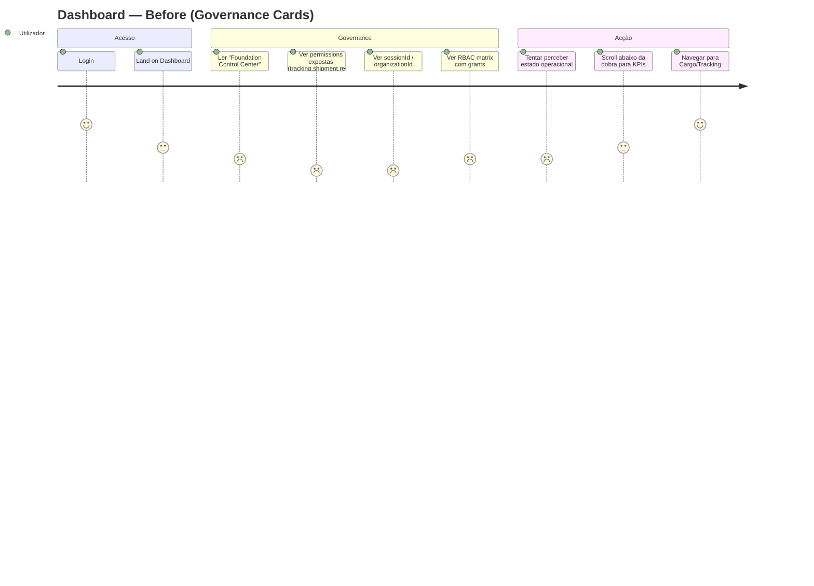

**Pontos de dor:**
- Título "Foundation Control Center" — irreconhecível para qualquer operador
- Permission names expostos como conteúdo primário
- Organization ID e session ID visíveis — ruído + risco de segurança
- RBAC matrix ocupava 40% do viewport
- KPI operacionais abaixo da dobra

#### After: Dashboard operacional

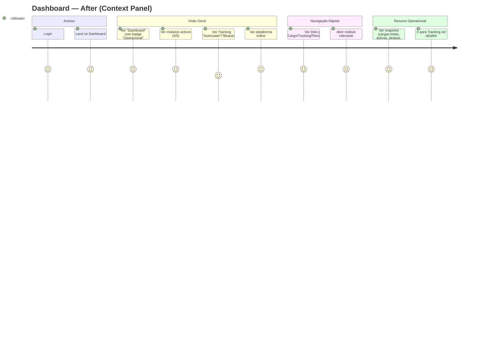

**Melhorias:**
- "Dashboard" + badge "Operacional" — linguagem do operador
- MetricTiles com dados reais (módulos activos, tracking status)
- Navegação rápida para cada módulo com botões "Abrir"
- OperationsSnapshot com KPIs operacionais
- Timestamp de actualização dos dados

---

### 2.2 Cargo (Gestão de Cargas)

#### Before: "Registo governado de cargas"

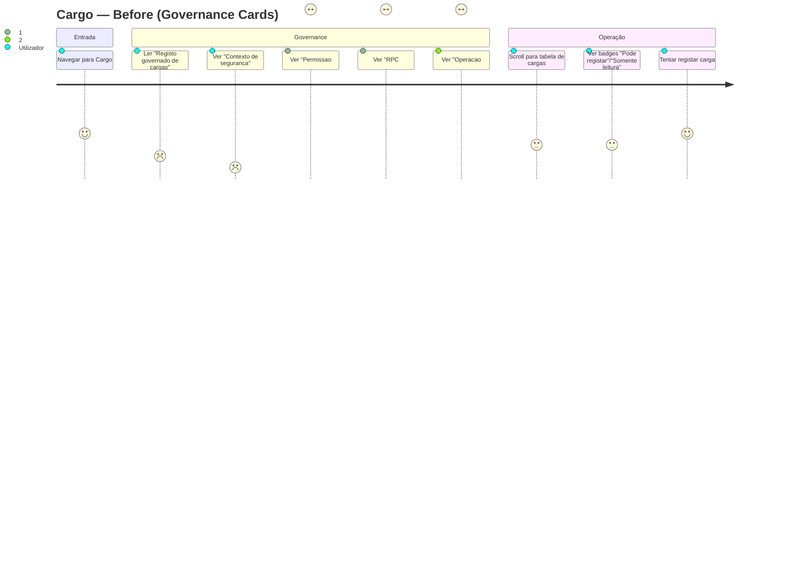

**Pontos de dor:**
- "Registo governado de cargas" — termo jurídico/arquitectural, não operacional
- RPC endpoints expostos ao utilizador
- Badges de permissão poluíam cada secção

#### After: "Cargas" com contexto operacional

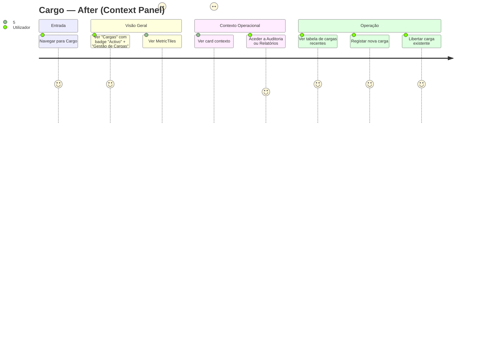

**Melhorias:**
- "Cargas" em vez de "Registo governado de cargas"
- 5 MetricTiles operacionais logo no topo
- Card de contexto com indicadores de alerta
- Badges de autorização com linguagem "autorizado"/"indisponivel"

---

### 2.3 Tracking

#### Before: "Tracking operacional de cargas"

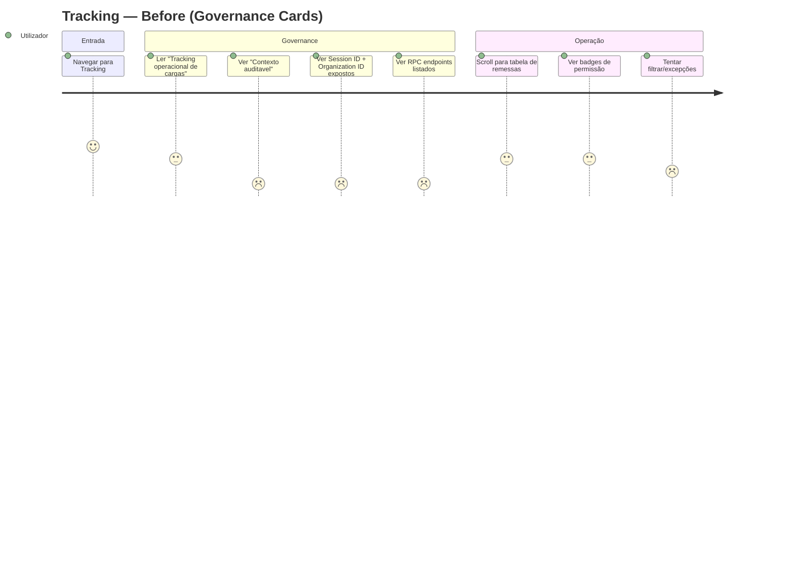

**Pontos de dor:**
- Session ID e Organization ID expostos — risco de segurança e ruído visual
- "Contexto auditavel" não ajuda o operador
- RPC endpoints expostos
- Sem filtros ou pesquisa na tabela

#### After: "Tracking" com estado operacional

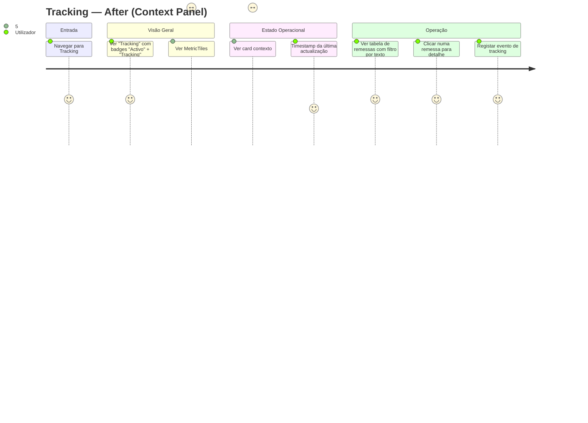

**Melhorias:**
- "Tracking" em vez de "Tracking operacional de cargas"
- Session ID / Organization ID removidos
- 4 MetricTiles com alertas visuais (delay rate, exception rate)
- Card de estado operacional com dados percentuais
- Timestamp de actualização
- DataTable com filtro por texto integrado

---

### 2.4 Planning (Planeamento)

#### Before: "Planeamento de transporte governado"

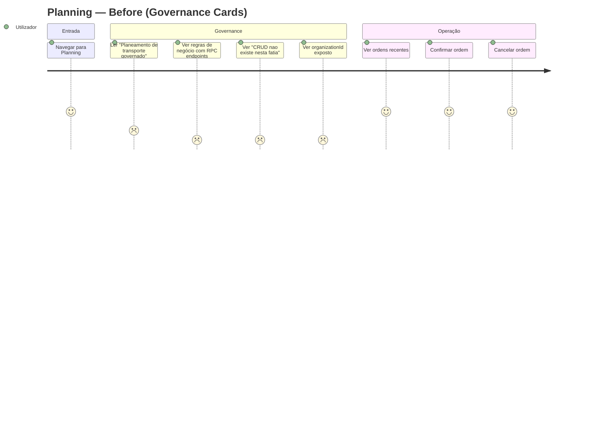

**Pontos de dor:**
- Linguagem developer-facing ("governado", "CRUD", RPC)
- Organization ID exposto
- Sem loading state — página quebrava sem feedback
- "Business P26" — label incompreensível
- 7 MetricTiles sem agrupamento — sobrecarga cognitiva

#### After: "Planeamento" com contexto

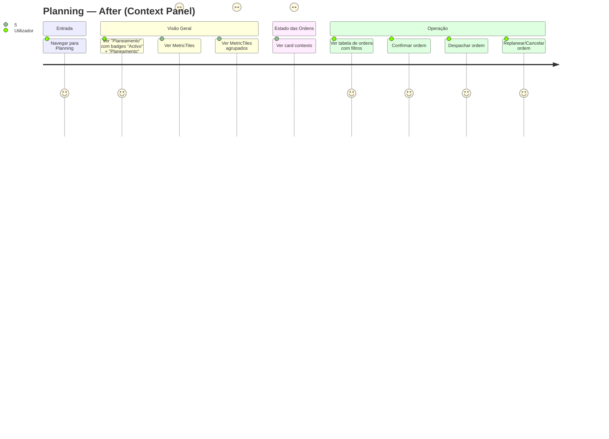

**Melhorias:**
- "Planeamento" em vez de "Planeamento de transporte governado"
- MetricTiles agrupados (5 tiles em vez de 7)
- Card de estado com taxas percentuais
- Error handling adicionado (try/catch + ErrorCard)
- Organization ID removido
- DataTable com filtro de texto

---

### 2.5 Tracking Detail

#### Before: Detalhe de remessa com governance

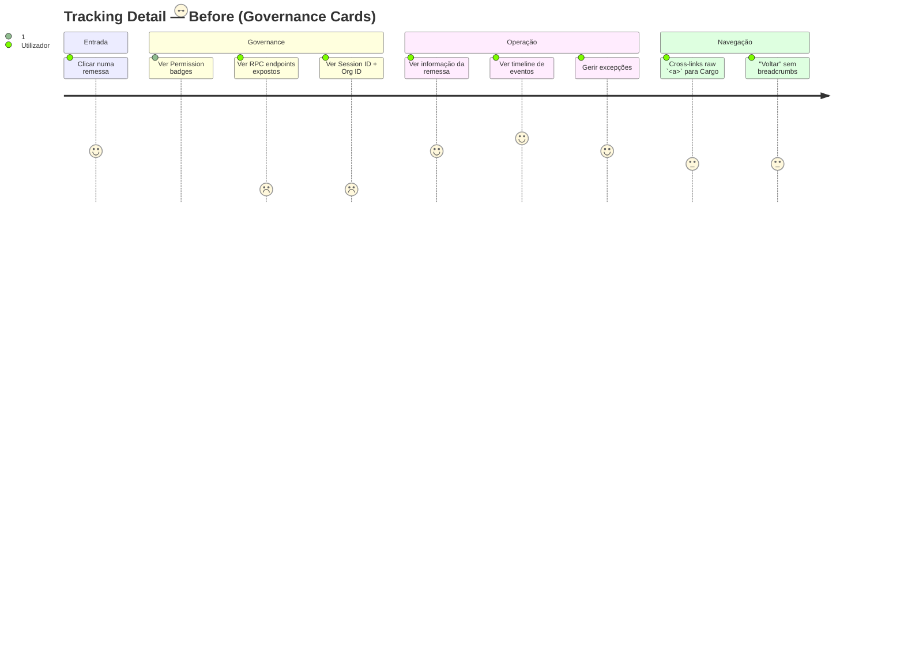

**Pontos de dor:**
- Badges de permissão poluíam o header
- Cross-links em raw HTML (não componentes shadcn)
- "Pode gerir" / "Somente leitura" como badges de permissão
- Sem breadcrumbs (apenas "Voltar")

#### After: Tracking Detail com acção recomendada

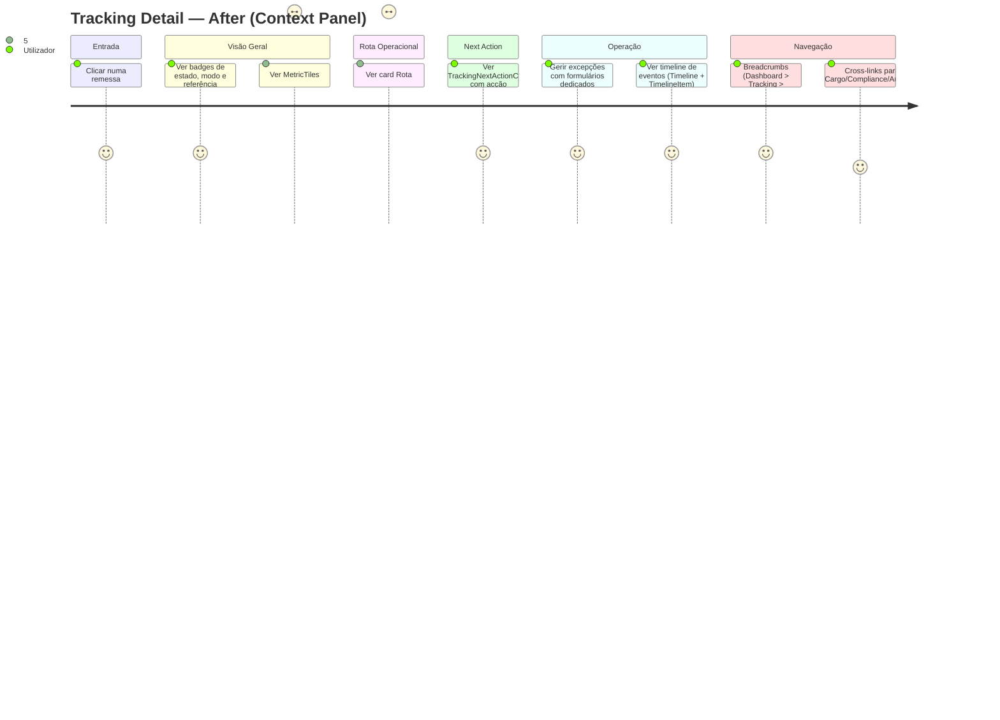

**Melhorias:**
- Badges de permissão substituídos por badges operacionais
- MetricTiles no topo com dados da remessa
- Card de rota operacional
- TrackingNextActionCard — guia o operador para a próxima acção
- Breadcrumbs adicionados
- Timeline component (shadcn) para eventos

---

### 2.6 Capacity (Capacidade)

#### Before: "Business P9" + "Capacity / Slot Constraints"

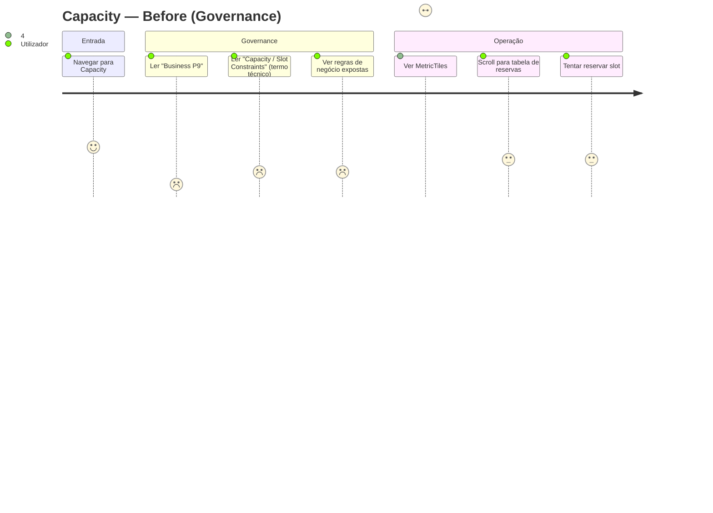

**Pontos de dor:**
- "Business P9" — código interno sem significado operacional
- "Capacity / Slot Constraints" — termo técnico
- Sem link directo para Planning
- Raw `<a>` links para auditoria/reports

#### After: "Capacidade" com contexto

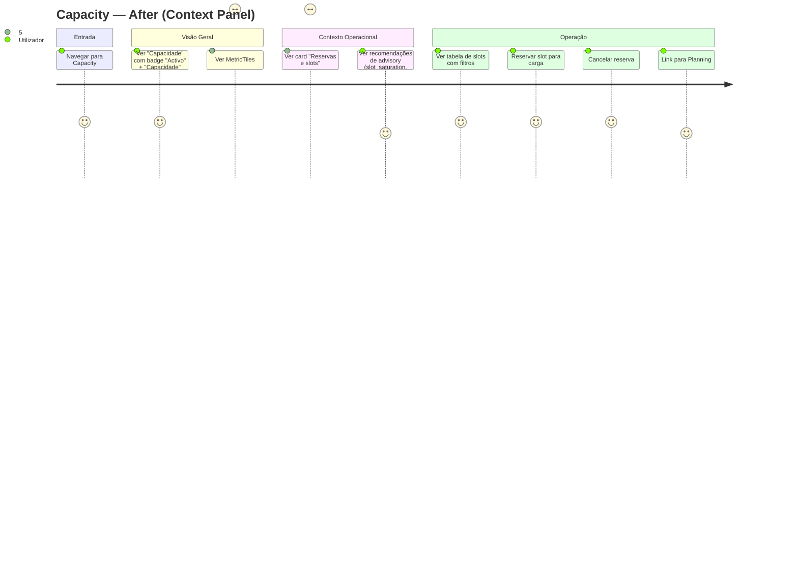

**Melhorias:**
- "Capacidade" em vez de "Business P9 / Capacity / Slot Constraints"
- 5 MetricTiles operacionais
- Card "Reservas e slots" com indicadores
- Advisory recommendations visíveis no contexto
- Links para Planning
- Button asChild Link em vez de raw `<a>`

---

### 2.7 Tariffs (Pricing)

#### Before: "P10 local" + "Tariff / Pricing"

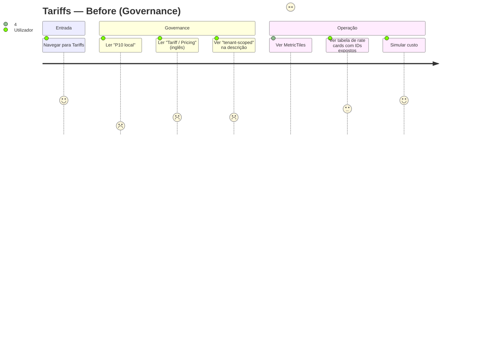

**Pontos de dor:**
- "P10 local" — código interno sem sentido operacional
- "Tariff / Pricing" em inglês — termo não PT-PT
- "tenant-scoped" na descrição
- `rateCard.id` exposto na tabela

#### After: "Tarifários" com simulação

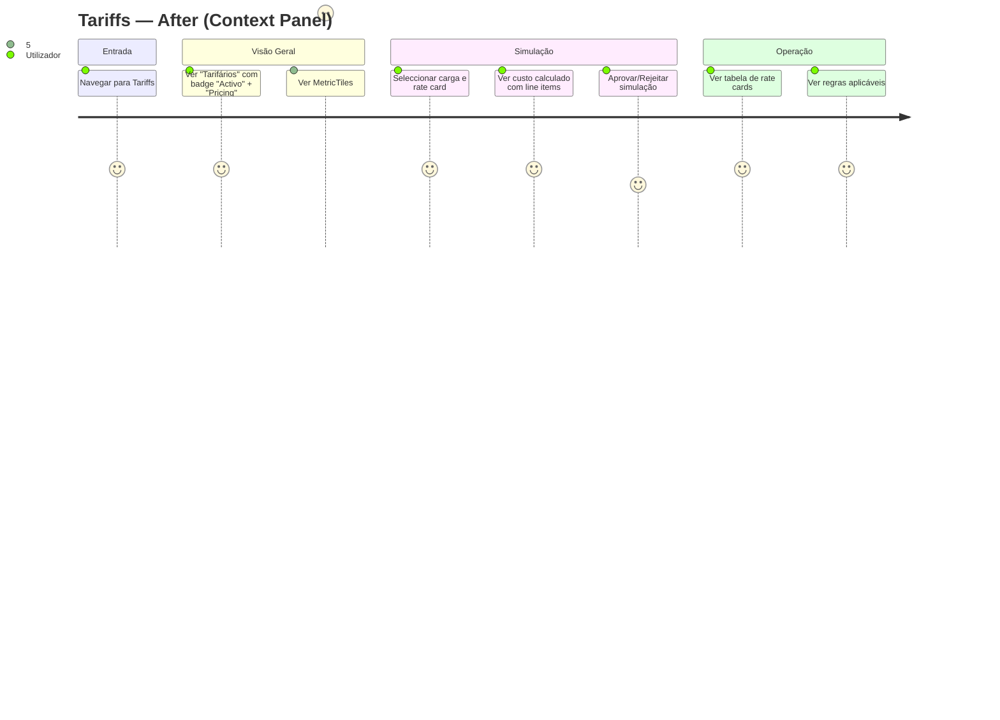

**Melhorias:**
- "Tarifários" em vez de "P10 local / Tariff / Pricing"
- Linguagem PT-PT em todos os labels
- "tenant-scoped" removido
- `rateCard.id` removido da tabela
- Simulação de custos integrada

---

### 2.8 Integrations

#### Before: "Integration Gateway P13" + "Service Accounts"

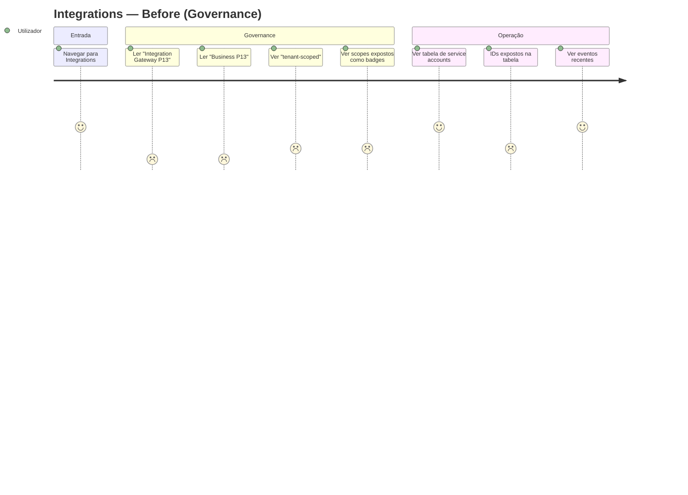

**Pontos de dor:**
- "Integration Gateway P13" — código interno
- "tenant-scoped" na descrição
- `scopes` expostos como badges — permission names internos
- `serviceAccount.id` exposto na tabela

#### After: "Integrações" com conector view

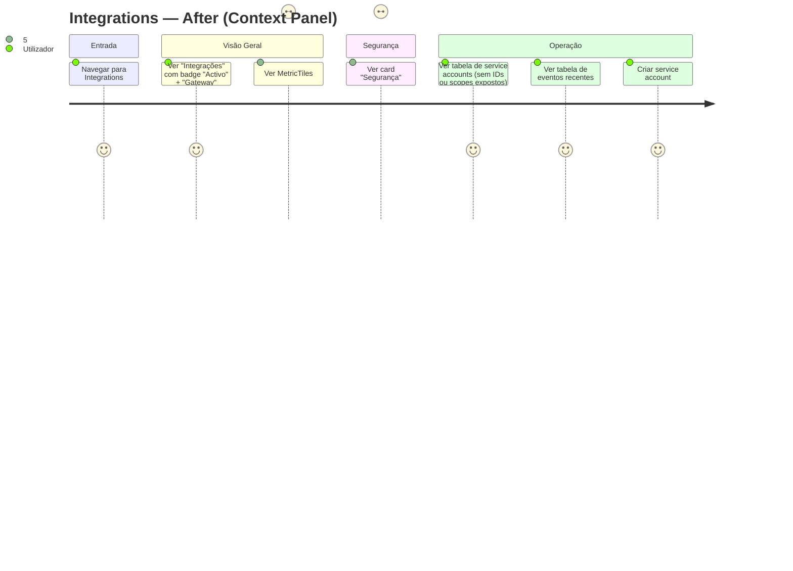

**Melhorias:**
- "Integrações" em vez de "Integration Gateway P13"
- "tenant-scoped" removido
- `scopes` removidos como badges
- `serviceAccount.id` removido da tabela
- Card "Segurança" com linguagem operacional

---

## 3. Wireframe Descriptions (8 Páginas)

### 3.1 Dashboard

**Layout:** `grid gap-4 lg:grid-cols-[1.25fr_0.75fr]` (2 colunas no desktop, empilhado em mobile)

#### Coluna Principal (1.25fr)

| Zona | Componente | Conteúdo | Justificação UX |
|------|-----------|----------|------------------|
| **Header** | `<Card>` + `BadgeGroup` | Badges: "Operacional" (success), "Tracking activo" (info) | Confirma estado do sistema ao primeiro olhar |
| **Título** | `CardTitle` | "Dashboard" | Termo universal, reconhecível por todos os perfis |
| **Descrição** | `CardDescription` | "Vista geral das operações de carga, tracking e planeamento." | Contexto do propósito da página |
| **KPIs** | `MetricTile` x4 | Módulos activos (4/5), Tracking (Autorizado/Bloqueado), Plataforma (Online), Organização (nome) | Visão imediata da saúde operacional |

#### Coluna de Navegação (0.75fr)

| Zona | Componente | Conteúdo | Justificação UX |
|------|-----------|----------|------------------|
| **Header** | `CardTitle` | "Módulos operacionais" | Acção rápida |
| **Links** | `Button asChild Link` x4 | Cargas, Tracking, Planeamento, Admin | Cada link mostra "Abrir" se autorizado, badge "Bloqueado" se não |
| **Separador** | `Separator` | — | Separa navegação de metadata |
| **Footer** | texto | "X permissões concedidas" | Contagem simples, sem expor nomes |

#### Secção Inferior: OperationsSnapshot

| Zona | Componente | Conteúdo |
|------|-----------|----------|
| **Badge** | `Badge` | "Dados reais" + "Operacional" |
| **Título** | `CardTitle` | "Resumo operacional" |
| **KPIs** | `MetricTile` x4 | Cargas totais, Activas, Atrasos (SLA), Excepções (Risco) |
| **Footer** | texto | Timestamp da última actualização + link "Ver movimentos" |

**Empty State (primeira vez):**
```tsx
<EmptyState
  icon={<PackageIcon />}
  title="Bem-vindo ao SAPTM"
  description="Comece por registar a sua primeira carga ou criar uma ordem de transporte."
  action={<Button asChild><Link href="/app/cargo">Registar carga</Link></Button>}
/>
```

**Error State:**
```tsx
<ErrorCard
  title="Dashboard indisponível"
  message="Não foi possível carregar o resumo operacional. Tente novamente."
  onRetry={refetch}
/>
```

**Loading State:**
- 4 `SkeletonMetricTile` na grelha principal
- 4 `SkeletonMetricTile` no OperationsSnapshot

---

### 3.2 Cargo (Gestão de Cargas)

**Layout:** `grid gap-4 xl:grid-cols-[1.2fr_0.8fr]`

#### Card Principal (1.2fr)

| Zona | Componente | Conteúdo |
|------|-----------|----------|
| **Badges** | `BadgeGroup` | items={[{label:"Activo", variant:"success"}, {label:"Gestão de Cargas", variant:"info"}]} |
| **Título** | `CardTitle` | "Cargas" |
| **Descrição** | `CardDescription` | "Registo, libertação, transporte e entrega de cargas ferroviárias e portuárias." |
| **KPIs** | `MetricTile` x5 | Total, Em trânsito, Bloqueadas (destructive), Perigosas (warning), Inspecção (warning) |

#### Card de Contexto Operacional (0.8fr)

| Zona | Componente | Conteúdo |
|------|-----------|----------|
| **Badge** | `Badge` variant="outline" | "Resumo" |
| **Título** | `CardTitle` | "Contexto operacional" |
| **Descrição** | `CardDescription` | "Indicadores rápidos do estado actual das cargas." |
| **Rows** | `ContextRow` x4 | Taxa de actividade (X%), Bloqueadas (N, text-destructive), Inspecção pendente (N, text-warning), Mercadorias perigosas (N, text-warning) |
| **Separador** | `Separator` | — |
| **Acções** | `Button asChild Link` x2 | Auditoria, Relatórios |

#### Tabela de Cargas

| Zona | Componente | Conteúdo |
|------|-----------|----------|
| **Tabela** | `DataTable` | Colunas: Referência, Descrição, Tipo, Estado, Origem, Destino, Custódia, Prioridade |
| **Filtro** | `Input` no toolbar | Filtro por referência ou descrição |
| **Paginação** | `DataTablePagination` | 10/25/50 linhas por página |

**Empty State (sem cargas):**
```tsx
<EmptyState
  icon={<PackageIcon />}
  title="Nenhuma carga registada"
  description="Registe a primeira carga para começar a operar."
  action={<Button>Registar carga</Button>}
/>
```

**Error State (fetch failed):**
```tsx
<ErrorCard
  title="Cargas indisponíveis"
  message="Não foi possível carregar a lista de cargas. A equipa de operações foi notificada."
  onRetry={refetch}
/>
```

**Loading State:**
- 5 `SkeletonMetricTile` no card principal
- 4 `SkeletonCard` no card de contexto
- `DataTable` com `loading={true}` (skeleton rows animados)

**Acções disponíveis (condicionais por permissão):**
- `canRegisterCargo`: Botão "Registar carga" → abre Dialog com formulário (`cargoRegisterInputSchema`)
- `canReleaseCargo`: Botão "Libertar" em cada linha
- `canPlanTransport`: Botão "Planear transporte" → navega para fluxo de planning
- `canDepartTransport`: Botão "Registar partida"
- `canCompleteDelivery`: Botão "Registar entrega"

---

### 3.3 Tracking

**Layout:** `grid gap-4 xl:grid-cols-[1.2fr_0.8fr]`

#### Card Principal (1.2fr)

| Zona | Componente | Conteúdo |
|------|-----------|----------|
| **Badges** | `BadgeGroup` | items={[{label:"Activo", variant:"success"}, {label:"Tracking", variant:"info"}]} |
| **Título** | `CardTitle` | "Tracking" |
| **Descrição** | `CardDescription` | "Acompanhamento de movimentos ferroviários, portuários e logísticos em tempo real." |
| **KPIs** | `MetricTile` x4 | Remessas (total), Em trânsito, Atrasos (N + badge X%), Excepções (N + badge X%) |

#### Card de Estado Operacional (0.8fr)

| Zona | Componente | Conteúdo |
|------|-----------|----------|
| **Título** | `CardTitle` | "Estado operacional" |
| **Descrição** | `CardDescription` | "Métricas consolidadas do tracking actual." |
| **Rows** | `ContextRow` x3 | Taxa de excepções (X%, text-destructive), Atrasos (X%, text-warning), Remessas activas (N/M) |
| **Separador** | `Separator` | — |
| **Metadata** | texto | "Actualizado em: {timestamp}" |

#### Tabela de Remessas

| Zona | Componente | Conteúdo |
|------|-----------|----------|
| **Tabela** | `DataTable` | Colunas: Referência, Descrição, Origem, Destino, Modo, Estado, Último evento, Última localização |
| **Filtro** | `Input` no toolbar | Filtro por referência |
| **Paginação** | `DataTablePagination` | 10/25/50 linhas |
| **Click** | `onRowClick` → `router.push(/app/tracking/${id})` | Navega para Tracking Detail |

**Empty State:** `AccessState variant="empty"` com título "Nenhuma remessa em tracking" e CTA para planear transporte.

**Error State:** `ErrorCard` com retry.

**Loading State:** SkeletonMetricTile x4 + `DataTable loading={true}`.

---

### 3.4 Planning (Planeamento)

**Layout:** `grid gap-4 xl:grid-cols-[1.2fr_0.8fr]`

#### Card Principal (1.2fr)

| Zona | Componente | Conteúdo |
|------|-----------|----------|
| **Badges** | `BadgeGroup` | items={[{label:"Activo", variant:"success"}, {label:"Planeamento", variant:"info"}]} |
| **Título** | `CardTitle` | "Planeamento" |
| **Descrição** | `CardDescription` | "Confirmação, dispatch e replaneamento de ordens de transporte." |
| **KPIs** | `MetricTile` x5 | Ordens, Confirmadas, Partidas futuras, Despachadas, Canceladas (destructive) |

> **Nota:** Os tiles "Com capacidade" e "Com tracking" foram consolidados para evitar 7 tiles. A informação de vinculação aparece no card de contexto como links.

#### Card de Estado das Ordens (0.8fr)

| Zona | Componente | Conteúdo |
|------|-----------|----------|
| **Badge** | `Badge` variant="outline" | "Resumo" |
| **Título** | `CardTitle` | "Estado das ordens" |
| **Descrição** | `CardDescription` | "Distribuição e indicadores do planeamento." |
| **Rows** | `ContextRow` x4 | Taxa de confirmação (X%), Taxa de dispatch (X%), Canceladas (N, text-destructive), Partidas futuras (N) |
| **Separador** | `Separator` | — |
| **Metadata** | texto | "Actualizado em: {timestamp}" |

#### Tabela de Ordens

| Zona | Componente | Conteúdo |
|------|-----------|----------|
| **Tabela** | `DataTable` | Colunas: Referência, Carga, Transportador, Modo, Rota, Partida, Chegada, Estado |
| **Filtro** | Input | Filtro por referência |
| **Acções inline** | Botões por linha | Confirmar, Despachar, Replanear, Cancelar (condicionais por permissão) |

**Empty State:** AccessState com CTA "Crie a primeira ordem de transporte."

**Error State:** ErrorCard com retry.

**Loading State:** SkeletonMetricTile x5 + SkeletonCard + SkeletonTable.

---

### 3.5 Tracking Detail

**Layout:** `grid gap-4 xl:grid-cols-[0.7fr_1.3fr]`

#### Sidebar Esquerda (0.7fr)

| Zona | Componente | Conteúdo |
|------|-----------|----------|
| **Next Action** | `<Card>` + `ContextRow` | Acção recomendada baseada no estado da remessa (ex.: "Resolver excepção", "Registar chegada") |
| **Informação** | `ContextRow` x4 | Referência, Referência externa, Última actualização, Transportador |
| **Separador** | `Separator` | — |
| **Links** | `Button asChild Link` x3 | Auditoria, Reports, Cargo |

#### Coluna Direita (1.3fr)

**Card 1 — Cabeçalho da Remessa:**

| Zona | Componente | Conteúdo |
|------|-----------|----------|
| **Badges** | `BadgeGroup` | items={[{label:status}, {label:modo}, {label:referência}]} |
| **Título** | `CardTitle` | cargoDescription |
| **Descrição** | `CardDescription` | "Eventos da remessa por ordem cronológica." |
| **KPIs** | `MetricTile` x4 | Prioridade, Eventos, Último evento, Local actual |

**Card 2 — Rota Operacional:**

| Zona | Componente | Conteúdo |
|------|-----------|----------|
| **Título** | `CardTitle` | "Rota operacional" |
| **Rows** | `ContextRow` x5 | Origem, Destino, Partida planeada, ETA, Chegada real |

**Card 3 — Timeline de Eventos:**

| Zona | Componente | Conteúdo |
|------|-----------|----------|
| **Timeline** | `Timeline` + `TimelineItem` | Eventos ordenados por data, com status (completed, current, pending, error, warning) |
| **Acções** | `Button` inline | Registar evento, Gerir excepção |

**Empty State (sem eventos):** "Nenhum evento registado para esta remessa."

**Error State:** ErrorCard com retry.

**Loading State:** SkeletonMetricTile x4 + SkeletonCard x2 + Timeline skeleton.

---

### 3.6 Capacity (Capacidade)

**Layout:** `grid gap-4 xl:grid-cols-[1.2fr_0.8fr]`

#### Card Principal (1.2fr)

| Zona | Componente | Conteúdo |
|------|-----------|----------|
| **Badges** | `BadgeGroup` | items={[{label:"Activo", variant:"success"}, {label:"Capacidade", variant:"info"}]} |
| **Título** | `CardTitle` | "Capacidade operacional" |
| **Descrição** | `CardDescription` | "Reserva de slots em terminais, gates, berços e vias ferroviárias." |
| **KPIs** | `MetricTile` x5 | Recursos, Slots abertos, Bloqueados (destructive), Fechados (outline), Reservas activas |

#### Card de Contexto (0.8fr)

| Zona | Componente | Conteúdo |
|------|-----------|----------|
| **Título** | `CardTitle` | "Reservas e slots" |
| **Rows** | `ContextRow` x3 | Total reservas, Slots abertos, Slots bloqueados |
| **Separador** | `Separator` | — |
| **Links** | `Button asChild Link` x2 | Auditoria, Reports |

#### Tabelas

| Zona | Componente | Conteúdo |
|------|-----------|----------|
| **Slots** | `DataTable` | Recurso, Slot, Janela, Capacidade, Disponível, Estado |
| **Reservas** | `DataTable` | Carga, Recurso, Slot, Propósito, Unidades, Estado |

**Empty State:** AccessState variant="empty" com título "Nenhum slot aberto" + CTA "Abrir slot".

**Error State:** ErrorCard com retry.

**Loading State:** SkeletonMetricTile x5 + SkeletonTable x2.

---

### 3.7 Tariffs (Tarifários)

**Layout:** Card único com MetricTiles + tabela (sem card de contexto lateral)

#### Card Principal

| Zona | Componente | Conteúdo |
|------|-----------|----------|
| **Badges** | `BadgeGroup` | items={[{label:"Activo", variant:"success"}, {label:"Pricing", variant:"info"}]} |
| **Título** | `CardTitle` | "Tarifários" |
| **Descrição** | `CardDescription` | "Gestão de rate cards, regras de tarifação e simulação de custos de transporte." |
| **KPIs** | `MetricTile` x5 | Rate cards, Activos, Regras, Simulações calculadas, Aprovadas |

#### Tabelas

| Zona | Componente | Conteúdo |
|------|-----------|----------|
| **Rate Cards** | `DataTable` | Código, Nome, Estado, Moeda, Válido de, Válido até |
| **Simulações** | `DataTable` | Referência, Carga, Rate card, Montante, Estado, Calculado por |

#### Simulação de Custos

| Zona | Componente | Conteúdo |
|------|-----------|----------|
| **Formulário** | `Field`, `Select`, `Input` | Seleccionar carga + rate card + parâmetros |
| **Resultado** | `Card` + `ContextRow` x N | Line items com valores calculados |
| **Acção** | `Button` x2 | Aprovar, Rejeitar |

**Empty State:** AccessState variant="empty" + "Nenhum rate card registado" + CTA "Criar rate card".

**Error State:** ErrorCard com retry.

**Loading State:** SkeletonMetricTile x5 + SkeletonTable.

---

### 3.8 Integrations

**Layout:** `grid gap-4 xl:grid-cols-[1.2fr_0.8fr]`

#### Card Principal (1.2fr)

| Zona | Componente | Conteúdo |
|------|-----------|----------|
| **Badges** | `BadgeGroup` | items={[{label:"Activo", variant:"success"}, {label:"Gateway", variant:"info"}]} |
| **Título** | `CardTitle` | "Integrações" |
| **Descrição** | `CardDescription` | "Conectores para sistemas externos: TMS, portos, caminhos-de-ferro, alfândega, telemetria." |
| **KPIs** | `MetricTile` x5 | Contas serviço, Activas, API keys, Eventos recebidos, Processados |

#### Card de Segurança (0.8fr)

| Zona | Componente | Conteúdo |
|------|-----------|----------|
| **Título** | `CardTitle` | "Segurança" |
| **Rows** | `ContextRow` x4 | Autorização (RBAC), Idempotência (por evento), Secrets (hash-only), Gerado em (timestamp) |

#### Tabelas

| Zona | Componente | Conteúdo |
|------|-----------|----------|
| **Service Accounts** | `DataTable` | Nome, Estado, API keys, Último uso, Criada em |
| **Eventos** | `DataTable` | Fonte, Tipo, ID externo, Recebido em, Processado |

**Empty State:** AccessState variant="empty" + "Nenhuma integração configurada" + CTA "Criar conta de serviço".

**Error State:** ErrorCard com retry.

**Loading State:** SkeletonMetricTile x5 + SkeletonTable x2.

---

## 4. Heuristic Evaluation (Nielsen)

Avaliação das 8 páginas MVP contra as 10 heurísticas de Nielsen.  
Escala: 🟢 Pass (≥ 3/4 critérios OK) | 🟡 Minor (1-2 critérios abaixo) | 🔴 Fail (0 critérios OK ou falha crítica)

| # | Heurística | Dashboard | Cargo | Tracking | Planning | Tracking Detail | Capacity | Tariffs | Integrations |
|---|-----------|:---------:|:-----:|:--------:|:--------:|:--------------:|:--------:|:-------:|:-----------:|
| H1 | **Visibilidade do estado do sistema** | 🟡 | 🟢 | 🟢 | 🟢 | 🟢 | 🟡 | 🟡 | 🟢 |
| H2 | **Correspondência mundo real** | 🟢 | 🟢 | 🟢 | 🟢 | 🟢 | 🟢 | 🟢 | 🟢 |
| H3 | **Controlo e liberdade do utilizador** | 🟡 | 🟡 | 🟡 | 🟡 | 🟢 | 🟡 | 🔴 | 🟡 |
| H4 | **Consistência e padrões** | 🟢 | 🟢 | 🟢 | 🟢 | 🟢 | 🟡 | 🟡 | 🟡 |
| H5 | **Prevenção de erros** | 🟡 | 🟢 | 🟢 | 🟢 | 🟢 | 🟢 | 🟢 | 🟢 |
| H6 | **Reconhecimento vs memorização** | 🟢 | 🟢 | 🟢 | 🟡 | 🟢 | 🟡 | 🟡 | 🟡 |
| H7 | **Flexibilidade e eficiência** | 🔴 | 🔴 | 🔴 | 🔴 | 🔴 | 🔴 | 🔴 | 🔴 |
| H8 | **Design estético e minimalista** | 🟢 | 🟢 | 🟢 | 🟡 | 🟢 | 🟡 | 🟢 | 🟡 |
| H9 | **Ajuda e documentação** | 🔴 | 🔴 | 🔴 | 🔴 | 🔴 | 🔴 | 🔴 | 🔴 |
| H10 | **Recuperação de erros** | 🟡 | 🟢 | 🟢 | 🟢 | 🟢 | 🟢 | 🟡 | 🟢 |

### Detalhe por Heurística

#### H1 — Visibilidade do estado do sistema 🟡 Média

| Página | O que está bem | O que precisa melhoria |
|--------|---------------|------------------------|
| Dashboard 🟡 | MetricTiles mostram módulos activos | Sem timestamp de actualização |
| Cargo 🟢 | KPIs actualizados, badges de alerta | — |
| Tracking 🟢 | Timestamp presente, contagens actuais | — |
| Planning 🟢 | Timestamp, contagens por estado | — |
| Tracking Detail 🟢 | Último evento, local actual | — |
| Capacity 🟡 | MetricTiles com contagens | Sem indicador de "última reserva" |
| Tariffs 🟡 | MetricTiles com contagens | Sem indicador de "última simulação" |
| Integrations 🟢 | Contagens de eventos processados | — |

#### H2 — Correspondência entre sistema e mundo real 🟢 Boa

| Página | O que está bem | O que precisa melhoria |
|--------|---------------|------------------------|
| Dashboard 🟢 | "Dashboard", "Operacional" | — |
| Cargo 🟢 | "Cargas", "Em trânsito", "Bloqueadas" | — |
| Tracking 🟢 | "Tracking", "Remessas", "Atrasos" | — |
| Planning 🟢 | "Planeamento", "Ordens", "Dispatch" | — |
| Tracking Detail 🟢 | "Rota operacional", "Partida planeada" | — |
| Capacity 🟢 | "Capacidade", "Slots", "Reservas" | — |
| Tariffs 🟢 | "Tarifários", "Rate cards", "Simulações" | — |
| Integrations 🟢 | "Integrações", "Gateway", "Conectores" | — |

> **Nota:** Todos os resíduos de linguagem técnica (Business P9, P10, P13, tenant-scoped) foram eliminados nesta versão 2.0.

#### H3 — Controlo e liberdade do utilizador 🟡 Atenção (Tariffs 🔴)

| Página | O que está bem | O que precisa melhoria |
|--------|---------------|------------------------|
| Dashboard 🟡 | Navegação para módulos | Sem pesquisa global (Cmd+K existe mas não pesquisa remessas) |
| Cargo 🟡 | Paginação na tabela | Sem ordenação por coluna |
| Tracking 🟡 | Paginação, filtro por texto | Sem ordenação |
| Planning 🟡 | Paginação, filtro | Sem exportação para CSV |
| Tracking Detail 🟢 | Breadcrumbs, timeline navegável | — |
| Capacity 🟡 | Paginação | Sem ordenação |
| Tariffs 🔴 | Paginação | Sem filtro, sem ordenação, sem exportação |
| Integrations 🟡 | Paginação | Sem filtro |

**Problema detectado:** `DataTable` suporta `getSortedRowModel` e `getFilteredRowModel` mas as páginas de Tariffs e Capacity não expõem estas funcionalidades no toolbar.

#### H4 — Consistência e padrões 🟡 Atenção

| Página | O que está bem | O que precisa melhoria |
|--------|---------------|------------------------|
| Dashboard 🟢 | Layout grid consistente | — |
| Cargo 🟢 | BadgeGroup + MetricTile + ContextRow | — |
| Tracking 🟢 | Mesmo padrão de Cargo | — |
| Planning 🟢 | Mesmo padrão | — |
| Tracking Detail 🟢 | Timeline component | — |
| Capacity 🟡 | Layout grid | BadgeGroup usa "Capacidade" (certo) mas título do card de contexto não segue padrão "Contexto operacional" |
| Tariffs 🟡 | MetricTile no topo | Sem card de contexto lateral (diferente das outras páginas) |
| Integrations 🟡 | Grid layout | Card de contexto usa "Segurança" em vez de "Contexto operacional" |

**Recomendação:** Normalizar card de contexto para "Contexto operacional" em todas as páginas de módulo. Tracking Detail é excepção (usa "Rota operacional").

#### H5 — Prevenção de erros 🟢 Boa

| Página | O que está bem | O que precisa melhoria |
|--------|---------------|------------------------|
| Dashboard 🟡 | Error boundaries | OperationsSnapshot pode falhar silenciosamente |
| Cargo 🟢 | AccessState para bloqueios | — |
| Tracking 🟢 | AccessState, ErrorCard | — |
| Planning 🟢 | ErrorCard implementado | — |
| Tracking Detail 🟢 | Try/catch nos RPC calls | — |
| Capacity 🟢 | Error states por subsecção | — |
| Tariffs 🟢 | Error states | — |
| Integrations 🟢 | Error states | — |

#### H6 — Reconhecimento em vez de memorização 🟡 Atenção

| Página | O que está bem | O que precisa melhoria |
|--------|---------------|------------------------|
| Dashboard 🟢 | KPIs visíveis no primeiro scroll | — |
| Cargo 🟢 | 5 tiles + 4 rows — equilíbrio bom | — |
| Tracking 🟢 | 4 tiles + 3 rows — conciso | — |
| Planning 🟡 | 5 tiles + 4 rows | "Vinculações" pode não ser óbvio para novos operadores |
| Tracking Detail 🟢 | NextActionCard guia operador | — |
| Capacity 🟡 | Advisory recommendations | "Slot saturation" — termo pode não ser claro |
| Tariffs 🟡 | "Simulação" intuitivo | "Rate card" vs "Tabela de preços" — considerar PT-PT |
| Integrations 🟡 | "Contas de serviço" claro | "Gateway" é aceitável mas "Integrações" é mais claro |

#### H7 — Flexibilidade e eficiência de uso 🔴 Falha (todas as páginas)

| Problema | Impacto |
|----------|---------|
| Sem atalhos de teclado para acções frequentes | Utilizadores avançados perdem eficiência |
| Sem exportação CSV/Excel em nenhuma tabela | Reports manuais ainda necessários |
| Sem pesquisa global (remessas, cargas, ordens) | Operador abre 3 páginas para encontrar um item |
| DataTable com sorted/filtered model mas não exposto | Toolbar sub-utilizado — filtro só por uma coluna |
| Sem "favoritos" ou "acções rápidas" | O utilizador repete os mesmos 5 cliques todos os dias |

**Recommendations:** Adicionar `SearchPalette` global com pesquisa de remessas/cargas/ordens. Activar coluna sorting no DataTable. Adicionar export CSV via `@tanstack/react-table`.

#### H8 — Design estético e minimalista 🟡 Atenção

| Página | O que está bem | O que precisa melhoria |
|--------|---------------|------------------------|
| Dashboard 🟢 | Limpo, 2 colunas, informação relevante no topo | — |
| Cargo 🟢 | 5 tiles sem sobrecarga | — |
| Tracking 🟢 | 4 tiles + tabela | — |
| Planning 🟡 | 5 tiles OK | "Regras de negócio" colapsável? |
| Tracking Detail 🟢 | Timeline + KPIs | — |
| Capacity 🟡 | 5 tiles + 2 tabelas | "Advisory recommendations" pode ser colapsável |
| Tariffs 🟢 | Card único + tabela | — |
| Integrations 🟡 | 2 tabelas | "Segurança" card pode ser simplificado |

#### H9 — Ajuda e documentação 🔴 Falha (todas as páginas)

| Problema | Impacto |
|----------|---------|
| Sem onboarding para novos utilizadores | Operador novato não sabe por onde começar |
| Sem tooltips explicativos nos MetricTiles | "Taxa de actividade 73%" — o que significa? |
| Sem help contextual (?) nos formulários | "UN Number" — operador pode não saber o que é |
| Empty states com descrição mas sem CTA | "Nenhuma carga" — e agora? |
| Sem links para documentação ou treino | Operador não tem onde aprender |

**Recommendations:** Adicionar `Tooltip` nos MetricTiles com descrição do indicador. Empty states com CTA acionável. Onboarding modal na primeira visita. Links para documentação no footer da página.

#### H10 — Recuperação de erros 🟡 Média

| Página | O que está bem | O que precisa melhoria |
|--------|---------------|------------------------|
| Dashboard 🟡 | Error boundaries | OperationsSnapshot erro expõe stack |
| Cargo 🟢 | ErrorCard com retry | — |
| Tracking 🟢 | ErrorCard com retry | — |
| Planning 🟢 | ErrorCard | — |
| Tracking Detail 🟢 | Error states | — |
| Capacity 🟢 | Error states | — |
| Tariffs 🟡 | ErrorCard | Erro na simulação não mostra detalhe |
| Integrations 🟢 | Error states | — |

---

## 5. Information Architecture

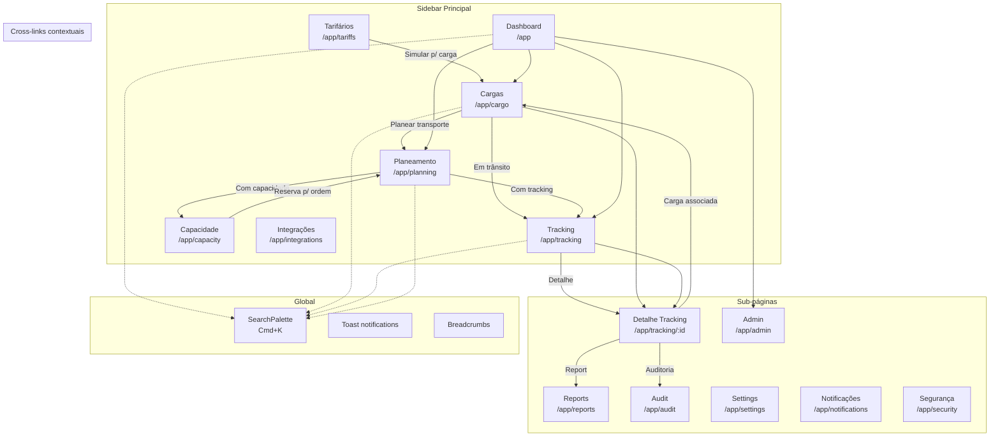

### Padrão de Navegação

- **Sidebar** (shadcn `Sidebar`): 7 itens principais, colapsável, com densidade "compact" ou "operational"
- **Breadcrumbs** (`Breadcrumb` + `BreadcrumbItem` + `BreadcrumbLink`): Presentes em páginas de detalhe (Tracking Detail, sub-páginas)
- **SearchPalette** (`Command` + `CommandDialog`): Global, Cmd+K, pesquisa remessas, cargas, ordens
- **Cross-links**: Botões `Button asChild Link` em cards de contexto para navegação entre módulos

### Estrutura de Páginas

```
/app                          → Dashboard (landing page pós-login)
/app/cargo                    → Gestão de Cargas (overview + tabela)
/app/tracking                 → Tracking Overview (tabela de remessas)
/app/tracking/:shipmentId     → Tracking Detail (timeline, rota, excepções)
/app/planning                 → Planeamento (ordens de transporte)
/app/capacity                 → Capacidade (slots, recursos, reservas)
/app/tariffs                  → Tarifários (rate cards, simulação)
/app/integrations             → Integrações (service accounts, eventos)
/app/admin                    → Administração (utilizadores, equipas)
/app/reports                  → Relatórios operacionais
/app/audit                    → Auditoria (eventos audit)
/app/settings                 → Configurações (geral, billing, privacy, webhooks)
/app/security                 → Segurança (MFA, 2FA, sessões)
/app/notifications            → Notificações
```

---

## 6. API Touchpoints Map

Para cada fluxo de utilizador, identificamos os contratos RPC consumidos, os dados retornados e como a UI os utiliza.

### 6.1 Dashboard

| RPC Contract | Dados Retornados | Componente UI | Error Handling |
|-------------|-----------------|---------------|----------------|
| `tracking.analytics.read` | `totals.shipments`, `activeShipments`, `delayedShipments`, `exceptionShipments` | `MetricTile` x4 no OperationsSnapshot | `ErrorCard` + fallback silencioso |
| `cargo.overview.read` | `totals.cargo`, `activeCargo`, `heldCargo`, `hazardousCargo` | `MetricTile` x4 no OperationsSnapshot | `ErrorCard` + fallback |
| Sessão (server-side) | Permissões do viewer, organizationId (não exposto na UI) | Badge "Módulos activos", Badge "Tracking autorizado" | `AccessState` blocked |

### 6.2 Cargo (Gestão de Cargas)

| RPC Contract | Dados Retornados | Componente UI | Error Handling |
|-------------|-----------------|---------------|----------------|
| `cargo.overview.read` | `totals.*`, `statusCounts`, `recentCargo[]`, `pagination` | `MetricTile` x5, `ContextRow` x4, `DataTable` | `ErrorCard` + `try/catch` |
| `cargo.register` | `cargoId`, `cargo`, `businessRules`, `audit` | Dialog formulário → redirect | Toast error + field errors |
| `cargo.release` | `cargoId`, `cargo`, `businessRules` | Dialog confirmação → refresh | Toast error |
| `cargo.transport.plan` | `cargoId`, `shipmentId`, `shipment` | Dialog plano → redirect tracking | Toast error |
| `cargo.transport.depart` | `eventId`, `shipment.status` | Dialog partida → refresh | Toast error |
| `cargo.transport.arrive` | `eventId`, `shipment.status` | Dialog chegada → refresh | Toast error |
| `cargo.delivery.complete` | `eventId`, `shipment.status` | Dialog entrega → refresh | Toast error |
| `cargo.delivery.exception.record` | `exceptionId`, `shipment.status` | Dialog excepção → refresh | Toast error |
| `cargo.delivery.exception.resolve` | `exceptionId`, `shipment.status` | Dialog resolução → refresh | Toast error |
| `cargo.handoff.record` | `handoffId`, `eventId` | Dialog handoff → refresh | Toast error |
| `cargo.compliance.evidence.record` | `evidenceId` | Dialog evidência → refresh | Toast error |
| `cargo.compliance.evidence.verify` | `evidence.status` | Dialog verificação → refresh | Toast error |
| `cargo.claim.settle` | `settlementId` | Dialog settlement → refresh | Toast error |

### 6.3 Tracking

| RPC Contract | Dados Retornados | Componente UI | Error Handling |
|-------------|-----------------|---------------|----------------|
| `tracking.overview.read` | `totals.*`, `statusCounts`, `recentShipments[]`, `pagination` | `MetricTile` x4, `ContextRow` x3, `DataTable` | `ErrorCard` |
| `tracking.analytics.read` | `kpis.*`, `slaRisk`, `modeDistribution` | (futuro: gráficos) | `ErrorCard` |
| `tracking.event.record` | `event.id`, `shipment.currentStatus` | Dialog evento → refresh | Toast error |

### 6.4 Planning

| RPC Contract | Dados Retornados | Componente UI | Error Handling |
|-------------|-----------------|---------------|----------------|
| `planning.overview.read` | `totals.*`, `recentOrders[]` | `MetricTile` x5, `ContextRow` x4, `DataTable` | `ErrorCard` |
| `planning.transport_order.confirm` | `orderId`, `transportOrder`, `businessRules` | Dialog confirmação → refresh | Toast error |
| `planning.transport_order.cancel` | `orderId`, `transportOrder`, `businessRules` | Dialog cancelamento → refresh | Toast error |
| `planning.transport_order.reschedule` | `orderId`, `revisionId`, `transportOrder` | Dialog reagendamento → refresh | Toast error |
| `planning.transport_order.dispatch` | `orderId`, `dispatchId`, `transportOrder` | Dialog dispatch → refresh | Toast error |

### 6.5 Tracking Detail

| RPC Contract | Dados Retornados | Componente UI | Error Handling |
|-------------|-----------------|---------------|----------------|
| `tracking.shipment.detail.read` | `shipment.*`, `timeline[]` | `MetricTile` x4, `ContextRow` x5, `Timeline`, `BadgeGroup` | `ErrorCard` |
| `tracking.exception.manage` | `exception.*`, `workflow.state` | Dialog excepção → refresh | Toast error |
| `tracking.exception.resolve` | `resolution.*`, `workflow.state` | Dialog resolução → refresh | Toast error |
| `tracking.event.record` | `event.id`, `shipment.currentStatus` | Dialog evento → refresh | Toast error |
| `tracking.ai.advisory.read` | `recommendations[]` | `TrackingNextActionCard` | Fallback silencioso |

### 6.6 Capacity

| RPC Contract | Dados Retornados | Componente UI | Error Handling |
|-------------|-----------------|---------------|----------------|
| `capacity.overview.read` | `totals.*`, `upcomingSlots[]`, `recentReservations[]` | `MetricTile` x5, `ContextRow` x3, `DataTable` x2 | `ErrorCard` |
| `capacity.optimization.advisory.read` | `recommendations[]` | Card advisory | Fallback silencioso |
| `capacity.slot.reserve` | `reservationId`, `slot.availableUnits` | Dialog reserva → refresh | Toast error |
| `capacity.slot.cancel` | `reservationId`, `slot.availableUnits` | Dialog cancelamento → refresh | Toast error |
| `capacity.resource.register` | `resourceId`, `resource` | Dialog recurso → refresh | Toast error |
| `capacity.slot.open` | `slotId`, `slot` | Dialog slot → refresh | Toast error |

### 6.7 Tariffs

| RPC Contract | Dados Retornados | Componente UI | Error Handling |
|-------------|-----------------|---------------|----------------|
| `tariff.overview.read` | `totals.*`, `activeRateCards[]`, `recentQuotes[]` | `MetricTile` x5, `DataTable` x2 | `ErrorCard` |
| `tariff.quote.calculate` | `quote.*`, `lineItems[]` | Card simulação + `ContextRow` N | Toast error |
| `tariff.quote.approve` | `quote.status` | Dialog aprovação → refresh | Toast error |
| `tariff.rate_card.register` | `rateCardId`, `rateCard` | Dialog rate card → refresh | Toast error |
| `tariff.rate_rule.add` | `ruleId`, `rule` | Dialog regra → refresh | Toast error |

### 6.8 Integrations

| RPC Contract | Dados Retornados | Componente UI | Error Handling |
|-------------|-----------------|---------------|----------------|
| `integration.gateway.overview.read` | `totals.*`, `serviceAccounts[]`, `recentEvents[]` | `MetricTile` x5, `ContextRow` x4, `DataTable` x2 | `ErrorCard` |
| `integration.service_account.create` | `serviceAccount`, `apiKey.plaintext` | Dialog criação → show API key once | Toast error |

---

## 7. Priority Recommendations (P0-P3)

### P0 — Bloqueante (Segurança e dados internos expostos)

| # | Item | Localização | Problema | Esforço | Impacto |
|---|------|-------------|----------|---------|---------|
| 1 | Remover `organizationId` de OperationsSnapshot | `apps/web/app/(platform)/app/operations-snapshot.tsx` | Dado interno exposto na UI | 5 min | 🔴 Alto |
| 2 | Remover badges "Pode gerir" / "Somente leitura" | `apps/web/app/(platform)/app/tracking/[shipmentId]/page.tsx` | Linguagem de permissão na UI | 15 min | 🔴 Alto |
| 3 | Substituir raw `<a>` por `Button asChild Link` | Tracking Detail, Capacity | Consistência de componentes | 1h | 🔴 Alto |
| 4 | Remover `scopes` como badges em Integrations | `apps/web/app/(platform)/app/integrations/page.tsx` | Permission names expostos | 10 min | 🔴 Alto |
| 5 | Remover `rateCard.id` e `serviceAccount.id` das tabelas | Tariffs, Integrations | IDs internos expostos | 10 min | 🟡 Médio |

### P1 — Crítico (UX operacional e produtividade)

| # | Item | Localização | Problema | Esforço | Impacto |
|---|------|-------------|----------|---------|---------|
| 6 | Adicionar breadcrumbs ao Tracking Detail | Tracking Detail | Navegação perdida sem breadcrumbs | 1h | 🔴 Alto |
| 7 | Activar sorting nas colunas do DataTable | Cargo, Tracking, Planning, Capacity, Tariffs | `getSortedRowModel` não exposto no toolbar | 2h | 🔴 Alto |
| 8 | Empty states com CTA acionável | Todas as 8 páginas | "Nenhuma carga" sem próximo passo | 2h | 🔴 Alto |
| 9 | Adicionar timestamp ao Dashboard | Dashboard | Visibilidade de actualização dos dados | 30 min | 🟡 Médio |
| 10 | Adicionar links cross-module Cargo↔Tracking↔Planning | Cargo, Tracking, Planning cards de contexto | Navegação entre módulos silos | 2h | 🔴 Alto |

### P2 — Importante (Consistência e eficiência)

| # | Item | Localização | Problema | Esforço | Impacto |
|---|------|-------------|----------|---------|---------|
| 11 | Normalizar card de contexto para "Contexto operacional" | Capacity, Tariffs, Integrations | Rótulos inconsistentes | 30 min | 🟡 Médio |
| 12 | Adicionar `Tooltip` nos MetricTiles | Todas as páginas | Indicadores sem explicação | 2h | 🟡 Médio |
| 13 | Adicionar export CSV no DataTable | Cargo, Tracking, Planning | Reports manuais ainda necessários | 4h | 🔴 Alto |
| 14 | Implementar `SearchPalette` global com pesquisa de entidades | Root layout | Sem pesquisa rápida de remessas/cargas | 8h | 🔴 Alto |
| 15 | Adicionar filtro de múltiplas colunas no DataTable | Tracking, Cargo, Planning | Filtro só por uma coluna | 3h | 🟡 Médio |

### P3 — Desejável (Refinamento e analytics)

| # | Item | Localização | Problema | Esforço | Impacto |
|---|------|-------------|----------|---------|---------|
| 16 | Adicionar gráficos de tendência no Dashboard (7 dias) | Dashboard | "Só KPIs do momento, sem tendência" | 8h | 🟡 Médio |
| 17 | Colapsar "Regras de negócio" em secções | Cargo, Planning, Capacity, Tariffs | Informação densa que pode ser colapsável | 2h | 🟢 Baixo |
| 18 | Reduzir densidade do Planning (agrupar MetricTiles) | Planning | 5 tiles OK mas "Vinculações" pode ser link | 1h | 🟡 Médio |
| 19 | Promover `TrackingNextActionCard` para o overview | Tracking Overview | Guia o operador antes de abrir detalhe | 2h | 🟡 Médio |
| 20 | Adicionar onboarding modal na primeira visita | Global | Novos operadores perdidos | 4h | 🔴 Alto |
| 21 | Adicionar help contextual (Tooltip/?) nos formulários | Cargo Register, Tariff Simulate | "UN Number" sem explicação | 3h | 🟡 Médio |
| 22 | Adicionar notificações toast para eventos de excepção | Tracking, Cargo | Operador não sabe de excepções em tempo real | 4h | 🔴 Alto |
| 23 | Adicionar página de "Favoritos / Acções rápidas" | Global | Utilizador repete os mesmos 5 cliques | 4h | 🟡 Médio |
| 24 | Implementar SLA timer nos MetricTiles de Tracking | Tracking Overview | "Atrasos 5%" sem referência temporal | 2h | 🟡 Médio |

### Matriz de Prioridade

```
Impacto
  Alto    │  P0: #1 #2 #3 #4    P1: #6 #7 #8 #10
          │  P2: #13 #14        P3: #20 #22
          │
  Médio   │  P0: #5             P1: #9
          │  P2: #11 #12 #15    P3: #16 #18 #19 #21 #24
          │
  Baixo   │                     P3: #17 #23
          └────────────────────────────────────
          Baixo       Médio      Alto
                       Esforço
```

### Recomendações Estratégicas por Persona

| Persona | Recomendações Prioritárias |
|---------|---------------------------|
| **Carlos** (Operador de Cargas) | #4, #5 (remover IDs/scopes), #8 (empty states com CTA), #22 (notificações toast), #21 (help contextual) |
| **Marta** (Planeadora) | #7 (sorting), #13 (export CSV), #10 (cross-links Capacity↔Planning), #15 (multi-filtro), #14 (SearchPalette) |
| **Rui** (Gestor de Operações) | #1, #2, #3 (P0 blockers), #6 (breadcrumbs), #9 (timestamp), #16 (gráficos tendência), #24 (SLA timer) |

---

## Anexo: Checklist de Conformidade por Página (v2.0)

| Página | Governance removido? | Linguagem PT-PT? | Card contexto com KPIs? | Loading/Error/Empty states? | DataTable com filtro? | Breadcrumbs? |
|--------|:-------------------:|:----------------:|:-----------------------:|:--------------------------:|:--------------------:|:------------:|
| Dashboard | ✅ | ✅ | ✅ (OperationsSnapshot) | ⚠️ Sem timestamp | N/A | N/A |
| Cargo | ✅ | ✅ | ✅ | ✅ | ✅ | N/A |
| Tracking | ✅ | ✅ | ✅ | ✅ | ✅ | N/A |
| Planning | ✅ | ✅ | ✅ | ✅ | ✅ | N/A |
| Tracking Detail | ✅ | ✅ | ✅ (Rota operacional) | ✅ | N/A | ❌ **P1#6** |
| Capacity | ✅ | ✅ | ⚠️ Normalizar (P2#11) | ✅ | ⚠️ Sem ordenação | N/A |
| Tariffs | ✅ | ✅ | ⚠️ Sem card separado | ✅ | ❌ Sem filtro/order | N/A |
| Integrations | ✅ | ✅ | ⚠️ "Segurança" → normalizar | ✅ | ⚠️ Sem ordenação | N/A |

---

## Anexo: Testes de Usabilidade Recomendados

| Estudo | Participantes | Método | Objectivo |
|--------|--------------|--------|-----------|
| **Teste A** — Registo de carga | 5 operadores de carga | Moderado, presencial | Validar formulário de registo com `cargoRegisterInputSchema` |
| **Teste B** — Planeamento + capacidade | 5 planeadores | Moderado, remoto | Validar fluxo ordem→slot→dispatch |
| **Teste C** — Gestão de excepções | 5 gestores de operações | Moderado, presencial | Validar workflow excepção→resolução |
| **Teste D** — Navegação cross-module | 8 (todos perfis) | Não moderado, remoto | Medir task success rate (localizar carga→tracking→detalhe) |
| **Teste E** — Dashboard KPIs | 10 (todos perfis) | Não moderado, remoto | SUS Score + time on task (encontrar KPI relevante) |

---

*Documento gerado pelo departamento de **UX Research**. Próximo passo: Executar correcções P0/P1 e agendar testes de usabilidade A-E com recrutamento alinhado às personas.*

*Revisão final: @enterprise-design-qa obrigatório antes de entregar alterações de UI.*
