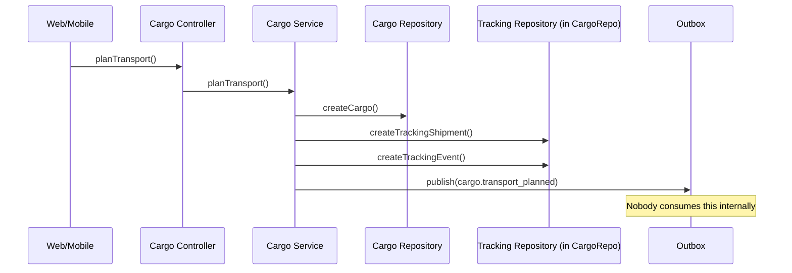
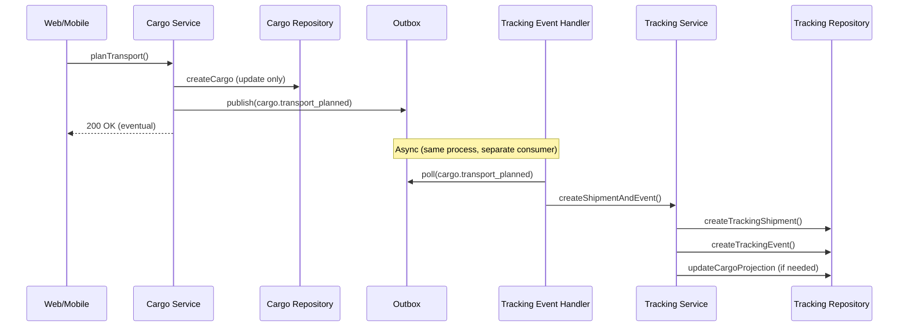

# ADR 0008 — Cargo ↔ Tracking Event-Driven Handoff

## Status

Accepted — implemented as dual-write pattern (Phase 1). Cutover to pure event-driven (Phase 2) pending.

> **Nota de actualização (2026-07-03):** O handler `cargo-event.handler.ts` existe em `apps/api/src/tracking/events/`, confirmando que a Fase 1 (dual-write) foi implementada. A Fase 2 (cutover completo) requer que o `CargoRepository` remova os métodos de tracking e que o handler seja a única fonte de dados de tracking. ADR foi alterado de "Proposed" para "Accepted" com base na evidência de implementação.

## Context

The SAPTM platform has two core bounded contexts: **Cargo** (carga registada, movimentada, entregue) and **Tracking** (shipments, eventos de transporte, exceções). These contexts share a lifecycle relationship — when a cargo is transport-planned, a tracking shipment is created, and cargo lifecycle events (departure, arrival, handoff, delivery) generate corresponding tracking events.

**Problem:** Currently, the Cargo bounded context directly owns and mutates tracking data. In `apps/api/src/cargo/cargo.service.ts`, the following operations manipulate tracking state directly via `cargoRepo`:

| Cargo Method | Tracking Data Created/Modified |
|---|---|
| `planTransport()` | Creates `tracking_shipment` + `tracking_event` (eventType: "created") |
| `departTransport()` | Creates `tracking_event` (eventType: "departed"), updates shipment status to "in_transit" |
| `arriveTransport()` | Creates `tracking_event` (eventType: "arrived"), updates shipment status to "arrived" |
| `recordOperationalHandoff()` | Creates `tracking_event` (eventType: "location_updated") |
| `completeDelivery()` | Creates `tracking_event` (eventType: "handover_completed"), updates shipment status to "completed" |
| `recordDeliveryException()` | Creates `tracking_event` (eventType: "exception") |

This violates **aggregate root boundaries** — `CargoEntity` should not control `TrackingShipment` / `TrackingEvent` state directly. The Cargo context publishes domain events (`cargo.transport_planned`, `cargo.transport_departed`, etc.) via the outbox, but **no consumer subscribes to these events**. The outbox events are only used for external webhook delivery.

**Consequences of current design:**
1. Cargo module imports `TrackingShipment` and `TrackingEvent` repository methods, creating coupling — any change to tracking schema requires changes in cargo service
2. Tracking bounded context cannot enforce its own invariants (e.g., duplicate events, state machine validation per shipment)
3. Cross-context transactions in cargo methods risk making both bounded contexts inconsistent if either fails
4. If a new consumer needs to react to cargo lifecycle events (e.g., billing, notifications), they cannot subscribe because the domain events have no internal consumers — only external webhook delivery
5. The `TrackingRpcRouter` exposes `tracking.overview`, `tracking.analytics`, and other queries, but users cannot create tracking events independently of cargo — they must go through cargo's lifecycle

**Current architecture (problematic):**

## Decision

**Refactor Cargo ↔ Tracking interactions to be purely event-driven.** Cargo will no longer directly create or modify tracking data. Instead:

1. **Cargo publishes lifecycle domain events** via the existing outbox (`eventBus.publish()`):
   - `cargo.transport_planned` → triggers Tracking to create shipment + initial event
   - `cargo.transport_departed` → triggers Tracking to record departure event + update shipment status
   - `cargo.transport_arrived` → triggers Tracking to record arrival event + update shipment status
   - `cargo.operational_handoff.recorded` → triggers Tracking to record location update event
   - `cargo.delivery_completed` → triggers Tracking to record handover event + complete shipment
   - `cargo.delivery_exception.recorded` → triggers Tracking to record exception event

2. **A new Tracking internal consumer subscribes to these events** via an outbox consumer pattern (same `OutboxEvent` table, different `consumerGroup` / `eventType` filter):
   - `apps/api/src/tracking/events/cargo-event-handler.ts` — consumes `cargo.*` events and calls `TrackingService` methods
   - Runs **outside** the cargo transaction — eventual consistency between contexts

3. **CargoRepository removes all tracking-related methods:**
   - `createTrackingShipment()`
   - `createTrackingEvent()`
   - `findTrackingShipmentById()`
   - `findTrackingShipmentByReferenceCode()`
   - `updateTrackingShipment()`
   - `findTrackingDepartureEventByIdempotencyKey()`
   - `findTrackingLifecycleEventByIdempotencyKey()`
   - `findOpenDeliveryExceptionForCargo()`
   - `getComplianceEvidenceStatusCounts()`

4. **Cargo transport status fields move to a separate `cargo_transport` table** (or remain as cargo projection but are updated by an event consumer, not directly). The cargo aggregate may retain a read-only projection of transport state (e.g., `trackingShipmentId` as reference, `transportOwnerTeam`, `departedAt`, `arrivedAt`) for display queries, but these are updated by a downstream projection handler, not by the Cargo aggregate itself.

5. **Consistency model:** Strong consistency within each bounded context, eventual consistency between them:
   - Cargo transaction: write cargo event → publish outbox event (same Prisma transaction) → return 200
   - Async: Tracking consumer picks up outbox event → validates its own invariants → creates/updates tracking data
   - If tracking consumer fails (e.g., invalid state), it logs a dead-letter record for manual resolution. No rollback of cargo event.

**Target architecture:**

## Consequences

### Positive
1. ✅ **Bounded context isolation** — Cargo no longer owns tracking data. Tracking can evolve independently with its own aggregate roots, invariants, and repository
2. ✅ **Event-driven extensibility** — Any new consumer (billing, notifications, analytics) can subscribe to the same `cargo.*` events without modifying Cargo
3. ✅ **CargoService complexity reduced** — Removes ~350 lines of tracking-related code from CargoService (~2500 → ~2150). Each tracking method in CargoService loses its replay checks, tracking event creation, and shipment update logic
4. ✅ **Tracking bounded context can enforce its own invariants** — e.g., a shipment cannot transition from "completed" to "in_transit", event types must follow the defined lifecycle
5. ✅ **Aligns with product vision KR2.1** — unified timeline becomes easier when tracking owns its event stream
6. ✅ **Outbox already exists** — no new infrastructure needed. The outbox pattern is already implemented in `OutboxEventBusAdapter`. We just need to add an internal consumer

### Negative
1. ❌ **Eventual consistency** — After cargo transport is planned, there is a window (milliseconds to seconds) where the tracking shipment does not yet exist. The UI polling for tracking data may briefly show no data for a cargo that was just planned. Mitigation: UI polling retry; cargo overview shows transport status from its own projection
2. ❌ **Failure handling** — If the tracking consumer fails after cargo committed, the tracking data will be missing until manual intervention. Mitigation: dead-letter queue + alerting on failed consumer; idempotency keys prevent duplicate processing
3. ❌ **Replay complexity** — Current idempotency checks in CargoService assume tracking data is created in the same transaction. After refactor, replay of cargo events will re-trigger tracking event creation — but idempotency keys on the tracking side prevent double-creation. Cargo's idempotency check (findByIdempotencyKey) still returns old data but no longer needs tracking data for the replay response
4. ❌ **Test complexity** — Integration tests must now account for the async consumer. Mitigation: expose a synchronous `processOutboxEvents()` helper in tests; E2E tests with explicit event polling

### Migration Strategy

**Phase 1 — Dual-write (no downtime):**
1. Add internal tracking consumer that reads `cargo.*` events
2. Modify CargoService to publish events in addition to (not instead of) direct tracking writes
3. Validate that consumer produces identical tracking state
4. Run in dual-write mode for 1 sprint to validate consistency

**Phase 2 — Cutover:**
1. Remove tracking writes from CargoService methods
2. Remove tracking repository methods from CargoRepository interface
3. Remove `BillingModule` import from CargoModule (if Cargo→Billing is also refactored — see ADR 0013)
4. Make tracking consumer the sole source of tracking state changes from cargo lifecycle

**Rollback:** Revert to Phase 1 in under 5 minutes — events still fire and direct writes still exist.

## Compliance

- [x] C4 diagrams updated (Nível 2 — Container)
- [x] Bounded contexts defined and documented in `docs/architecture/domain-map.md`
- [x] ADR written for this decision
- [x] Dependency graph validated (no new cycles — Cargo no longer depends on Tracking internals)
- [x] Layer boundaries respected (Cargo → EventBus → Consumer → Tracking)
- [x] Impact analysis complete (see below)

## Impact Analysis

| File | Change | Effort |
|---|---|---|
| `apps/api/src/cargo/cargo.service.ts` | Remove tracking writes from 6 methods; keep event publishing | ~4h |
| `apps/api/src/cargo/domain/cargo.repository.ts` | Remove 9 tracking-related method signatures | ~1h |
| `apps/api/src/cargo/infrastructure/prisma-cargo.repository.ts` | Remove 9 tracking-related method implementations | ~2h |
| `apps/api/src/tracking/events/cargo-event-handler.ts` | **New** — consume `cargo.*` events, call TrackingService | ~3h |
| `apps/api/src/tracking/tracking.module.ts` | Add `OutboxConsumerModule` or equivalent | ~1h |
| `apps/api/src/tracking/tracking.service.ts` | Add `createShipmentFromCargo()`, `recordTransportEvent()` etc. | ~3h |
| `apps/api/src/tracking/domain/tracking.repository.ts` | May need new methods for cargo-initiated operations | ~1h |
| `apps/api/src/tracking/infrastructure/prisma-tracking.repository.ts` | Implement new methods | ~2h |
| Test updates | Update integration tests for eventual consistency | ~4h |
| **Total** | | **~21h** |
