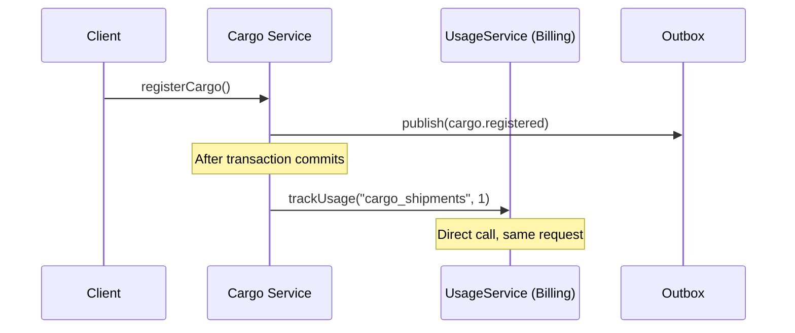
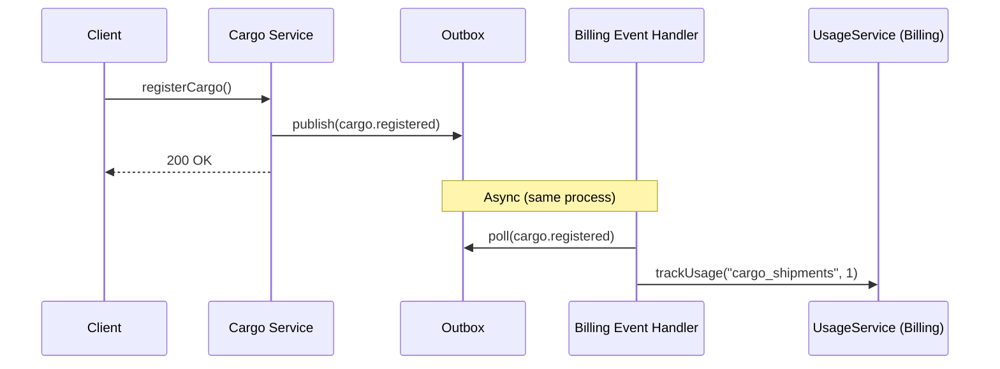

# ADR 0013 — Event-Driven Usage Tracking (Remove Direct Cargo→Billing Dep)

## Status

Proposed.

## Context

SAPTM uses `UsageService` (in `apps/api/src/billing/usage.service.ts`) to track usage metrics per organization — `cargo_shipments`, `tracking_events`, `members`. Currently, two bounded contexts call `UsageService` directly:

| Context | File | Line | Call |
|---|---|---|---|
| **Cargo** | `cargo.service.ts` | 360 | `usageService.trackUsage(orgId, "cargo_shipments", 1)` after cargo registration |
| **Tracking** | `tracking.service.ts` | 776 | `usageService.trackUsage(orgId, "tracking_events", 1)` after event recording |

This creates three problems:

1. **Bounded context violation** — Cargo and Tracking modules both import and inject a Billing service, creating a reverse dependency (domain contexts → billing). The dependency direction should be: Billing consumes domain events, not domain contexts call Billing directly.

2. **Hard coupling to billing implementation** — If billing logic changes (e.g., new pricing tiers, different metrics, rate limiting), both Cargo and Tracking must be modified.

3. **Inconsistency with the outbox pattern** — Cargo already publishes `cargo.registered` events via the outbox, and Tracking publishes `tracking.event.recorded`. These events are currently only used for external webhook delivery — they could drive usage tracking internally.

### Current flow



### Target flow



## Decision

**Replace all direct `usageService.trackUsage()` calls from Cargo and Tracking with event-driven consumption:**

1. **Remove direct calls:**
   - `cargo.service.ts:360` — remove `usageService.trackUsage(input.organizationId, "cargo_shipments", 1)`
   - `tracking.service.ts:776` — remove `usageService.trackUsage(input.organizationId, "tracking_events", 1)`

2. **Remove `UsageService` injection from both services:**
   - Remove constructor injection from `CargoService` and `TrackingService`
   - Remove `BillingModule` import from `CargoModule` and `TrackingModule`

3. **Create billing event consumer:**
   - `apps/api/src/billing/events/usage-event-handler.ts` — subscribes to `cargo.registered` and `tracking.event.recorded` events
   - Calls `UsageService.trackUsage()` with the appropriate metric
   - Runs as a consumer of the outbox (same pattern as the future tracking consumer from ADR 0008)

4. **Keep `UsageService` in BillingModule** — it remains exported and available for synchronous usage tracking where necessary (e.g., admin operations, migrations). Only domain context mutation handlers are moved to event-driven.

### Event-to-metric mapping

| Event Type | Metric | Delta | Source |
|---|---|---|---|
| `cargo.registered` | `cargo_shipments` | 1 | `cargo.service.ts` registerCargo |
| `tracking.event.recorded` | `tracking_events` | 1 | `tracking.service.ts` recordEvent |

### Consumer implementation

The consumer runs in the same Node process as the API, polling the outbox table:

```typescript
// apps/api/src/billing/events/usage-event-handler.ts
@Injectable()
export class UsageEventHandler {
  constructor(
    private readonly usageService: UsageService,
    private readonly outboxReader: OutboxReader, // reads unreconciled outbox events
  ) {
    // Subscribe to relevant event types
    this.outboxReader.subscribe({
      eventTypes: ["cargo.registered", "tracking.event.recorded"],
      consumerGroup: "billing-usage",
      handler: (event) => this.handle(event),
    });
  }

  async handle(event: OutboxEvent): Promise<void> {
    switch (event.eventType) {
      case "cargo.registered":
        await this.usageService.trackUsage(event.organizationId, "cargo_shipments", 1);
        break;
      case "tracking.event.recorded":
        await this.usageService.trackUsage(event.organizationId, "tracking_events", 1);
        break;
    }
  }
}
```

## Consequences

### Positive
1. ✅ **Clean bounded context isolation** — Cargo and Tracking no longer depend on Billing. The dependency arrow reverses: Billing consumes events from domain contexts
2. ✅ **Removes 2 direct cross-context calls** — both fully removed
3. ✅ **Leverages existing outbox infrastructure** — events already published, consumer pattern already understood
4. ✅ **Simplified CargoModule/TrackingModule** — no `BillingModule` import, no `UsageService` injection
5. ✅ **Billing can evolve independently** — new pricing tiers, metrics, or usage tracking logic only affects billing module
6. ✅ **Usage tracking becomes auditable** — since it's event-driven, each usage increment maps to a specific domain event with idempotency key

### Negative
1. ❌ **Eventual consistency** — Usage counts may lag by milliseconds. Mitigation: acceptable for billing purposes (monthly cycles); real-time usage limits (e.g., `checkLimit()`) remain synchronous via the RPC layer if needed
2. ❌ **Risk of double-counting on replay** — If events are replayed (e.g., idempotency replay), usage will be double-counted. Mitigation: the consumer must check an idempotency key against usage records before incrementing; alternatively, the `trackUsage` method becomes idempotent (upsert on eventId + metric)

### Migration

**Phase 1 — Dual-write:**
1. Create `UsageEventHandler` consumer that also calls `trackUsage()`
2. Keep the direct `usageService.trackUsage()` calls in Cargo and Tracking
3. Validate that counts are consistent (no double-counting)
4. Run for 1 sprint

**Phase 2 — Cutover:**
1. Remove direct calls from Cargo and Tracking
2. Remove `BillingModule` imports
3. Remove `UsageService` injection
4. Consumer becomes sole source of usage tracking

**Rollback:** Add direct calls back — both paths will fire for 1 cycle (acceptable for non-critical counts).

## Compliance

- [x] C4 diagrams updated (Nível 2 — Container, showing event-driven Billing)
- [x] Bounded contexts documented (Cargo/Tracking no longer depend on Billing)
- [x] ADR written for this decision
- [x] Dependency graph validated (CargoModule + TrackingModule no longer import BillingModule)
- [x] Layer boundaries respected (Domain contexts → Outbox → Consumer → Billing)

## Impact Analysis

| File | Change | Effort |
|---|---|---|
| `apps/api/src/billing/events/usage-event-handler.ts` | **New** — event consumer | ~2h |
| `apps/api/src/billing/billing.module.ts` | Add `UsageEventHandler` to providers | ~15min |
| `apps/api/src/cargo/cargo.service.ts:360` | Remove `usageService.trackUsage()` line | ~5min |
| `apps/api/src/cargo/cargo.service.ts` | Remove `UsageService` constructor injection | ~5min |
| `apps/api/src/cargo/cargo.module.ts` | Remove `BillingModule` import | ~5min |
| `apps/api/src/tracking/tracking.service.ts:776` | Remove `usageService.trackUsage()` line | ~5min |
| `apps/api/src/tracking/tracking.service.ts` | Remove `UsageService` constructor injection | ~5min |
| `apps/api/src/tracking/tracking.module.ts` | Remove `BillingModule` import | ~5min |
| Test updates | Update tests for event-driven usage | ~2h |
| **Total** | | **~5h** |
