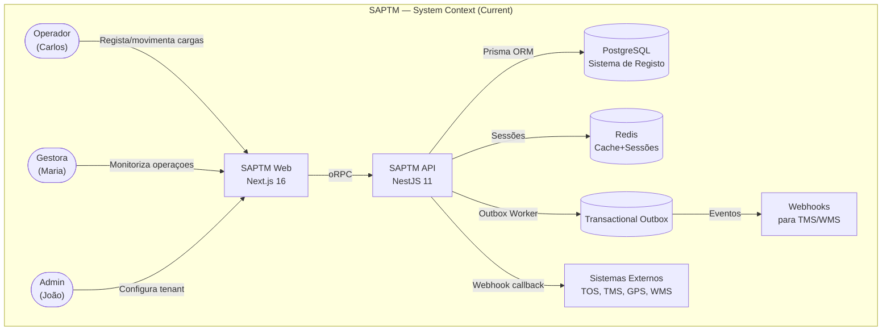
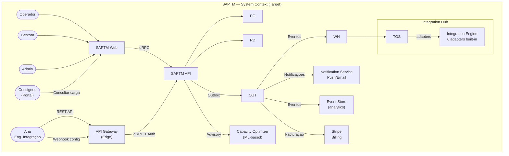
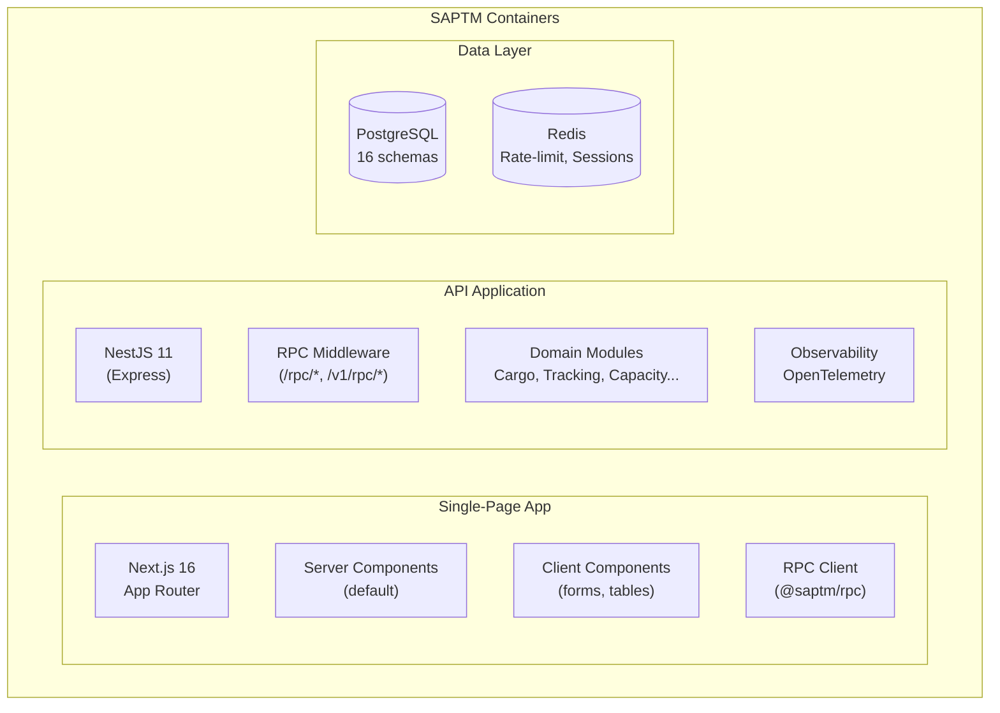
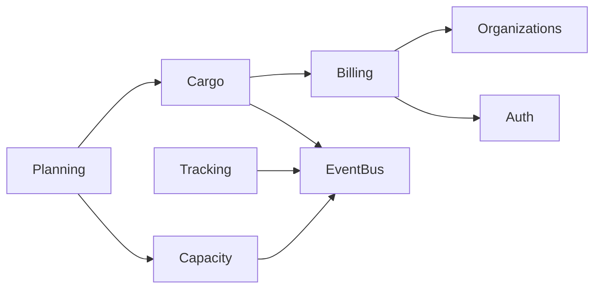
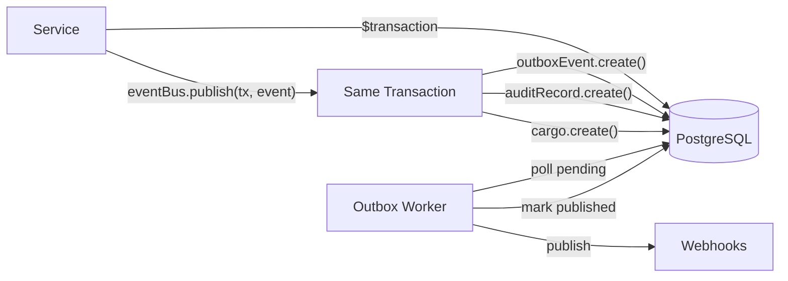
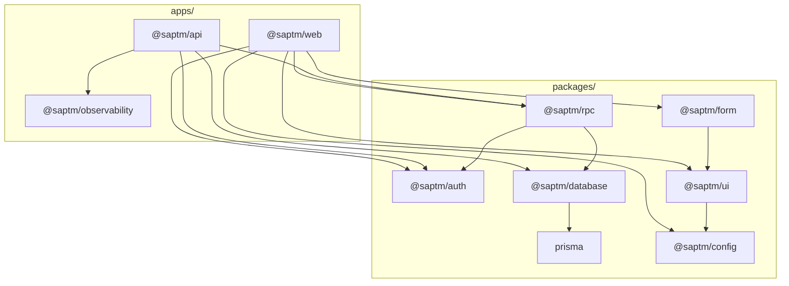

# SAPTM — Architecture Audit

> **Departamento:** Enterprise Architecture (`@enterprise-architecture`)
> **Versão:** 1.0.0
> **Data:** 2026-07-02
> **Alinhamento:** Product Vision & OKRs (Q3 2026)
> **Estado:** ⚠️ 28 gaps identificados, 6 blocking

---

## Sumário Executivo

A arquitetura SAPTM está **bem fundada** — DDD tático com repository pattern, clean architecture layers (Controller → Service → Repository), event-driven com transactional outbox, multi-tenancy nativo com Prisma Client Extension, e contract-first RPC via oRPC. O módulo Cargo é o mais maduro, com entidades de domínio ricas, business rules isoladas, e audit trail completo.

**Contudo**, existem gaps estruturais significativos quando alinhados com a Product Vision e OKRs Q3 2026:

| Dimensão | Score | Status |
|----------|-------|--------|
| **Bounded Contexts** | 65/100 | ⚠️ Contextos bem definidos mas com overlap Cargo⇄Tracking |
| **Module Structure** | 80/100 | ✅ DDD layers corretas, repository pattern implementado |
| **Event Architecture** | 72/100 | ⚠️ Outbox pattern sólido, mas eventos não versionados |
| **Multi-tenancy** | 85/100 | ✅ Scoping nativo, sem leaks detectados |
| **ADRs** | 50/100 | ❌ 7 ADRs mas faltam decisões críticas (CQRS, outbox, billing) |
| **Integration Architecture** | 55/100 | ⚠️ Webhooks existem, mas sem API externa nem developer portal |
| **Billing Architecture** | 70/100 | ⚠️ Stripe integrado, mas sem self-service signup flow |
| **Composite** | **68/100** | ⚠️ Necessita de ~20 pontos para atingir o nível Q3 |

---

## 1. C4 Context Diagram

### Current State (Nível 1 — Context)



### Target State (Nível 1 — Context, Q4 2026+)



### Container Diagram (Nível 2)



---

## 2. Bounded Contexts Assessment

### 2.1 Current Bounded Contexts

| # | Context | Pacote RPC | Módulo API | Modelos DB | Maturidade |
|---|---------|-----------|-------------|-------------|-----------|
| 1 | **Cargo** | `cargo.ts`, `compliance.ts` | `apps/api/src/cargo/` | Cargo, CargoDeliveryException, CargoClaimSettlement, CargoComplianceEvidence, CargoOperationalHandoff | ✅ Maduro |
| 2 | **Tracking** | `tracking.ts` | `apps/api/src/tracking/` | TrackingShipment, TrackingEvent | ✅ Maduro |
| 3 | **Capacity** | `capacity.ts` | `apps/api/src/capacity/` | CapacityResource, CapacitySlot, CapacitySlotReservation, CapacityAdvisoryDecision | ✅ Maduro |
| 4 | **Planning** | `planning.ts` | `apps/api/src/planning/` | TransportOrder, TransportOrderDispatch, TransportOrderScheduleRevision | ⚠️ Em desenvolvimento |
| 5 | **Tariff** | `tariff.ts` | `apps/api/src/tariff/` | TariffRateCard, TariffRateRule, TariffQuote | ⚠️ Em desenvolvimento |
| 6 | **Billing** | `billing.ts` | `apps/api/src/billing/` | Subscription, Invoice, UsageRecord | ✅ Maduro (Stripe) |
| 7 | **Identity & Access** | `authorization.ts` | `apps/api/src/auth/`, `apps/api/src/teams/` | User, Session, Account, Organization, Membership, Role, Permission, Team | ✅ Maduro |
| 8 | **Notifications** | `notifications.ts` | `apps/api/src/notifications/` | Notification | ⚠️ Básico (inbox only) |
| 9 | **Audit** | `audit.ts` | `apps/api/src/audit/` | AuditRecord | ✅ Maduro |
| 10 | **Integrations** | `integrations.ts`, `webhooks.ts` | `apps/api/src/integrations/`, `apps/api/src/webhooks/` | IntegrationEvent, WebhookEndpoint, WebhookDelivery | ⚠️ Parcial |
| 11 | **Admin** | `admin.ts` | `apps/api/src/admin/` | ServiceAccount, ApiKey | ⚠️ Básico |
| 12 | **Settings** | `settings.ts` | `apps/api/src/settings/` | — | 🔴 Incipiente |
| 13 | **Reports** | `reports.ts` | `apps/api/src/reports/` | — | 🔴 Incipiente |
| 14 | **Privacy** | `privacy.ts` | `apps/api/src/privacy/` | — | 🔴 Incipiente |
| 15 | **Documents** | `documents.ts` | `apps/api/src/documents/` | — | 🔴 Incipiente |

### 2.2 Context Boundary Issues

#### ⚠️ Overlap Crítico: Cargo ↔ Tracking

**Problema:** O módulo `cargo` penetra diretamente no bounded context de `tracking`. No `cargo.service.ts`, o CargoService:
- Cria `TrackingShipment` records (createTrackingShipment)
- Cria `TrackingEvent` records (createTrackingEvent)
- Atualiza `TrackingShipment` status (updateTrackingShipment)
- Faz query de tracking events por idempotency key

**Localização:** `apps/api/src/cargo/cargo.service.ts:534-565, 715-765, 903-936`

**Impacto:** Isto cria um **acoplamento temporal implícito** — o lifecycle do cargo dita o lifecycle do tracking. Se o contexto Tracking evoluir (ex: adicionar processing pipeline), o Cargo fica quebrado. Viola o princípio DDD de que cada aggregate root só deve ser modificado pelo seu próprio aggregate.

**Recomendação:** Extrair a criação de tracking events/shipments para um **serviço de domínio partilhado** ou implementar **event-driven handoff**: Cargo emite domain events ("cargo.transport_planned"), Tracking consome e cria os registos necessários. Isto prepara a eventual extração para microserviço (ADR-0002).

#### ⚠️ Overlap: Cargo ↔ Billing

**Problema:** `CargoService` importa `UsageService` do billing module diretamente:

```typescript
import { UsageService } from "../billing/usage.service.js";
// usado em: registerCargo() → this.usageService.trackUsage(...)
```

**Localização:** `apps/api/src/cargo/cargo.service.ts:36-37, 360`

**Impacto:** Acoplamento cross-context sem interface. O billing deve ser notificado via **evento de domínio**, não via chamada direta de serviço. Cada registo de carga já publica `cargo.registered` no outbox — o billing deve consumir esse evento.

#### ⚠️ Contexto "Compliance" Anémico

**Problema:** O compliance no RPC contracts está em `cargo.ts` como parte do contexto Cargo (`cargoComplianceEvidence*`), e tem um ficheiro `compliance.ts` separado com apenas a operação `complianceOverview`. No Prisma, `CargoComplianceEvidence` é um modelo separado.

**Localização:** `packages/rpc/src/compliance.ts` (63 linhas), `packages/rpc/src/cargo.ts` (linhas 323-370 para schemas compliance)

**Impacto:** Compliance é meio-tenant entre Cargo e um contexto próprio. A Product Vision trata Compliance como cidadão de primeira classe (OKR 3: "Rastreabilidade Total"), mas a arquitetura atual trata-o como subordinado do Cargo. Com o roadmap a prever dashboard de compliance dedicado, isto precisa de ser extraído.

### 2.3 Missing Contexts (Product Vision Gaps)

| Contexto Ausente | Justificação | Prioridade |
|-----------------|-------------|-----------|
| **Shipper Portal** | A Product Vision descreve "Portal do cliente (consignee)" no roadmap Later Q1 2027, e a persona "Ana" como integradora. Não há atualmente nenhum contexto para autosserviço do cliente final. | P1 |
| **Billing/Subscription** | Existe o módulo billing com Stripe, mas não há self-service signup (KR4.1). Invoices existem no schema mas o RPC billing está funcional. O gap é no **signup flow integrado**. | P0 |
| **Notification Orchestration** | Notificações existem como modelo DB e RPC inbox, mas não há **engine de notificação** (push, email, SMS). O outbox publica eventos, mas ninguém os consome para notificar operadores. | P0 |
| **Analytics/Reporting** | Reports existe como módulo incipiente. A Product Vision exige analytics com tendências temporais (KR2.1), SLA timers (KR1.4), dashboards de compliance. Não há agregadores de eventos para reporting. | P1 |
| **AI/Advisory Engine** | O Tracking Advisory existe como módulo rule-based (`trackingAdvisoryRecommendationSchema`), mas é básico. O roadmap prevê Capacity Optimizer (Q1 2027). | P2 |

---

## 3. Module Structure Audit

### 3.1 DDD Layer Compliance

**Padrão atual:**
```
apps/api/src/{domain}/
  cargo-rpc.router.ts      ← Controller layer (inbound port)
  cargo.service.ts         ← Application/Service layer
  domain/
    cargo.entity.ts        ← Domain entity (rich model)
    cargo.repository.ts    ← Repository interface (outbound port)
    business-rules.ts      ← Domain business rules (pure functions)
    audit-trail.ts         ↑ Audit data transformers
    dto.ts                 ↑ Data mappers
  infrastructure/
    prisma-cargo.repository.ts  ← Repository implementation
```

**Resultado:**
- ✅ **Repository pattern** corretamente implementado via interface `CargoRepository` + `CARGO_REPOSITORY` symbol + `PrismaCargoRepository`
- ✅ **Business rules isoladas** em funções puras (`business-rules.ts`)
- ✅ **Injeção de dependência** com `@Inject(CARGO_REPOSITORY)`
- ✅ **Nenhum controller acede diretamente ao Prisma** (confirmado: `grep -r "prisma.cargo" apps/api/src/cargo/` → 0)
- ⚠️ **Entity anémica?** `CargoEntity` é uma interface, não uma classe com métodos de domínio. `CargoReference` e `GrossWeight` são value objects com validação, mas a entidade principal não tem behaviour próprio
- ⚠️ **Service layer inchado** — `cargo.service.ts` tem ~2500 linhas com repetição massiva do padrão (1) replayed check, (2) business rules, (3) transaction, (4) audit, (5) event publish. Cada método segue o mesmo template.

### 3.2 Circular Dependencies

**Análise de dependências entre módulos API:**



- ✅ **Nenhum ciclo identificado nos módulos atuais**
- ⚠️ **Dependência Cargo→Billing** é cross-context (ver secção 2.2)
- ⚠️ **Cargo→Tracking** é uma dependência forte no repository (ver secção 2.2)

### 3.3 Module Standardisation

**Módulos que seguem o padrão completo** (Controller, Service, Repository, Entity, Business Rules):
- `cargo/` ✅
- `capacity/` ✅
- `tracking/` ✅
- `planning/` ✅
- `integrations/` ✅

**Módulos sem DDD tático** (apenas service + DB access):
- `audit/` ⚠️ — apenas query de audit records
- `notifications/` ⚠️ — apenas inbox/mark-read
- `health/` — trivial
- `rate-limit/` — configuração
- `reports/` 🔴 — incipiente
- `settings/` 🔴
- `privacy/` 🔴

### 3.4 Inbound/Outbound Ports

| Módulo | Inbound Port | Outbound Port | Status |
|--------|-------------|---------------|--------|
| Cargo | `cargo-rpc.router.ts` (oRPC handler) | `CargoRepository` (interface) | ✅ |
| Tracking | `tracking-rpc.router.ts` (oRPC handler) | (no explicit repository interface) | ⚠️ Sem interface |
| Capacity | `capacity-rpc.router.ts` (oRPC handler) | (uses Prisma directly) | ⚠️ Sem interface |
| Planning | `planning-rpc.router.ts` (oRPC handler) | (uses Prisma directly) | ⚠️ Sem interface |

---

## 4. Event Architecture

### 4.1 Outbox Pattern Implementation



**Status:**
- ✅ **OutboxEventBus** corretamente implementado em `packages/database/src/outbox-event-bus.ts`
- ✅ Todas as operações críticas usam `$transaction` com `eventBus.publish(tx, event)` dentro da mesma transação
- ✅ `OutboxEvent` model com status lifecycle (`pending → processing → published/failed`)
- ✅ Idempotency keys com unique constraints no PostgreSQL
- ✅ SLOs definidos para outbox delay (p95 < 5s, 99.5%)

**Gaps:**
- ⚠️ **DomainEvent não versionado** — `DomainEvent` type tem `eventType: string` mas sem campo `eventVersion`. Se o schema do payload mudar, consumidores legacy quebram.
- ⚠️ **Sem Event Registry** — não há um registo central de eventos com schema versionado e documentação.
- ⚠️ **Sem consumidores internos** — o outbox worker publica para webhooks, mas **não há consumidores internos** (ex: notification engine, analytics aggregator, billing usage counter). Isto significa que:
  - Notificações não são geradas a partir de eventos de domínio
  - Billing usa `UsageService.trackUsage()` **fora da transação** (chamada síncrona no final do método)
  - Não há materialized views ou read models atualizados por eventos

### 4.2 Current Domain Events

**Eventos publicados atualmente (33):**

| Evento | Aggregate | Fonte | Status |
|--------|-----------|-------|--------|
| `cargo.registered` | cargo | CargoService | ✅ |
| `cargo.released` | cargo | CargoService | ✅ |
| `cargo.transport_planned` | cargo | CargoService | ✅ |
| `cargo.transport_departed` | cargo | CargoService | ✅ |
| `cargo.transport_arrived` | cargo | CargoService | ✅ |
| `cargo.delivery_completed` | cargo | CargoService | ✅ |
| `cargo.delivery_exception.recorded` | cargo | CargoService | ✅ |
| `cargo.delivery_exception.resolved` | cargo | CargoService | ✅ |
| `cargo.operational_handoff.recorded` | cargo | CargoService | ✅ |
| `cargo.claim_settlement.recorded` | cargo | CargoService | ✅ |
| `cargo.compliance_evidence.recorded` | cargo | CargoService | ✅ |
| `cargo.compliance_evidence.verified` | cargo | CargoService | ✅ |
| `tracking.event.recorded` | tracking.shipment | TrackingService | ✅ |
| `tracking.exception.managed` | tracking.shipment | TrackingService | ✅ |
| `tracking.exception.resolved` | tracking.shipment | TrackingService | ✅ |
| `capacity.resource.registered` | capacity | CapacityService | ✅* |
| `capacity.slot.opened` | capacity | CapacityService | ✅* |
| `capacity.slot.reserved` | capacity | CapacityService | ✅* |
| `capacity.slot.cancelled` | capacity | CapacityService | ✅* |
| `capacity.advisory.decided` | capacity | CapacityService | ✅* |
| `planning.transport_order.confirmed` | planning | PlanningService | ✅* |
| `planning.transport_order.cancelled` | planning | PlanningService | ✅* |
| `planning.transport_order.dispatched` | planning | PlanningService | ✅* |
| `planning.transport_order.rescheduled` | planning | PlanningService | ✅* |
| `tariff.rate_card.registered` | tariff | TariffService | ✅* |
| `tariff.rate_rule.added` | tariff | TariffService | ✅* |
| `tariff.quote.calculated` | tariff | TariffService | ✅* |
| `tariff.quote.approved` | tariff | TariffService | ✅* |
| `notification.created` | notification | NotificationService | ✅* |
| `audit.recorded` | audit | AuditService | ✅ |
| `integration.event.received` | integration | IntegrationsService | ✅* |
| `notification.marked_read` | notification | NotificationService | ✅ |
| `billing.*` | billing | BillingService | — |

\* = definido em `event-types.ts` mas não confirmada implementação real em todos os serviços

### 4.3 Missing Events (Product Vision Required)

| Evento | OKR | Nota |
|--------|-----|------|
| `cargo.north_star.achieved` | North Star | Evento composto quando carga atinge delivered com evidência completa e sem excepções |
| `cargo.sla_breach.risked` | KR1.4 | SLA timer a expirar para resolução de excepção |
| `cargo.sla_breach.exceeded` | KR1.4 | Excepção excedeu SLA |
| `organization.signup.completed` | KR4.1 | Self-service signup concluído |
| `organization.billing.plan_changed` | KR4.1 | Mudança de plano |
| `organization.team.created` | KR4.2 | Equipa criada |
| `notifications.push.sent` | O2 | Push notification enviada |
| `compliance.evidence.expiring` | O3 | Evidência a expirar em 7 dias |
| `compliance.evidence.expired` | O3 | Evidência expirada |
| `advisory.recommendation.published` | KR4.3 | Recomendação de advisory publicada |
| `advisory.decision.recorded` | KR4.3 | Decisão humana registada |

---

## 5. Multi-tenancy Architecture

### 5.1 Tenant Scoping Implementation

**Mecanismo:**
1. **Prisma Client Extension** em `packages/database/src/tenant-scoping.ts` — injeta `organizationId` automaticamente em queries `findMany`, `findUnique`, `create`, `update`
2. **AsyncLocalStorage** em `packages/database/src/tenant-context.ts` — `runWithTenantContext()` define o tenant ativo
3. **Middleware RPC** em `apps/api/src/rpc/` — extrai `organizationId` da sessão e define o context

**Análise de segurança:**
- ✅ Todas as queries de domínio incluem `organizationId` via extension — **não é possível esquecer**
- ✅ Todas as mutações usam `organizationId` no `create()` — a extension adiciona automaticamente
- ✅ `@@unique([organizationId, reference])` em modelos críticos — impede referências duplicadas entre tenants
- ✅ `@@index([organizationId, ...])` em todos os modelos — performance de queries tenant-scoped
- ✅ `AuditRecord.organizationId` é `optional?` mas preenchido em todas as operações críticas

**Riscos:**
- ⚠️ **`organizationId` é optional no AuditRecord** (`organizationId String?`) — se um bug deixar `organizationId` null num audit record, esse registo fica órfão. Bom para auditoria cross-tenant por admins, mas risco se mal usado.
- ⚠️ **OutboxEvent.organizationId é nullable** — mesmo risco. Eventos sem `organizationId` não podem ser scoped.
- ⚠️ **Organizações soft-deleted** — `Organization.deletedAt` e `Organization.deletedBy` existem, mas não há validação que impeça acesso a dados de organizações deletadas.

### 5.2 Cross-tenant Data Access Risks

**Risco 1:** Rotas de health/readiness não têm tenant scoping — esperado e seguro.

**Risco 2:** Algumas queries em `admin/` podem operar cross-tenant (ex: listar todas as organizações). Necessário verificar se `admin/` controllers usam `runWithTenantContext` ou bypass scoping. O admin module parece incipiente.

**Risco 3:** O RPC metadata tem `organizationRequired: true/false`. Operações com `organizationRequired: false` (ex: `billing.plans`) podem ser chamadas sem tenant. Verificar se estas operações não expõem dados sensíveis.

### 5.3 Support for "Escala Multi-Inquilino" Strategic Theme

**O que existe:**
- ✅ Tenant scoping nativo via Prisma extension
- ✅ Membership lifecycle (invited → active → suspended → removed)
- ✅ Role-based access control (RBAC) com 64+ permissões
- ✅ Team-based access control (teams + team_members)
- ✅ Subscription per organization (free/pro/enterprise)

**O que falta para a visão:**
- ❌ **Self-service signup** (KR4.1) — atualmente só seed manual
- ❌ **SSO/SAML** (Roadmap Next Q4) — não implementado
- ❌ **Organization branding** — sem suporte a temas customizados por tenant
- ❌ **Billing self-service** — Stripe integrado, mas sem fluxo de checkout completo para upgrade/downgrade

---

## 6. Architecture Decision Records

### 6.1 Existing ADRs (7)

| ADR | Decisão | Status | Notas |
|-----|---------|--------|-------|
| 0001 | Monorepo com Turborepo + pnpm | ✅ Accepted | Sólido |
| 0002 | NestJS modular antes de microserviços | ✅ Accepted | Preparar extração futura |
| 0003 | Better Auth + autorização de plataforma | ✅ Accepted | Boa separação de concerns |
| 0004 | oRPC contract-first API | ✅ Accepted | Bem implementado |
| 0005 | Prisma + PostgreSQL como sistema de registo | ✅ Accepted | Adequado ao domínio |
| 0006 | Infraestrutura dependency exceptions | ✅ Accepted | Pragmático |
| 0007 | API versioning strategy | ✅ Accepted | URL prefix versioning |

### 6.2 Missing ADRs (Critical Gaps)

| # | Decisão a Documentar | Prioridade | Contexto |
|---|---------------------|-----------|----------|
| **M1** | **Transactional Outbox + Domain Events** | P0 | Decisão arquitetural fundamental. Porquê outbox em vez de event bus síncrono? Porquê polling em vez de CDC (Change Data Capture)? |
| **M2** | **CQRS with Read Models** | P0 | A arquitetura usa repository pattern para writes, mas reads são feitos pelo mesmo modelo. A decisão de usar (ou não) CQRS completo deve ser documentada. |
| **M3** | **Billing Architecture (Stripe + Usage)** | P1 | Stripe integrado, mas sem ADR. Quais eventos de billing existem? Como funciona o metering? |
| **M4** | **Notification Architecture** | P1 | Como as notificações são geradas? Apenas inbox ou push/email também? |
| **M5** | **Event Versioning & Schema Registry** | P1 | Como versionar eventos para consumidores externos? Schema evolution policy? |
| **M6** | **Multi-tenancy Scoping Strategy** | P1 | A extensão Prisma + AsyncLocalStorage é uma decisão importante. Porquê esta abordagem em vez de schema-per-tenant ou database-per-tenant? |
| **M7** | **Integration Architecture (6 Adapters)** | P2 | Como integrar com TOS, TMS, GPS, WMS, Customs? Quais protocolos? Onde correm os adapters? |
| **M8** | **Monitoring & Observability (OpenTelemetry)** | P2 | OpenTelemetry foi instrumentado no observability.service.ts. Decisão de usar vendor-agnostic tracing. |
| **M9** | **Cargo ↔ Tracking Boundary** | P0 | A decisão (ou falta dela) sobre como Cargo interage com Tracking. Atualmente é chamada direta, mas devia ser eventos. ADR é urgente. |
| **M10** | **Service Communication Pattern** | P1 | Quado um módulo precisa de dados de outro (ex: Cargo precisa de dados de Tracking), como comunicar? Chamada direta? Eventos? Shared database? |

---

## 7. Gap Analysis: Strategic Themes → Architecture

### Theme 1: 🚂 Excelência Operacional

| Requisito | Arquitetura Atual | Gap | Prioridade |
|-----------|------------------|-----|-----------|
| KR1.1: <3min registo | Forms com Zod validation, idempotency keys | ✅ Registos já são rápidos. Gap de UX, não de arquitetura | — |
| KR1.2: Autocomplete (shipper templates) | Sem suporte a templates | ❌ Não há conceito de "shipper template" no domínio | P1 |
| KR1.3: >90% sem erros | Zod validation em todas as operações | ✅ Arquitetura já garante validação forte | — |
| KR1.4: <24h excepção | SLA timers existem no tracking como conceito | ❌ Não há SLA timer automático — sem engine de monitoring | P1 |
| "My Queue" pendências | Sem conceito de fila de trabalho | ❌ Não existe no domínio | P1 |

**Arquitectura necessária:** Motor de SLA monitoring + work queue (fila de tarefas do operador) + template engine para shipper data.

### Theme 2: 📡 Visibilidade em Tempo Real

| Requisito | Arquitetura Atual | Gap | Prioridade |
|-----------|------------------|-----|-----------|
| KR2.1: Timeline unificada | Timeline component existe, mas dados separados (cargo + tracking) | ❌ API não expõe timeline unificada — client tem que fazer 2 queries | P1 |
| KR2.2: >95% eventos ligados | Tracking events têm cargoId opcional | ❌ Tracking events podem ser registados sem ligação a cargo | P0 |
| KR2.3: >95% evidence pre-partida | Business rules verificam compliance antes de departure | ✅ Regras de negócio implementadas | — |
| KR2.4: <30s latência | Outbox pattern + SLO de 5s p95 | ⚠️ SLO é 5s para outbox — pipeline de UI não está instrumentado | P0 |
| Notificações push | Apenas inbox DB | ❌ Sem push, sem email, sem WebSocket/SSE | P0 |
| Analytics temporais | TrackingAnalytics existe com 30/90 dias | ⚠️ Apenas no contexto tracking, não cross-domain | P1 |

**Arquitectura necessária:** Stream de eventos (WebSocket ou SSE), notificação push/email, timeline unificada no backend, cargo↔tracking linking obrigatório.

### Theme 3: 🔒 Confiança & Compliance

| Requisito | Arquitetura Atual | Gap | Prioridade |
|-----------|------------------|-----|-----------|
| KR3.1: 100% audit trail | AuditRecord criado em cada mutação crítica | ⚠️ Nem todas as operações têm audit (queries read não) | P1 |
| KR3.2: >90% evidence digital | Compliance evidence model com approve/reject | ✅ Modelo completo | — |
| KR3.3: <15s pesquisa audit | Audit indexado por organizationId + subjectType + subjectId | ⚠️ Sem full-text search ou filtros avançados | P2 |
| KR3.4: >80% 2FA | TwoFactor model + two-factor.guard.ts | ✅ Implementado | — |
| Portal de auditoria | Sem página dedicada de compliance | ❌ Backend tem `complianceOverview` RPC, mas frontend precisa de página dedicada | P1 |

**Arquitectura necessária:** Página de compliance dedicada, filtros de audit search, exportação de relatório SOC2.

### Theme 4: 🏢 Escala Multi-Inquilino

| Requisito | Arquitetura Atual | Gap | Prioridade |
|-----------|------------------|-----|-----------|
| KR4.1: 100% self-service signup | Apenas seed manual | ❌ Bloqueador de OKR | **P0** |
| KR4.2: >50% equipas | Team model + TeamMember existem | ⚠️ Falta scoping de permissões por equipa (team-based access control) | P1 |
| SSO/SAML | Não implementado | ❌ Roadmap Next Q4 | P1 |
| Billing self-service | Stripe integrado, Subscription model | ⚠️ Sem fluxo de checkout completo | P1 |
| Organization branding | Sem suporte | 🟢 Roadmap Later | P2 |

**Arquitectura necessária:** Signup flow com criação de organização, checkout Stripe, team-based permissions, SSO/SAML.

### Theme 5: 🤖 Eficiência Aumentada

| Requisito | Arquitetura Atual | Gap | Prioridade |
|-----------|------------------|-----|-----------|
| Capacity Advisory | `trackingAdvisoryRecommendationSchema` rule-based | ⚠️ Regras básicas implementadas | P1 |
| KR4.3: Advisory com decisão | `CapacityAdvisoryDecision` model existe | ⚠️ Modelo existe, mas fluxo de decisão humano não integrado com UI | P2 |
| Predição atrasos (ML) | Não implementado | 🟢 Roadmap Q1 2027 | P2 |
| Capacity Optimizer | Não implementado | 🟢 Roadmap Q1 2027 | P2 |

---

## 8. Recommendations & ADR Proposals

### P0 — Blocking OKRs (Must Fix in Sprint 4-5)

#### R1: Criar ADR para Cargo ↔ Tracking Boundary

- **O quê:** Documentar a decisão de extrair o acoplamento Cargo→Tracking para eventos de domínio
- **Onde:** `docs/adr/0008-cargo-tracking-event-driven-handoff.md`
- **Ação:** Cargo emite `cargo.transport_planned`, Tracking cria shipment/events como consumidor. O `cargo.service.ts` deixa de chamar `createTrackingShipment`/`createTrackingEvent` diretamente.
- **Ficheiros:** `apps/api/src/cargo/cargo.service.ts` (refactor métodos planTransport, departTransport, etc.), `apps/api/src/tracking/` (novo handler de eventos)
- **Esforço:** 8h

#### R2: Separar Cargo → Billing para Event-driven

- **O quê:** Substituir `usageService.trackUsage()` direto por consumo de `cargo.registered` event
- **Onde:** `apps/api/src/cargo/cargo.service.ts:360` — remover chamada direta a `UsageService`
- **Criar:** `apps/api/src/billing/events/` — novo handler que consome eventos do outbox para tracking de usage
- **Esforço:** 4h

#### R3: Implementar Self-Service Signup (KR4.1)

- **O quê:** Fluxo de signup com criação de organização + Stripe subscription
- **Onde:** Novas rotas RPC `organization.signup` + frontend flow
- **Contratos:** `packages/rpc/src/organizations.ts` — adicionar `organizationSignupInputSchema`
- **Depende de:** Fluxo de checkout Stripe funcional (já existe em billing)
- **Esforço:** 16h

#### R4: Implementar Engine de Notificações (Push/Email)

- **O quê:** Consumir eventos do outbox para gerar notificações push e email
- **Onde:** `apps/api/src/notifications/` — novo `notification.processor.ts` que lê `OutboxEvent` e cria `Notification` + dispara push/email
- **Contratos:** `packages/rpc/src/notifications.ts` — schema existente é suficiente
- **Esforço:** 12h

#### R5: ADR para oRPC vs REST vs gRPC

- **O quê:** Documentar a decisão de usar oRPC como único transporte e justificar porquê não REST
- **Onde:** `docs/adr/0012-orpc-transport-rationale.md`
- **Esforço:** 1h

### P1 — Critical for Next Quarter (Sprint 5-7)

#### R6: Criar Event Versioning Strategy ADR

- **O quê:** Documentar como versionar eventos de domínio (schema registry, backwards compatibility policy)
- **Onde:** `docs/adr/0009-event-versioning-schema-registry.md`
- **Ação:** Adicionar `eventVersion: number` ao `DomainEvent` type (`packages/database/src/domain-events.ts`)
- **Esforço:** 3h

#### R7: Extrair Compliance como Bounded Context Independente

- **O quê:** Compliance merece módulo API próprio com service, repository, entity
- **Onde:** Criar `apps/api/src/compliance/` — extrair de `cargo/`
- **Contratos:** `packages/rpc/src/compliance.ts` — expandir com operações CRUD de evidência
- **Esforço:** 8h

#### R8: Implementar Timeline Unificada (KR2.1)

- **O quê:** Endpoint RPC que combina cargo lifecycle + tracking events numa única timeline
- **Onde:** `packages/rpc/src/tracking.ts` — novo schema `trackingTimelineOutputSchema`
- **RPC:** `tracking.timeline.unified.read` com merge de eventos de cargo + tracking
- **Esforço:** 6h

#### R9: Tracking Event Linking Obrigatório (KR2.2)

- **O quê:** Tornar `cargoId` obrigatório em tracking events
- **Onde:** `packages/rpc/src/tracking.ts` — adicionar `cargoId: z.string().min(1)` ao `trackingEventRecordInputSchema`
- **Nota:** Isto é breaking change — requer version bump (v2) ou deprecação gradual
- **Esforço:** 4h

#### R10: Team-Based Access Control (KR4.2)

- **O quê:** Implementar scoping de permissões por equipa
- **Onde:** `apps/api/src/teams/` — adicionar `TeamPermission` model + middleware de scoping
- **Schema:** `packages/database/prisma/schema.prisma` — novo modelo `TeamPermission`
- **Esforço:** 12h

#### R11: ADR para CQRS Strategy

- **O quê:** Documentar a decisão de usar CQRS para queries complexas (overview, analytics) vs não usar para queries simples
- **Onde:** `docs/adr/0010-cqrs-read-models.md`
- **Esforço:** 1h

#### R12: ADR para Multi-tenancy Approach

- **O quê:** Documentar column-level scoping vs schema-per-tenant vs database-per-tenant
- **Onde:** `docs/adr/0011-multi-tenancy-tenant-scoping.md`
- **Esforço:** 1h

### P2 — Nice to Have (Sprint 8+)

#### R13: Event Sourcing para Audit Trail

- **O quê:** Avaliar event sourcing para audit trail imutável em operações críticas
- **Esforço:** 20h (avaliação + POC)

#### R14: Analytics Aggregator (Materialized Views)

- **O quê:** Criar materialized views para métricas operacionais (tempos médios, SLA compliance, KPI dashboards)
- **Onde:** `packages/database/prisma/migrations/` + background job para refresh
- **Esforço:** 8h

#### R15: API externa (Developer Portal) para Persona "Ana"

- **O quê:** REST API (ou oRPC) pública com rate limiting, API keys, docs
- **Onde:** `apps/api/src/public-api/` — novos endpoints + swagger
- **Esforço:** 24h

---

## 9. ADRs Pendentes — Checklist

| ADR # | Título | Prioridade | Status Proposto | Departamento |
|-------|--------|-----------|----------------|-------------|
| 0008 | Cargo ↔ Tracking Event-Driven Handoff | P0 | Proposed | Architecture + Backend |
| 0009 | Event Versioning & Schema Registry | P1 | Proposed | Architecture |
| 0010 | CQRS with Read Models | P1 | Proposed | Architecture + Backend |
| 0011 | Multi-tenancy Scoping Strategy | P1 | Proposed | Architecture |
| 0012 | oRPC Transport Rationale | P0 | Proposed | Architecture |
| 0013 | Billing & Subscription Architecture | P1 | Proposed | Architecture + Product |
| 0014 | Notification & Push Architecture | P1 | Proposed | Architecture + Backend |
| 0015 | Integration Hub & External API Design | P2 | Proposed | Architecture + Backend |

---

## 10. Action Plan — Architecture Q3 2026

| Sprint | Ação | Dono | Esforço |
|--------|------|------|---------|
| **Sprint 4** | ADRs 0008, 0012 (Cargo↔Tracking + oRPC rationale) | Architecture | 2h |
| **Sprint 4** | Extrair dependência Cargo→Billing para eventos | Backend | 4h |
| **Sprint 5** | Implementar engine de notificações (R4) | Backend | 12h |
| **Sprint 5** | Self-service signup flow (R3) | Backend + Frontend | 16h |
| **Sprint 5** | Criar ADR Event Versioning (R6) | Architecture | 1h |
| **Sprint 6** | Extrair Compliance como módulo independente (R7) | Backend | 8h |
| **Sprint 6** | Timeline unificada endpoint (R8) | Backend | 6h |
| **Sprint 6** | Criar ADRs CQRS + Multi-tenancy (R11, R12) | Architecture | 2h |
| **Sprint 7** | Team-based access control (R10) | Backend | 12h |
| **Sprint 7** | Tracking event linking obrigatório (R9) | Backend | 4h |

---

## 11. Scorecard Final

| Dimensão | Score | Peso | Ponderado | Alvo Q3 |
|----------|-------|------|-----------|---------|
| **Bounded Contexts** | 65/100 | 20% | 13.0 | 85/100 |
| **Module Structure** | 80/100 | 15% | 12.0 | 90/100 |
| **Event Architecture** | 72/100 | 20% | 14.4 | 90/100 |
| **Multi-tenancy** | 85/100 | 15% | 12.8 | 95/100 |
| **ADRs** | 50/100 | 15% | 7.5 | 80/100 |
| **Integration Architecture** | 55/100 | 10% | 5.5 | 75/100 |
| **Billing Architecture** | 70/100 | 5% | 3.5 | 85/100 |
| **Composite** | **68/100** | 100% | **68.7/100** | **86/100** |

---

## 12. Appendix: Dependency Graph Validation



- ✅ **Sem dependências circulares** no grafo de pacotes
- ✅ **Nenhum pacote importa `src/` de outro pacote**
- ✅ **Workspace names (`@saptm/*`)** usados consistentemente
- ✅ **Direção de dependências:** apps → packages, packages → outros packages (nunca apps)

---

> **Documento mantido pelo Departamento de Enterprise Architecture (`@enterprise-architecture`)**  
> *Próxima revisão: 2026-07-16 (mid-sprint)*
