# Detailed Dependency Map

## 1. Dependency Graph (Mermaid.js)

```mermaid
graph TD
  %% Applications
  WEB["@saptm/web<br/>(Next.js)"]
  API["@saptm/api<br/>(NestJS)"]

  %% Packages
  AUTH["@saptm/auth"]
  CONFIG["@saptm/config"]
  DB["@saptm/database"]
  EMAIL["@saptm/email"]
  OBS["@saptm/observability"]
  RPC["@saptm/rpc"]
  TEST["@saptm/testing"]
  TSCONFIG["@saptm/tsconfig"]
  TYPES["@saptm/types"]
  UI["@saptm/ui"]

  %% External de facto references
  subgraph External
    BETTERAUTH["better-auth"]
    ZOD["zod"]
    PRISMA["prisma"]
    RESEND["resend"]
    SENTRY["@sentry/nextjs"]
    NESTJS["@nestjs/*"]
    NEXT["next"]
    ORPC["@orpc/server"]
    REACT["react"]
    PLAYWRIGHT["@playwright/test"]
    TANSTACK["@tanstack/react-query"]
    SHADCN["radix-ui / recharts / etc"]
  end

  %% Web dependencies
  WEB --> AUTH
  WEB --> CONFIG
  WEB --> RPC
  WEB --> TYPES
  WEB --> UI
  WEB --> NEXT
  WEB --> REACT
  WEB --> SENTRY
  WEB --> TANSTACK

  %% API dependencies
  API --> AUTH
  API --> CONFIG
  API --> DB
  API --> OBS
  API --> RPC
  API --> TYPES
  API --> NESTJS
  API --> ORPC

  %% Auth dependencies
  AUTH --> CONFIG
  AUTH --> DB
  AUTH --> EMAIL
  AUTH --> OBS
  AUTH --> BETTERAUTH

  %% Config dependencies
  CONFIG --> ZOD

  %% Database dependencies
  DB --> CONFIG
  DB --> EMAIL
  DB --> OBS
  DB --> PRISMA

  %% Email dependencies
  EMAIL --> CONFIG
  EMAIL --> OBS
  EMAIL --> RESEND

  %% Observability (leaf — no internal deps)
  OBS

  %% RPC dependencies
  RPC --> AUTH
  RPC --> OBS
  RPC --> TYPES
  RPC --> ORPC
  RPC --> ZOD

  %% Testing dependencies
  TEST --> AUTH
  TEST --> OBS
  TEST --> RPC
  TEST --> PLAYWRIGHT

  %% Types (leaf — no internal deps)
  TYPES

  %% UI dependencies
  UI --> REACT
  UI --> SHADCN

  %% Tsconfig (leaf — no internal deps)
  TSCONFIG

  %% Dev-only dependencies (tsconfig as devDependency)
  AUTH -.-> TSCONFIG
  API -.-> TSCONFIG
  CONFIG -.-> TSCONFIG
  DB -.-> TSCONFIG
  EMAIL -.-> TSCONFIG
  OBS -.-> TSCONFIG
  RPC -.-> TSCONFIG
  TEST -.-> TSCONFIG
  TYPES -.-> TSCONFIG
  UI -.-> TSCONFIG
  WEB -.-> TSCONFIG

  %% Styles for layers
  classDef infra fill:#f0f4ff,stroke:#3366ff,stroke-width:2px
  classDef domain fill:#f0fff0,stroke:#33cc33,stroke-width:2px
  classDef app fill:#fff0f0,stroke:#ff3333,stroke-width:2px
  classDef external fill:#f5f5f5,stroke:#999,stroke-width:1px,stroke-dasharray: 3

  class DB,CONFIG,OBS,EMAIL infra
  class AUTH,RPC,TYPES domain
  class API,WEB,UI,TEST app
  class BETTERAUTH,ZOD,PRISMA,RESEND,SENTRY,NESTJS,NEXT,ORPC,REACT,PLAYWRIGHT,TANSTACK,SHADCN external
```



## 2. Import Paths

### Module Resolution

All packages resolve via `workspace:*` protocol in `pnpm-workspace.yaml`. TypeScript uses `moduleResolution: "Bundler"` in the base config (`tsconfig.base.json`). Subpath exports are declared in each package's `package.json` `exports` field.

### Web Resolve Aliases

**Source:** `apps/web/next.config.ts`

Both Turbopack and Webpack resolve `@saptm/*` imports to the compiled `dist/` output of each package:

| Import Path | Resolves To |
|---|---|
| `@saptm/auth` | `../../packages/auth/dist/index.js` |
| `@saptm/auth/client` | `../../packages/auth/dist/client.js` |
| `@saptm/auth/server` | `../../packages/auth/dist/server.js` |
| `@saptm/config` | `../../packages/config/dist/index.js` |
| `@saptm/database` | `../../packages/database/dist/src/index.js` |
| `@saptm/observability` | `../../packages/observability/dist/index.js` |
| `@saptm/rpc` | `../../packages/rpc/dist/index.js` |
| `@saptm/ui` | `../../packages/ui/dist/index.js` |
| `@saptm/ui/styles.css` | `../../packages/ui/src/styles/globals.css` |

### API Import Resolution

**Source:** `apps/api/tsconfig.json` (extends `packages/tsconfig/nest.json`)

Uses `moduleResolution: "NodeNext"` with TypeScript project references. All `@saptm/*` imports resolve through `node_modules/.pnpm` via workspace protocol. No custom resolve aliases — relies entirely on the pnpm workspace symlink structure.

## 3. Export Maps (per package)

### `@saptm/auth`

```
"." → dist/index.js
  Exports: ApiKeyMaterial, ApiKeyValidationDecision, AuthContext, AuthActorType,
           AuthorizationDecision, AuthorizationMode, AuthorizationRequirement,
           BetterAuthSessionRecord, BetterAuthSessionResult, BetterAuthSessionUser,
           PlatformPermission, evaluateAuthorization, hasPlatformPermission,
           createApiKeyMaterial, createAuthContext, validateApiKeyCredential,
           hashApiKey, resolveAuthContextFromBetterAuthSession, etc.

"./client" → dist/client.js
  Exports: createAuthClient, BetterAuthClient

"./server" → dist/server.js
  Exports: createAuthServer, auth
```

### `@saptm/config`

```
"." → dist/index.js
  Exports: ServerEnv, ClientEnv, parseServerEnv, parseClientEnv, getServerEnv,
           getClientEnv, getTrustedOrigins, serverEnvSchema, clientEnvSchema
```

### `@saptm/database`

```
"." → dist/src/index.js
  Exports: SaptmPrismaClient, PrismaTx, createPrismaClient, getPrismaClient,
           withTransactionRetry, paginateWithCursor, OutboxEventBus,
           AuditTrailClient, AuditTrailWriter, RbacBootstrapClient,
           seedRbacBootstrap, EventBus, DomainEvent
```

### `@saptm/email`

```
"." → dist/index.js
  Exports: sendInvitationEmail, sendVerificationEmail, sendPasswordResetEmail,
           invitationEmailHtml, passwordResetEmailHtml, verificationEmailHtml,
           getResendClient, resetResendClient
```

### `@saptm/observability`

```
"." → dist/index.js
  Exports: TraceContext, LogRecord, MetricRecord, SpanRecord, AuditRecord,
           Logger, createTraceContext, createLogRecord, createMetricRecord,
           createSpanRecord, createAuditRecord, createConsoleLogger,
           serializeTraceHeaders, parseTraceHeaders, normalizeError,
           createPrometheusRegistry, InMemoryPrometheusRegistry,
           redactSensitiveAttributes, createCorrelationId, createRequestId
```

### `@saptm/rpc`

```
"." → dist/index.js
  Exports: RpcErrorEnvelope, RpcErrorCode, RpcErrorDefinition, rpcErrorCatalog,
           createRpcErrorEnvelope, RpcOperationMetadata, RpcAuthMode, RpcAuditClassification,
           RpcIdempotencyMode, RpcOperationCriticality, RpcOperationKind,
           createRpcOperationMetadata, evaluateRpcAuthorization, isRpcAuthenticationRequired,
           createRpcAuthorizationRequirement, RpcRequestContext, serializeRpcTraceHeaders,
           parseRpcTraceHeaders,
           + domain-specific contract types and Zod schemas for:
           admin, audit, billing, capacity, cargo, integrations, notifications,
           planning, reports, settings, tariff, teams, tracking, webhooks
```

### `@saptm/testing`

```
"." → dist/index.js
  Exports: createTestAuthContext, createTestUserAuthContext,
           createTestServiceAccountAuthContext, createTestPlatformAuthContext,
           assertAuthorizationAllowed, assertAuthorizationDenied,
           createTestTraceContext, createTestRpcOperationMetadata,
           assertRpcAuthorizationAllowed, assertRpcAuthorizationDenied,
           createPermissionSet, createPermissionSubset
```

### `@saptm/tsconfig`

```
"./base" → ./base.json
"./next" → ./next.json
"./nest" → ./nest.json
"./package" → ./package.json
```

### `@saptm/types`

```
"." → dist/index.js
  Exports: RuntimeEnvironment, RuntimeHealthStatus, RuntimeHealthCheck,
           RuntimeHealthReport, RuntimeHealthDetail, RuntimeHealthDetails,
           runtimeEnvironments, runtimeHealthStatuses
```

### `@saptm/ui`

```
"." → dist/index.js
  Exports: cn, densityTokens, elevationTokens, operationalStatusTokens,
           radiusTokens, semanticColorTokens, typographyTokens,
           + all component re-exports

"./components" → dist/components/index.js
  Exports: Button, Card, Badge, Avatar, Input, Select, Table, Dialog, etc. (50+ components)

"./components/*" → dist/components/*.js
  Individual component access: Button → dist/components/button.js, etc.

"./hooks" → dist/hooks/index.js
  Exports: use-toast, etc.

"./lib/utils" → dist/lib/utils.js
  Exports: cn

"./styles.css" → src/styles/globals.css
  Direct CSS import

"./tokens" → dist/tokens/index.js
  Exports: DensityToken, SemanticColorToken, OperationalStatusToken,
           densityTokens, elevationTokens, semanticColorTokens,
           operationalStatusTokens, radiusTokens, typographyTokens
```

## 4. Circular Dependency Verification

### No circular dependencies exist.

The dependency graph forms a strict DAG (Directed Acyclic Graph). Verification:

| Check | Result |
|---|---|
| `@saptm/config` → any internal package | **No imports** — leaf |
| `@saptm/types` → any internal package | **No imports** — leaf |
| `@saptm/observability` → any internal package | **No imports** — leaf |
| `@saptm/ui` → any internal package | **No imports** — leaf (only React peer dep + external libs) |
| `@saptm/rpc` → `@saptm/auth` → ... → `@saptm/rpc`? | Not possible: `auth` does not depend on `rpc` |
| `@saptm/database` → `@saptm/config` → any package → `database`? | Not possible: `config` is a leaf |
| `@saptm/api` → packages → `api`? | Not possible: packages do not import apps |
| `@saptm/web` → packages → `web`? | Not possible: packages do not import apps |

### Layer-to-Layer Dependency Rules

```
infra layer:    database, config, observability, email
domain layer:   auth, rpc, types
app layer:      api, web, ui, testing

Allowed:  app → domain → infra
Allowed:  app → infra (direct when necessary)
Allowed:  domain → infra
Forbidden: infra → domain (database must not depend on auth)
Forbidden: domain → app (auth must not depend on api)
Forbidden: infra → app (config must not depend on web)
```

## 5. Key File Reference

| File | Purpose |
|---|---|
| `pnpm-workspace.yaml` | Workspace definition and version catalog |
| `tsconfig.base.json` | Shared TypeScript compiler options |
| `packages/tsconfig/nest.json` | NestJS-specific TS config (NodeNext, decorators) |
| `packages/tsconfig/next.json` | Next.js-specific TS config (jsx preserve, noEmit) |
| `apps/web/next.config.ts` | Webpack/Turbopack resolve aliases |
| `turbo.json` | Build task pipeline configuration |
