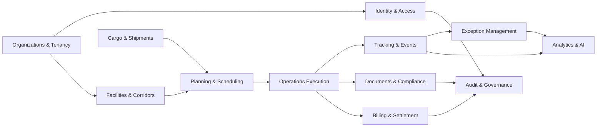

# Phase 1 — Discovery

## Business Objective

Build a modern enterprise SaaS platform for multimodal logistics operations across railways, ports, cargo yards, terminals, warehouses, and transport corridors.

The platform must coordinate operational planning, cargo tracking, berth and train movement visibility, exception management, analytics, automation, and AI-assisted decision support. It is inspired by the enterprise depth of SAP Transportation Management, Oracle Transportation Management, and Siemens Mobility, but must be modular, API-first, observable, secure, and suitable for phased SaaS delivery.

## Primary Domain

Operational logistics orchestration for rail-port-cargo networks.

The core domain is not generic transport management. It is the coordination of cargo, assets, schedules, operational events, exceptions, and cross-organization workflows across infrastructure operators, logistics providers, cargo owners, and regulatory stakeholders.

## Principal Entities

| Entity | Status | Description | Critical Attributes |
| --- | --- | --- | --- |
| Organization | ✅ Implemented | Tenant or business participant using the platform | id, name, slug, status |
| Facility | ⏳ Planned | Port, terminal, yard, station, depot, warehouse, border point | location, capacity, operating calendar, capabilities |
| Corridor | ⏳ Planned | Logical transport route between facilities | mode, transit constraints, service levels, risk profile |
| Cargo | ✅ Implemented | Goods being transported or stored | cargoReference, cargoType, grossWeightKg, packageCount, hazardous, status |
| Shipment | ✅ Implemented (as TrackingShipment) | Commercial or operational movement request | referenceCode, transportMode, originName, destinationName, status |
| Consignment | ⏳ Planned | Trackable portion of shipment | cargo units, documents, custody state |
| Transport Order | ✅ Implemented | Executable movement plan | mode, carrierName, routeSummary, plannedDepartureAt, plannedArrivalAt |
| Rail Movement | ⏳ Planned | Train or wagon movement segment | train number, wagons, path, timetable, actual events |
| Port Call | ⏳ Planned | Vessel visit and port operational window | berth, ETA, ETD, cargo operations |
| Handling Job | ⏳ Planned | Operational task for loading, unloading, inspection, transfer | resource, SLA, status, exceptions |
| Asset | ⏳ Planned | Wagon, locomotive, container, crane, truck, vessel, scanner | identity, ownership, state, telemetry references |
| Operational Event | ✅ Implemented (as TrackingEvent) | Timestamped domain event | eventType, occurredAt, locationName, correlationId, payload |
| Exception | ✅ Implemented (as CargoDeliveryException) | Deviation requiring attention | exceptionType, deliveryConditionStatus, status, evidenceReference |
| Document | ✅ Implemented (as CargoComplianceEvidence) | Customs, bill of lading, manifest, inspection, permit | evidenceType, documentReference, documentUri, issuerName, status |
| Invoice | ✅ Implemented | Commercial charge or settlement record | amount, currency, status, stripeInvoiceId |
| Audit Record | ✅ Implemented (as AuditRecord) | Immutable trace of sensitive action | actorType, action, subjectType, subjectId, before/after |
| Report | ⏳ Planned | Analytical or operational output | scope, filters, generated by, export policy |

## Users

| User Group | Primary Need |
| --- | --- |
| Platform Owner | Govern SaaS operations, tenants, security, billing, and releases |
| Tenant Admin | Manage organization setup, users, roles, facilities, integrations |
| Logistics Planner | Plan shipments, routes, transport orders, schedules, and capacity |
| Operations Controller | Monitor movements, exceptions, facilities, handoffs, and SLAs |
| Port Operator | Manage port calls, berth windows, cargo handling, yard operations |
| Rail Operator | Manage train paths, wagons, rail events, incidents, and ETA changes |
| Cargo Owner | Track cargo, documents, milestones, exceptions, and service quality |
| Finance User | Review charges, billing events, tariffs, and settlement status |
| Compliance User | Validate documents, inspections, audit evidence, and regulatory events |
| Executive Analyst | Consume KPIs, forecasts, trends, and AI recommendations |
| Integration Client | Push and pull machine-to-machine events and operational data |

## Profiles

| Profile | Scope |
| --- | --- |
| Super Admin | Platform-wide emergency and governance access |
| Platform Operator | SaaS operations, tenants, runtime health, incident response |
| Tenant Owner | Organization-level ownership and subscription control |
| Tenant Admin | User, role, facility, and integration administration |
| Operations Manager | Cross-facility operational control and exception ownership |
| Planner | Planning and scheduling activities within authorized facilities |
| Dispatcher | Movement execution and live event updates |
| Viewer | Read-only operational visibility |
| Analyst | Reports, analytics, and exports within data policy |
| Auditor | Audit, compliance, and immutable evidence access |
| Integration Service | Scoped API access via service credentials |

## Permission Families

| Family | Examples |
| --- | --- |
| Tenant Governance | manage organization, manage subscription, manage tenant policy |
| Identity | invite users, assign roles, revoke sessions, manage service accounts |
| Facility | create facility, update facility capacity, view facility operations |
| Cargo | register cargo, update cargo status, view cargo history |
| Shipment | create shipment, approve shipment, cancel shipment, view shipment |
| Movement | plan movement, dispatch movement, update milestone, confirm handoff |
| Exception | raise exception, assign exception, resolve exception, reopen exception |
| Documents | upload document, validate document, reject document, export document |
| Finance | view charges, approve invoice, reconcile settlement |
| Analytics | view dashboard, export report, run forecast, access AI insights |
| Integrations | create API key, rotate secret, subscribe webhook, replay event |
| Audit | view audit trail, export audit evidence, manage retention |

## Critical Flows

1. Tenant onboarding and secure organization setup.
2. User invitation, role assignment, and permission verification.
3. Facility and corridor configuration before operational planning.
4. Shipment intake and cargo registration.
5. Route planning and transport order creation.
6. Rail movement and port call coordination.
7. Live tracking from operational events and external integrations.
8. Exception detection, assignment, escalation, and resolution.
9. Document validation and compliance evidence capture.
10. Analytics and AI-assisted recommendations.
11. Billing event generation and financial reconciliation.
12. Audit review and incident investigation.

## Functional Requirements

| Area | Requirement |
| --- | --- |
| Multi-tenancy | Every operational entity must be scoped by tenant or explicit cross-tenant collaboration contract |
| Identity | Users authenticate through Better Auth sessions and service accounts authenticate through scoped machine credentials |
| Authorization | RBAC grants coarse access and ABAC enforces tenant, facility, corridor, ownership, and data classification constraints |
| Operations | Cargo, shipment, movement, facility, and exception events must be tracked as timeline records |
| Integrations | External systems must publish events through versioned contracts and idempotency keys |
| Analytics | Reports must support operational KPIs, SLA breaches, dwell time, throughput, ETA reliability, and exception trends |
| AI | AI recommendations must be explainable, auditable, and never execute critical operations without approval |
| Audit | Sensitive actions must produce immutable audit records |
| Exports | Data exports must enforce role, tenant, purpose, retention, and classification policies |

## Non-Functional Requirements

| Category | Requirement |
| --- | --- |
| Availability | Target 99.9% for early SaaS, with roadmap to 99.95% for critical operations |
| Latency | Interactive API p95 under 300 ms for cached reads and under 800 ms for normal writes |
| Scalability | Horizontal API scaling, read replicas, partitionable event/audit tables, queue-based integrations |
| Security | Secure cookies, least privilege, encrypted secrets, auditable access, no unauthenticated operational endpoints |
| Compliance | Auditability, retention policies, export controls, incident evidence, data residency roadmap |
| Reliability | Idempotent writes for integrations and replayable operational events |
| Observability | Every critical operation emits correlated logs, traces, metrics, and audit records |
| Maintainability | Modular monorepo with shared contracts, typed APIs, ADRs, and release governance |
| Accessibility | Web UI must meet WCAG 2.2 AA for enterprise workflows |
| Internationalization | Architecture must support multilingual UI, regional units, time zones, and regulatory variants |

## Scalability Expectation

Initial target:

- 50 to 200 tenants.
- 1,000 to 10,000 active users.
- 100,000 to 1,000,000 operational events per day.
- 10,000 to 100,000 tracked cargo or shipment records per tenant per year.

Growth target:

- Partitioned operational event and audit tables.
- Event ingestion separated from synchronous APIs.
- Read replicas for analytics and dashboards.
- Webhook/event replay infrastructure.
- AI workloads separated from transactional operations.

## Domain Map

## Simplified Event Storming

| Trigger | Command | Domain Event | Consumers |
| --- | --- | --- | --- |
| Tenant contract signed | Create organization | OrganizationCreated | Auth, Billing, Audit |
| Admin invites user | Invite user | UserInvited | Auth, Notifications, Audit |
| Facility configured | Activate facility | FacilityActivated | Planning, Analytics, Audit |
| Cargo submitted | Register cargo | CargoRegistered | Shipment, Compliance, Audit |
| Shipment request received | Create shipment | ShipmentCreated | Planning, Documents, Analytics |
| Planner selects route | Confirm transport order | TransportOrderConfirmed | Execution, Billing, Audit |
| Train departs | Record rail departure | RailMovementDeparted | Tracking, Exceptions, Analytics |
| Vessel arrives | Record port arrival | PortCallArrived | Execution, Handling, Analytics |
| Delay detected | Raise exception | OperationalExceptionRaised | Notifications, Analytics, Audit |
| Exception resolved | Resolve exception | OperationalExceptionResolved | Tracking, Analytics, Audit |
| Document validated | Approve document | DocumentApproved | Compliance, Execution, Audit |
| Charge generated | Generate billing event | BillingEventGenerated | Finance, Reports, Audit |
| KPI requested | Generate report | ReportGenerated | Audit, Analytics |

## Bounded Contexts

| Context | Type | Purpose |
| --- | --- | --- |
| Auth | Supporting | Authentication, sessions, users, service accounts |
| Organizations | Core | Tenants, memberships, facilities ownership, partner relationships |
| Cargo | Core | Cargo identity, consignments, custody, document linkage |
| Transport Planning | Core | Shipments, routes, schedules, capacity, transport orders |
| Operations Tracking | Core | Rail movements, port calls, handling jobs, operational events |
| Exceptions | Core | Incident, disruption, SLA breach, escalation and resolution |
| Documents & Compliance | Supporting | Regulatory and operational documents, validation evidence |
| Billing & Settlement | Supporting | Charges, tariffs, invoices, settlement states |
| Notifications | Supporting | Operational alerts, escalations, digest delivery |
| Analytics & AI | Core/Analytical | KPIs, forecasts, recommendations, optimization |
| Audit | Generic/Safety | Immutable audit records for sensitive actions |
| Reports | Analytical | Report definitions, exports, scheduled reporting |

## Business Rules

1. No operational action is valid outside an organization context.
2. No cargo movement is executable without a valid cargo identity, origin, destination, and custody state.
3. No transport order may be confirmed without route, capacity, responsibility, and permission validation.
4. No exception may be closed without resolution reason, responsible actor, timestamp, and audit record.
5. No document may unlock a compliance-gated operation before validation status is approved.
6. No cross-tenant access is allowed without an explicit partner relationship or platform-level support authorization.
7. No AI recommendation may mutate operational state without human approval and an audit trail.
8. No integration event may be applied twice; idempotency is mandatory.
9. No critical event may be accepted without source, correlation id, timestamp, and actor/service identity.
10. No report export may bypass permission, tenant, retention, or data-classification checks.

## User Journeys

### Tenant Onboarding

1. Platform operator creates organization.
2. Tenant owner accepts invitation.
3. Tenant admin configures facilities, users, and roles.
4. Integration service credentials are created.
5. Audit records confirm setup completion.

### Shipment Planning

1. Planner registers shipment and cargo details.
2. System validates origin, destination, cargo constraints, and facility availability.
3. Planner selects corridor and movement plan.
4. Transport order is confirmed.
5. Execution teams receive operational plan.

### Live Operations Control

1. Dispatcher monitors rail, port, and cargo events.
2. Integration events update movement milestones.
3. System detects delay or SLA risk.
4. Exception is raised and assigned.
5. Resolution is captured and audited.

### Executive Analytics

1. Analyst selects tenant, corridor, and period.
2. System validates data access scope.
3. Report calculates dwell time, throughput, delay, SLA, and exception KPIs.
4. AI proposes operational improvements with evidence.
5. Export is logged and governed.

