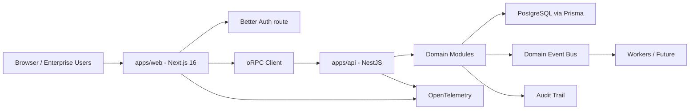

# Phase 2 — Technical Architecture

## Architecture Style

The platform uses a modular monorepo with typed contracts, explicit bounded contexts, shared infrastructure packages, and a split between browser-facing web experience and API/domain services.

The first implementation target is a pragmatic modular architecture, not microservices. Service extraction is deferred until operational load, team topology, and deployment needs justify it.

## Runtime Topology

## Applications

| App | Runtime | Responsibility |
| --- | --- | --- |
| `apps/web` | Next.js 16, React 19 | Browser UI, server components, auth route, TanStack Query client integration |
| `apps/api` | NestJS | oRPC endpoints, domain services, policies, persistence orchestration, integrations |

## Shared Packages

| Package | Responsibility |
| --- | --- |
| `@saptm/ui` | shadcn/ui-based design system primitives and enterprise component composition |
| `@saptm/auth` | Better Auth configuration, session types, auth client/server helpers |
| `@saptm/database` | Prisma schema, generated client wrapper, migrations, seed strategy |
| `@saptm/rpc` | oRPC contracts, clients, shared errors, endpoint metadata |
| `@saptm/types` | Cross-context TypeScript types that are not runtime contracts |
| `@saptm/config` | Environment schema, runtime configuration, feature flags |
| `@saptm/testing` | Test factories, fixtures, contract test helpers |
| `@saptm/tsconfig` | Shared TypeScript presets |

## Backend Module Boundaries

| NestJS Module | Bounded Context |
| --- | --- |
| `AdminModule` | Platform-level administration (user management, system config) |
| `AuditModule` | Immutable audit capture and retrieval |
| `AuthModule` | Auth integration and session guard adapters |
| `BillingModule` | Charge and invoice lifecycle via Stripe |
| `CacheModule` | Redis-backed cache management |
| `CapacityModule` | Resource and slot management (vessels, railcars, trucks) |
| `CargoModule` | Cargo and consignment lifecycle |
| `DocumentsModule` | Document metadata, validation state, retention rules |
| `EventBusModule` | Domain event bus (outbox pattern) |
| `HealthModule` | Health check endpoints (liveness/readiness) |
| `IntegrationsModule` | External system integration (TMS, WMS, GPS, Port, Customs) |
| `NotificationsModule` | Notification commands and delivery integration |
| `ObservabilityModule` | OpenTelemetry tracing, Prometheus metrics, structured logging |
| `OrganizationsModule` | Organizations, memberships, facilities, partner relationships |
| `PlanningModule` | Shipments, corridors, schedules, transport orders |
| `RateLimitModule` | Global rate limiting via @nestjs/throttler |
| `ReportsModule` | Report definitions and governed exports |
| `RpcModule` | oRPC contract mounting and context propagation |
| `SettingsModule` | Organization-level settings and branding configuration |
| `TariffModule` | Pricing and rate management (rate cards, rules, quotes) |
| `TeamsModule` | Team management within organizations |
| `TrackingModule` | Real-time shipment tracking, telematics, GPS, anomalies |
| `WebhooksModule` | Outbound webhook delivery to external systems |

## API Strategy

- oRPC is the primary typed API layer between web and NestJS.
- Contracts live in `@saptm/rpc`.
- Server implementations live in `apps/api`.
- Browser clients consume generated/typed oRPC clients through TanStack Query.
- API versions are contract-level and not hidden inside controller paths.
- All mutations require authorization, idempotency where externally triggered, validation, and audit classification.

## Data Strategy

- PostgreSQL is the system of record.
- Prisma manages schema, migrations, and generated type-safe database access.
- Multi-tenancy is enforced in application policy and database indexes.
- Critical operational events and audit records are append-first.
- Analytics read models are derived from transactional state and events.

## Event Strategy

Initial phase:

- In-process domain events for transactional consistency and audit coupling.
- Persistent outbox table for integration and async delivery readiness.

Growth phase:

- External broker for high-volume integrations and background workflows.
- Replayable event streams for operational tracking and analytics pipelines.

## Auth and Authorization Placement

- Better Auth handles identity, session lifecycle, session cookies, and user/session typing.
- The platform owns RBAC, ABAC, permission matrix, tenant scoping, facility scoping, and operational policy enforcement.
- Next.js exposes the Better Auth browser route.
- NestJS validates user context and applies policy guards before domain operations.
- Cookie-only checks are allowed only for optimistic redirects, never for sensitive API authorization.

## Observability Placement

- Every request receives a correlation id.
- oRPC middleware propagates trace context.
- NestJS interceptors capture domain operation metadata.
- Audit records capture sensitive business facts.
- Metrics capture service health, business throughput, and SLA risk.

## ADRs

- `docs/adr/0001-monorepo-turborepo-pnpm.md`
- `docs/adr/0002-modular-nestjs-before-microservices.md`
- `docs/adr/0003-better-auth-plus-platform-authorization.md`
- `docs/adr/0004-orpc-contract-first-api.md`
- `docs/adr/0005-prisma-postgresql-system-of-record.md`

