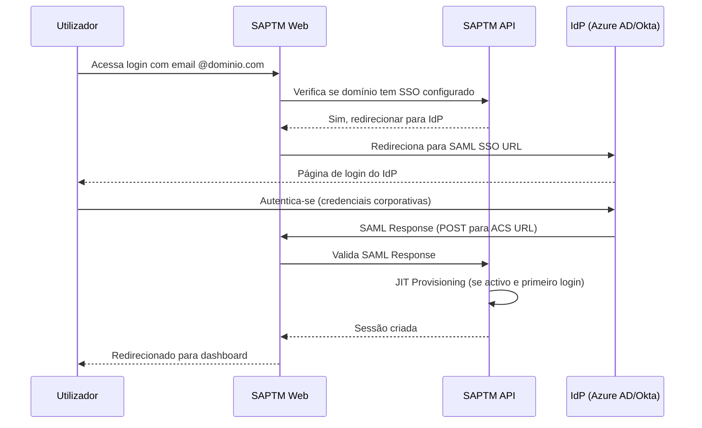

# Guia de Configuração de SSO/SAML

> **Versão:** 1.0.0 | **Última actualização:** 2026-07-03 | **Departamento:** Documentação / Security
> **Idioma:** Português (PT-PT) — guia para administradores de organização

## Visão Geral

O SAPTM suporta Single Sign-On (SSO) via protocolo SAML 2.0 para organizações com plano **Enterprise**. Este guia explica como configurar o SSO para a sua organização.

## Pré-requisitos

- **Plano Enterprise** — O SSO está disponível apenas em planos Enterprise
- **Acesso de administrador** — Necessita permissão `tenant.manage` na organização
- **Identity Provider (IdP)** — Um fornecedor de identidade SAML 2.0 (ex: Azure AD, Okta, Google Workspace, OneLogin)
- **Domínio verificado** — O domínio do email corporativo (ex: `logisticaporto.pt`)

## Fornecedores Suportados

| Fornecedor | Protocolo | Testado |
|------------|-----------|---------|
| Azure AD (Microsoft Entra ID) | SAML 2.0 | ✅ |
| Okta | SAML 2.0 | ✅ |
| Google Workspace | SAML 2.0 | ✅ |
| OneLogin | SAML 2.0 | ✅ |
| Keycloak | SAML 2.0 | ✅ |
| Qualquer IdP SAML 2.0 | SAML 2.0 | ⚠️ (suporte genérico) |

## Configuração Passo a Passo

### 1. Aceder à Página de Autenticação

1. Navegue para **Administração > Autenticação** na sidebar
2. Se não vir esta opção, confirme que a sua organização tem o plano Enterprise

### 2. Configurar o Domínio

1. No campo **Domínio**, insira o domínio do email corporativo (ex: `logisticaporto.pt`)
2. Clique em **Verificar domínio**
3. O sistema irá fornecer um registo DNS TXT para verificação
4. Adicione o registo TXT às configurações de DNS do seu domínio
5. Após a propagação DNS (pode levar até 24 horas), clique em **Verificar**

**Estados de Verificação:**

| Estado | Indicador | Descrição |
|--------|-----------|-----------|
| Por verificar | ⚪ | Domínio ainda não verificado |
| A verificar | 🔄 | Verificação em curso |
| Verificado | ✅ | Domínio verificado com sucesso |
| Falhou | ❌ | Não foi possível verificar o domínio |

### 3. Configurar o Identity Provider (IdP)

#### Opção A: URL de Metadata (Recomendado)

1. No seu IdP, exporte o URL de metadata SAML (ex: `https://idp.example.com/metadata`)
2. No SAPTM, insira esse URL no campo **IdP Metadata URL**
3. O sistema irá preencher automaticamente os campos Entity ID, SSO URL e Certificate

#### Opção B: Upload de Ficheiro XML

1. No seu IdP, exporte o ficheiro XML de metadata SAML
2. No SAPTM, clique em **Escolher ficheiro** e seleccione o XML
3. O sistema irá preencher automaticamente os campos necessários

#### Opção C: Configuração Manual

Se o seu IdP não fornecer metadata, pode configurar manualmente:

| Campo | Descrição | Exemplo |
|-------|-----------|---------|
| **Entity ID** | Identificador da aplicação no IdP | `https://saptm.app/auth/saml/metadata` |
| **ACS URL** | URL de callback SAML | `https://saptm.app/auth/saml/callback` |
| **IdP Entity ID** | Identificador do IdP | `https://idp.example.com/entity-id` |
| **IdP SSO URL** | URL de login SAML | `https://idp.example.com/sso/saml` |
| **IdP Certificate** | Certificado público do IdP (formato PEM) | `-----BEGIN CERTIFICATE-----\n...` |

### 4. Configurar o Provisionamento

**Just-In-Time (JIT) Provisioning:**

Quando activado, utilizadores que façam login via SSO pela primeira vez são automaticamente:

1. Registados como utilizador no SAPTM
2. Adicionados à organização
3. Atribuídos a um cargo padrão (configurável)

| Opção | Descrição |
|-------|-----------|
| **JIT Provisioning** | Criar utilizadores automaticamente no primeiro login via SSO |
| **Cargo padrão JIT** | Cargo atribuído a novos utilizadores (ex: "Operador") |
| **Equipa padrão JIT** | Equipa atribuída a novos utilizadores (opcional) |

### 5. Activar o SSO

1. Após configurar todos os campos, clique em **Guardar configuração**
2. Active o SSO usando o toggle **SSO Activado**
3. Teste o login: num navegador anónimo, tente fazer login com um email do domínio configurado

## Fluxo de Login com SSO



## Configuração por Fornecedor

### Azure AD (Microsoft Entra ID)

1. No Azure Portal, aceda a **Enterprise Applications > Nova Aplicação**
2. Crie uma nova aplicação **SAPTM**
3. Configure **Single Sign-On > SAML**
4. **Identificador (Entity ID):** `https://saptm.app/auth/saml/metadata`
5. **URL de Resposta (ACS):** `https://saptm.app/auth/saml/callback`
6. Descarregue o **XML de Metadata de Federação**
7. No SAPTM, faça upload do XML ou cole o URL de metadata

### Okta

1. No Okta Admin Console, aceda a **Applications > Add Application**
2. Crie uma nova **SAML 2.0 Web Application**
3. **Single sign-on URL:** `https://saptm.app/auth/saml/callback`
4. **Audience URI (SP Entity ID):** `https://saptm.app/auth/saml/metadata`
5. **Name ID format:** `EmailAddress`
6. **Attribute Statements:**
   - `email` → `user.email`
   - `firstName` → `user.firstName`
   - `lastName` → `user.lastName`
7. Copie o **URL do IdP** e o **Certificado** para o SAPTM

### Google Workspace

1. No Google Admin Console, aceda a **Apps > Web and mobile apps**
2. Adicione uma **Custom SAML app**
3. **ACS URL:** `https://saptm.app/auth/saml/callback`
4. **Entity ID:** `https://saptm.app/auth/saml/metadata`
5. **Name ID:** `Basic Information > Primary email`
6. Descarregue o **Certificate** e copie o **SSO URL**

## Gestão de Domínios

### Verificação de Domínio

A verificação de domínio é feita através de um registo DNS TXT:

```
Tipo: TXT
Nome: _saptm-auth.{dominio}   (ex: _saptm-auth.logisticaporto.pt)
Valor: saptm-verification={código}
TTL: 3600 (recomendado)
```

### Múltiplos Domínios

Cada organização pode configurar apenas **um domínio** para SSO. Se precisar de múltiplos domínios, o IdP deve ser configurado para aceitar múltiplos domínios (ex: Azure AD com domínios verificados).

### Alterar Domínio

Para alterar o domínio configurado:

1. Desactive o SSO
2. Remova a verificação do domínio actual
3. Configure o novo domínio
4. Verifique o novo domínio
5. Active o SSO

## Troubleshooting

### O login SSO não aparece para utilizadores do meu domínio

1. Verifique se o SSO está activo na página de Autenticação
2. Confirme que o domínio está verificado (✅)
3. Teste com um email que termine exactamente em `@{dominio}`
4. Verifique se a organização tem plano Enterprise

### Erro "SAML Response inválido"

1. Confirme que o certificado do IdP não expirou
2. Verifique se o Entity ID e ACS URL estão correctos no IdP
3. Reimporte o XML de metadata se o IdP foi reconfigurado

### Utilizador não consegue aceder após login SSO

1. Se JIT Provisioning está activo, verifique o cargo padrão atribuído
2. Se JIT está desactivado, o utilizador precisa ser convidado manualmente
3. Verifique se o email do IdP corresponde a um email válido

### "Domínio já associado a outra organização"

1. Cada domínio pode ser usado por apenas uma organização SAPTM
2. Contacte o suporte se precisar de transferir o domínio

## Limitações

- **Um domínio por organização** — Cada organização pode configurar apenas um domínio SSO
- **Disponível apenas no plano Enterprise**
- **JIT Provisioning** não suporta assign automático de permissões específicas (apenas cargo padrão)
- **Sem suporte OIDC/OAuth** para SSO — apenas SAML 2.0

## Segurança

- **Certificados IdP** — Devem ser renovados antes da expiração para evitar interrupções
- **Domínios não verificados** — Não podem ser usados para SSO
- **Desactivação de SSO** — Desactiva o login via IdP mas mantém a configuração guardada
- **Audit trail** — Todas as alterações de configuração SSO são registadas no audit trail

---

**Departamento de Documentação** — `@enterprise-documentation`
