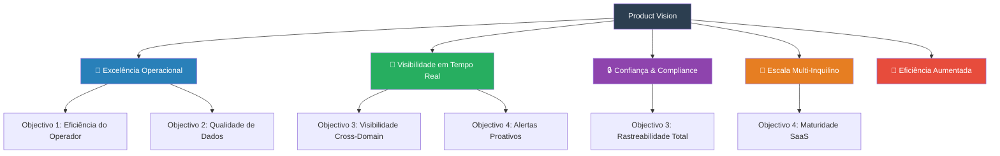
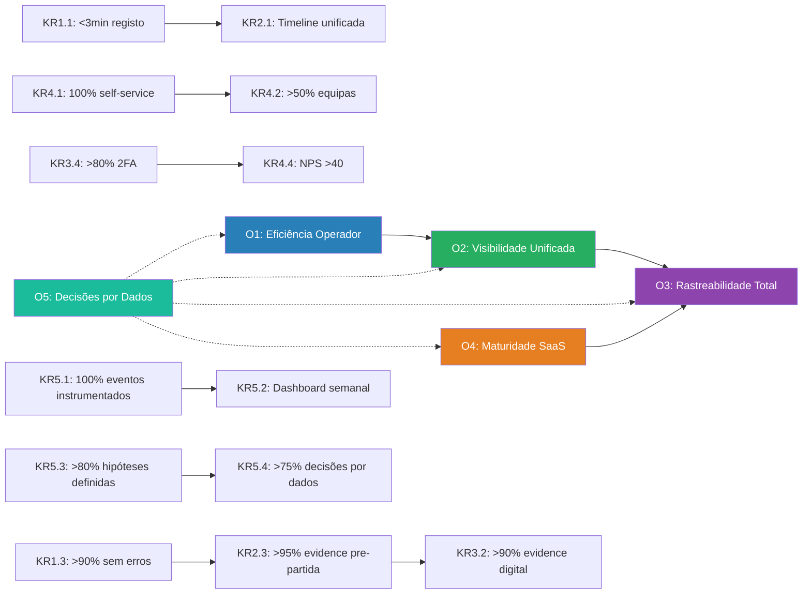
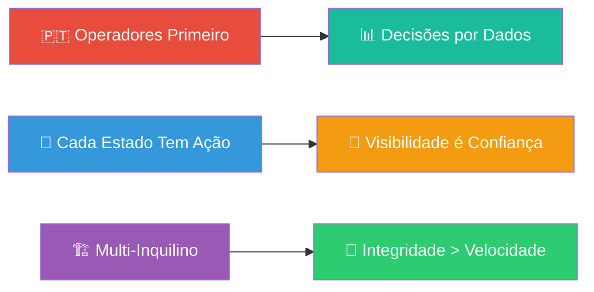

# SAPTM — Product Vision & OKRs

> **Departamento:** Product  
> **Versão:** 1.0.0  
> **Data:** 2026-07-02  
> **Estado:** Aprovado — Documento Fundacional

---

## 1. Product Vision

### Visão

**SAPTM é o sistema operacional que transforma a logística ferroviária e portuária portuguesa numa experiência previsível, transparente e sem atritos.**

Para operadores logísticos que movimentam cargas através de terminais, caminhos-de-ferro e portos, a SAPTM é a plataforma única que unifica o ciclo de vida completo da carga — desde o registo até à entrega — com rastreabilidade em tempo real, gestão de capacidade inteligente, conformidade documental automatizada e controlo de acesso multi-empresa.

Ao contrário de ERPs genéricos que exigem customizações caras, a SAPTM é construída de raiz para a linguagem operacional portuguesa, respeitando os fluxos de trabalho reais de terminais, alfândegas, transitários e operadores ferroviários. Cada funcionalidade é idempotente, auditada e multi-inquilino — porque na logística, confiança e rastreabilidade não são opcionais.

### The Transformation We Enable

```
┌─────────────────────────────────────────────────────────┐
│  ANTES:                                                  │
│  📋 Folhas de Excel · 📠 Chamadas telefónicas           │
│  🔍 "Onde está a carga?" → "Vou ligar ao terminal"     │
│  📄 Processos manuais de compliance                      │
│  💰 Disputas de claims sem evidência digital            │
└─────────────────────────────────────────────────────────┘
                          │
                          ▼
┌─────────────────────────────────────────────────────────┐
│  DEPOIS:                                                 │
│  🖥️ Dashboard unificado · 📡 Tracking em tempo real     │
│  ✅ "Onde está a carga?" → "Checkpoint X, ETA 14:30"   │
│  📑 Compliance evidence digital + verificação automática│
│  🔗 Claim settlement com audit trail completo           │
└─────────────────────────────────────────────────────────┘
```

---

## 2. Target Audience / Personas

A SAPTM serve quatro perfis distintos dentro do ecossistema logístico português:

### Persona 1: Carlos — Operador Logístico

| Atributo | Descrição |
|----------|-----------|
| **Idade** | 36 anos |
| **Experiência** | 12 anos em logística portuária e ferroviária |
| **Literacia técnica** | Moderada — usa sistemas operacionais diariamente |
| **Contexto** | Turnos de 12h, gere 20-50 movimentos por turno |
| **Objetivo principal** | Registar, movimentar e entregar cargas com rapidez e precisão |
| **Maior frustração** | Repetição de dados, documentos de compliance manuais, pressão temporal |
| **Permissões-chave** | `cargo.*`, `tracking.event.record`, `tracking.shipment.read` |

### Persona 2: Maria — Gestora de Operações

| Atributo | Descrição |
|----------|-----------|
| **Idade** | 42 anos |
| **Experiência** | 18 anos em supply chain e gestão |
| **Literacia técnica** | Alta — experiência com ERPs |
| **Contexto** | Gere 8-15 operadores em dois turnos |
| **Objetivo principal** | Otimizar capacidade, gerir tarifas, resolver excepções |
| **Maior frustração**| Falta de visão consolidada da equipa, priorização manual de advisory |
| **Permissões-chave** | `capacity.*`, `tariff.*`, `planning.*`, `cargo.delivery.exception.resolve` |

### Persona 3: João — Administrador

| Atributo | Descrição |
|----------|-----------|
| **Idade** | 45 anos |
| **Experiência** | 20 anos em IT, 5 em tecnologia logística |
| **Literacia técnica** | Especialista — infraestrutura e segurança |
| **Contexto** | Administra plataforma para 50-200 utilizadores |
| **Objetivo principal** | Segurança, compliance, onboarding eficiente |
| **Maior frustração**| 64+ permissões granulares sem histórico de alterações |
| **Permissões-chave** | `tenant.manage`, `identity.*`, `audit.*`, `integration.*` |

### Persona 4: Ana — Engenheira de Integração

| Atributo | Descrição |
|----------|-----------|
| **Idade** | 31 anos |
| **Experiência** | 8 anos em engenharia, 3 em integração logística |
| **Literacia técnica** | Especialista — API-first |
| **Contexto** | Integra TMS, WMS, GPS, alfândega com SAPTM |
| **Objetivo principal** | Conectar sistemas externos com idempotência e fiabilidade |
| **Maior frustração**| Sem sandbox de integração, erros sem detalhes estruturados |
| **Sistemas-alvo** | Port TOS, Rail TMS, Carrier TMS, Telematics GPS, Customs ERP, Warehouse WMS |

```
                    ┌──────────────────────┐
                    │   ADMINISTRADOR      │
                    │   (João)             │
                    │   Tenant + RBAC      │
                    └──────────┬───────────┘
                               │
        ┌──────────────────────┼──────────────────────┐
        │                      │                      │
        ▼                      ▼                      ▼
┌───────────────┐    ┌──────────────────┐    ┌──────────────────┐
│  OPERADOR     │    │  GESTORA         │    │  INTEGRADORA     │
│  (Carlos)     │    │  (Maria)         │    │  (Ana)           │
│  Cargas       │    │  Capacidade      │    │  APIs            │
│  Tracking     │    │  Tarifas         │    │  Webhooks        │
│  Excepções    │    │  Planeamento     │    │  Eventos         │
└───────────────┘    └──────────────────┘    └──────────────────┘
```

---

## 3. Value Proposition

### Porquê SAPTM em vez de um ERP genérico?

| Dimensão | ERP Genérico | SAPTM |
|----------|-------------|-------|
| **Linguagem** | Termos genéricos (order, shipment) | Português operacional português (carga, descarga, trânsito, handoff) |
| **Fluxos** | Configuração pesada | Fluxos de trabalho pré-definidos para rail/port/logística |
| **Compliance** | Módulo separado | Compliance embebido no ciclo de vida da carga (evidence → verify → release) |
| **Excepções** | Workflow genérico | Excepções com resolução, claims, settlements — integrado |
| **Capacidade** | Não nativo | Slots, reservas, advisory optimizer com decisão humana |
| **Multi-inquilino** | Add-on caro | Nativo desde o primeiro dia (tenant scoping por Prisma extension) |
| **Idempotência** | Inexistente | Todas as mutações são idempotentes — segurança em redes instáveis |
| **Audit trail** | Log básico | Audit trail imutável com before/after payloads em todas as operações críticas |
| **Integrações** | Middleware caro | 6 adapters built-in (TOS, TMS, GPS, WMS, Customs) |
| **Preço** | Licenciamento enterprise caro | SaaS por subscrição (free/pro/enterprise) |

### Em duas frases

> **Para operadores logísticos que precisam de mover cargas com confiança através de portos e caminhos-de-ferro portugueses, a SAPTM é a plataforma que unifica o ciclo de vida completo da carga com rastreabilidade, conformidade e gestão de capacidade — tudo na língua operacional do dia-a-dia.**
>
> **Ao contrário de ERPs tradicionais, a SAPTM nasce multi-inquilino, idempotente e auditada, eliminando a lacuna entre o registo da carga e a entrega final.**


---

## 4. Strategic Themes

Cinco temas estratégicos que guiam a evolução do produto:

### Theme 1: 🚂 Excelência Operacional

A plataforma deve tornar o trabalho do operador mais rápido, mais preciso e menos frustrante. Cada clique deve ter propósito. Cada estado deve ter uma ação seguinte clara.

**Direções:**
- Reduzir o tempo de registo de carga em 60% com preenchimento inteligente
- Eliminar a duplicação de dados entre cargas e tracking
- Fornecer um "My Queue" unificado com as pendências do operador

### Theme 2: 📡 Visibilidade em Tempo Real

Onde está a carga? Quando chega? Está atrasada? A resposta deve estar a um clique de distância, não numa chamada telefónica.

**Direções:**
- Timeline unificada (carga + tracking) em cada página de detalhe
- Notificações push para eventos críticos (excepções, atrasos SLA)
- Analytics com tendências temporais (7 dias, 30 dias)

### Theme 3: 🔒 Confiança & Compliance

Cada movimento de carga é um ato registado. Cada documento é verificado. Cada transição de estado é imutável.

**Direções:**
- Compliance evidence como cidadão de primeira classe (página dedicada, dashboard)
- SLA timers para resolução de excepções
- Portal de auditoria com exportação e alertas configuráveis

### Theme 4: 🏢 Escala Multi-Inquilino

A plataforma serve desde pequenos transitários até grandes operadores portuários — cada um com as suas equipas, permissões e integrações.

**Direções:**
- Equipas com scoping de permissões (team-based access control)
- Self-service de organização (signup, branding, settings)
- SSO/SAML para empresas
- Gestão de billing por subscrição

### Theme 5: 🤖 Eficiência Aumentada

A plataforma não apenas regista — ela aconselha. Advisory de capacidade, sugestões de rota, alertas de SLA, predição de atrasos.

**Direções:**
- Capacity Optimizer Advisory com recomendação por confiança
- Tracking Advisory com alertas de SLA risk
- Predição de atrasos baseada em padrões históricos



---

## 5. Objectives & Key Results

### OKR Framework

- **Trimestre:** Q3 2026 (Julho — Setembro)
- **Formato:** Objective (aspiracional) + 3 Key Results (mensuráveis)
- **Alinhamento:** Cada OKR mapeia para 1-2 Strategic Themes

---

### Objective 1: Tornar o operador logístico 2x mais rápido no registo e movimentação de cargas

**Alinhamento:** 🚂 Excelência Operacional

| Key Result | Baseline | Target | Métrica |
|-----------|----------|--------|---------|
| KR 1.1: Tempo médio de registo de carga | ~8 min (estimado) | <3 min | Tempo decorrido entre abertura do formulário e submissão bem-sucedida |
| KR 1.2: % de cargas com dados repetidos preenchidos automaticamente | 0% | 50% | % de registos que usam "shipper templates" ou autocomplete |
| KR 1.3: % de operadores que completam o fluxo registo→libertação sem erros de validação | ~60% (estimado) | >90% | % de fluxos sem erros de validação (Zod) em formulários consecutivos |
| KR 1.4: Tempo médio de resolução de excepção (abertura → resolução) | ~48h (estimado) | <24h | Medido desde `exception.recorded` até `exception.resolved` |

**Iniciativas:**
- Implementar "shipper templates" para preenchimento automático de campos frequentes
- Adicionar auto-complete de códigos alfandegários e UN numbers
- Criar "My Queue" com pendências do operador
- Simplificar formulário de registo com campos condicionais por tipo de carga
- Adicionar SLA timer visual na página de excepções

---

### Objective 2: Unificar a visibilidade da carga do registo à entrega numa única timeline

**Alinhamento:** 📡 Visibilidade em Tempo Real · 🔒 Confiança & Compliance

| Key Result | Baseline | Target | Métrica |
|-----------|----------|--------|---------|
| KR 2.1: % de páginas de detalhe com timeline unificada (carga + tracking) | 0% (separadas) | 100% | Cobertura de páginas de detalhe com timeline combinada |
| KR 2.2: % de eventos de tracking automaticamente ligados à carga correspondente | ~70% (estimado) | >95% | Eventos com `cargoId` preenchido / total de eventos |
| KR 2.3: % de cargas com compliance evidence aprovado antes da partida | ~60% (estimado) | >95% | Cargas que partiram com evidence aprovado / total de partidas |
| KR 2.4: Tempo entre ocorrência de evento e disponibilidade na timeline | ~5 min (estimado) | <30s | Latência de ponta-a-ponta: evento → outbox → notificação → UI |

**Iniciativas:**
- Embed da tracking timeline na página de detalhe da carga
- Notificações push para eventos críticos via outbox → notificação
- Página dedicada de Compliance com dashboard de documentos pendentes e expirados
- Stream de eventos com WebSocket ou Server-Sent Events

---

### Objective 3: Garantir rastreabilidade total com audit trail e compliance digital

**Alinhamento:** 🔒 Confiança & Compliance · 🏢 Escala Multi-Inquilino

| Key Result | Baseline | Target | Métrica |
|-----------|----------|--------|---------|
| KR 3.1: % de operações críticas com audit trail completo | ~85% | 100% | Operações com `audit.action` + `audit.subjectType` + `audit.subjectId` preenchidos |
| KR 3.2: % de excepções resolvidas com digital evidence associada | ~40% (estimado) | >90% | Excepções com `evidenceReference` preenchido / total de excepções resolvidas |
| KR 3.3: Tempo de pesquisa no audit trail para compliance | ~3 min (estimado) | <15s | Tempo para encontrar um registo de auditoria específico com filtros |
| KR 3.4: % de utilizadores com 2FA ativa | ~25% (estimado) | >80% | Utilizadores com 2FA configurada / total de utilizadores ativos |

**Iniciativas:**
- Página de Compliance dedicada com visão consolidada de documentos
- Exportar relatório de auditoria SOC2-ready com um clique
- Alertas de compliance expirado (evidências, certificados)
- Campanha de ativação de 2FA com onboarding obrigatório para roles admin

---

### Objective 4: Elevar a maturidade SaaS para servir 10+ organizações em produção

**Alinhamento:** 🏢 Escala Multi-Inquilino · 🤖 Eficiência Aumentada

| Key Result | Baseline | Target | Métrica |
|-----------|----------|--------|---------|
| KR 4.1: % de organizações onboarded via self-service | 0% (seed manual) | 100% | Organizações criadas via UI de signup / total de organizações |
| KR 4.2: Organizações com equipas configuradas (team-based access control) | 0% | >50% | Organizações ativas com ≥2 equipas |
| KR 4.3: % de recomendações de advisory com decisão humana registada | 0% | >80% | Recomendações com `advisory.decision.recorded` / total publicadas |
| KR 4.4: NPS do produto (survey trimestral) | — (baseline) | >40 | NPS medido via PostHog survey |

**Iniciativas:**
- Fluxo de signup com criação de organização
- Configuração de SSO/SAML para organizações enterprise
- Gestão de equipas com scoping de permissões
- Billing por subscrição com planos free/pro/enterprise
- Dashboard de advisory analytics com KPIs de decisão
- Primeira pesquisa NPS integrada no produto

---

### Objective 5: Tomar decisões de produto baseadas em dados, não em palpites

**Alinhamento:** 📊 Decisões Baseadas em Dados (Princípio #6)

| Key Result | Baseline | Target | Métrica |
|-----------|----------|--------|---------|
| KR 5.1: % de eventos PostHog instrumentados na taxonomia | ~58% (22/38) | 100% | Eventos com `capture()` implementado / total de eventos definidos |
| KR 5.2: Dashboard de produto com métricas de OKR visível semanalmente | 0% | 100% | Dashboard PostHog com todos os KRs monitorizados |
| KR 5.3: % de features lançadas com hipótese mensurável definida a priori | ~0% (estimado) | >80% | Features com hipótese documentada antes do desenvolvimento |
| KR 5.4: % de decisões de produto baseadas em dados (não opinião) | ~30% (estimado) | >75% | Decisões documentadas com referência a dados ou testes |

**Iniciativas:**
- Completar instrumentação dos 16 eventos PostHog em falta
- Criar dashboard PostHog com KRs dos OKRs Q3
- Template de "hipótese de produto" para cada nova feature (antes do desenvolvimento)
- Feature flags para rollout progressivo (Unleash ou LaunchDarkly)
- Revisão semanal de métricas com a equipa de produto

---

### OKR Dependency Map



---

## 6. Product Principles

Seis princípios que guiam cada decisão de produto:

### 1. 🇵🇹 Operadores Primeiro

Toda a UI deve usar a linguagem operacional do sector logístico português. Nunca expor `permission names`, `RPC endpoints`, `IDs técnicos` ou termos como "CRUD", "governado" ou "RBAC" na interface.

> *"Registo autorizado" em vez de "cargo.register permission granted"*
> *"Cargas em trânsito" em vez de "status: in_transport"*

### 2. 🎯 Cada Estado Tem Uma Próxima Ação

Nunca deixar o utilizador num beco sem saída. Cada página, cada estado, cada tabela vazia deve ter um call-to-action visível.

> *"Não há cargas registadas — registe a sua primeira carga" com botão primário*
> *"Carga bloqueada por alfândega — registe evidência de compliance para libertar"*

### 3. 🔗 Integridade dos Dados > Velocidade

Todas as mutações são idempotentes. Cada operação crítica gera audit trail. Cada transição de estado é imutável. Preferimos bloquear uma operação inválida a permitir dados inconsistentes.

> *"Departure requires: cargo ready, shipment planned, approved compliance evidence, no open compliance review"*

### 4. 📡 Visibilidade é Confiança

Mostrar sempre a fonte, o timestamp e o responsável por cada dado. Um operador confia mais num sistema que mostra "evento registado por rail_tms há 2 minutos" do que num que apenas mostra o estado atual.

> *Timeline entries com: sourceSystem, timestamp, operatorName, locationName*

### 5. 🏗️ Multi-Inquilino desde o Primeiro Dia

Toda a funcionalidade é desenhada para servir múltiplas organizações de forma isolada e segura. Não existem "single-tenant features" — cada página, cada query, cada mutation respeita o tenant context.

> *Prisma Client Extension injeta `organizationId` automaticamente*
> *Nenhuma query pode cruzar dados de diferentes organizações*

### 6. 📊 Decisões Baseadas em Dados, Não Opiniões

Cada funcionalidade é lançada com uma hipótese mensurável. Usamos feature flags para rollout progressivo. Medimos o impacto pós-lançamento antes de iterar.

> *"Hipotese: shipper templates reduzem tempo de registo em 60%" → feature flag → medir → decidir*



---

## 7. North Star Metric

### 🚚 Cargas Entregues com Evidência Digital Completa

**Definição:** Número de cargas que atingem o estado `delivered` com:
- Timeline de eventos completa (registered → released → planned → departed → arrived → delivered)
- Todos os compliance evidence obrigatórios aprovados antes da partida
- Nenhuma excepção em aberto no momento da entrega
- Audit trail completo para cada transição de estado

**Porquê esta métrica?**

Porque captura o valor central da SAPTM: **mover cargas do ponto A ao ponto B com confiança, rastreabilidade e sem surpresas.** Uma carga entregue com evidência digital completa significa que:

1. O operador usou a plataforma para todo o ciclo de vida ✅
2. A conformidade documental foi respeitada ✅
3. A cadeia de custódia está registada ✅
4. Não há litígios pendentes ✅
5. O cliente final recebeu a carga com condição sound ✅

**Métrica composta:**

```
North Star = Cargas com status = "delivered"
           AND compliance_evidence_approved = true (before departure)
           AND exception_status != "open"
           AND audit_records_complete = true (all lifecycle transitions)
```

**Target Q3 2026:** >80% das cargas registadas atingem o estado North Star dentro do prazo estimado.

**Dimensionalização possível:**
- Por organização (tenant)
- Por tipo de carga (container, bulk, hazardous)
- Por modo de transporte (rail, port, road, multimodal)
- Por operador (quem entrega mais cargas completas?)

---

## 8. Product Dashboard (KPIs)

Para monitorizar o progresso dos OKRs e da North Star:

| Métrica | Fonte | Frequência | Responsável |
|---------|-------|------------|-------------|
| Cargas entregues com evidência completa (North Star) | PostHog + DB | Semanal | Product |
| Tempo médio de registo de carga | PostHog (`cargo:created`) | Semanal | Product |
| Tempo médio de resolução de excepção | DB (exception.recorded → resolved) | Semanal | Operations |
| % compliance evidence aprovado pre-partida | DB | Diário | Compliance |
| Latência evento→timeline | OpenTelemetry | Diário | Engineering |
| NPS do produto | PostHog survey | Trimestral | Product |
| % utilizadores com 2FA ativa | DB | Mensal | Security |
| % organizações com equipas configuradas | DB | Mensal | Product |
| % recomendações advisory com decisão | DB | Semanal | Operations |
| % eventos PostHog instrumentados | Código + PostHog | Quinzenal | Product |
| % features com hipótese definida a priori | ADR + docs | Por feature | Product |
| Receita mensal recorrente (MRR) | Stripe | Mensal | Finance |

---

## 9. Roadmap — Now / Next / Later

> **Nota:** O roadmap foi atualizado para refletir o progresso dos sprints de hardening (Sprints 1-6 + Phase 1-2) e as novas prioridades de produto. Vários itens do roadmap original foram entretanto concluídos (error boundaries, loading states, paginação, API versioning, repositórios, event bus, testes unitários, validação Zod, entre outros).

### Now — Sprint A (Q3 2026, Dias 1-14)

| Iniciativa | OKR | Tema | RICE |
|-----------|-----|------|------|
| Completar instrumentação dos 16 eventos PostHog em falta | O5 | 📊 Decisões por Dados | 13.50 |
| Componente Breadcrumb + implementação em 8 rotas profundas | O2 | 📡 Visibilidade | 18.00 |
| Página de Perfil do Utilizador (nome, email, foto, password) | O4 | 🏢 Escala | 5.33 |
| Adoção total de spacing tokens (zero hardcoded values) | — | 🎨 Design System | 4.50 |
| Fluxo de signup + criação de organização | O4 | 🏢 Escala | 3.20 |
| Checkout Stripe básico + plano Pro | O4 | 🏢 Escala | 2.40 |

### Next — Sprint B (Q3 2026, Dias 15-28)

| Iniciativa | OKR | Tema | RICE |
|-----------|-----|------|------|
| SSO/OAuth (Google, Microsoft, SAML) | O4 | 🏢 Escala | 2.40 |
| Gestão de Equipas com scoping de permissões | O4 | 🏢 Escala | 3.00 |
| TanStack Query para caching client-side | O2 | 📡 Visibilidade | 3.50 |
| Página de Configuração de Organização (branding) | O4 | 🏢 Escala | 3.20 |
| Webhook delivery real (worker + retry + dead-letter) | O3, O4 | 🔒 Confiança | 2.40 |
| Dark mode toggle no shell | — | 🎨 Design System | 8.40 |

### Later (Q4 2026)

| Iniciativa | OKR | Tema |
|-----------|-----|------|
| SLA timers visuais nas excepções | O1, O3 | 🚂 + 🔒 |
| Dashboard de produto (PostHog + KPIs de OKR) | O5 | 📊 Decisões |
| Feature flag system (Unleash ou LaunchDarkly) | O4 | 🏢 Escala |
| Notificações push para eventos críticos (SSE/WS) | O2 | 📡 Visibilidade |
| Pesquisa NPS integrada (PostHog survey) | O4 | 🏢 Escala |
| Billing com usage metering (Stripe) | O4 | 🏢 Escala |
| Exportar relatório de auditoria SOC2-ready | O3 | 🔒 Confiança |

### Backlog (Q1 2027+)

| Iniciativa | Tema |
|-----------|------|
| Shipper templates + autocomplete no registo | 🚂 Excelência Operacional |
| "My Queue" — pendências do operador | 🚂 Excelência Operacional |
| Embed da tracking timeline na página de carga | 📡 Visibilidade |
| Capacity Optimizer Advisory — recomendação preditiva | 🤖 Eficiência |
| Predição de atrasos baseada em ML | 🤖 Eficiência |
| Mapa interativo de cargas em trânsito | 📡 Visibilidade |
| Portal do cliente (consignee) | 🏢 Escala |
| App mobile para operadores de pátio | 🚂 Excelência |
| Relatórios visuais (gráficos, dashboards) | 📡 Visibilidade |

---

## 10. Anexos

### Referências

- [Personas](./personas.md) — Definição detalhada das 4 personas
- [User Flows](./user-flows.md) — Fluxos de onboarding, carga, excepções, capacidade, admin
- [Journey Maps](./journey-maps.md) — Mapeamento de jornadas por persona
- [Interaction Patterns](./interaction-patterns.md) — Padrões de UI/UX (tabelas, formulários, timelines)
- [Design Principles](./design-principles.md) — Princípios de design operacional
- [Analytics Events](./analytics-events.md) — Taxonomia de eventos PostHog
- [Domain Map](../architecture/domain-map.md) — Mapa de bounded contexts e agregados
- [Product Audit](../../audit/PRODUCT-AUDIT.md) — Auditoria de completude MVP
- [Enterprise Scorecard](../../audit/ENTERPRISE-SCORECARD.md) — Scorecard enterprise com gaps
- [Gap Analysis](../../audit/GAP-ANALYSIS.md) — Análise de gaps P0-P3

### ADRs Relevantes

- [ADR-001: Monorepo com Turborepo + pnpm](../adr/0001-monorepo-turborepo-pnpm.md)
- [ADR-002: NestJS modular antes de microserviços](../adr/0002-modular-nestjs-before-microservices.md)
- [ADR-003: Better Auth + autorização de plataforma](../adr/0003-better-auth-plus-platform-authorization.md)
- [ADR-004: oRPC contract-first API](../adr/0004-orpc-contract-first-api.md)
- [ADR-005: Prisma + PostgreSQL como sistema de registo](../adr/0005-prisma-postgresql-system-of-record.md)

---

> **Documento mantido pelo Departamento de Produto (@enterprise-product)**  
> *Última revisão: 2026-07-02*  
> *Próxima revisão: 2026-10-02 (início Q4)*
