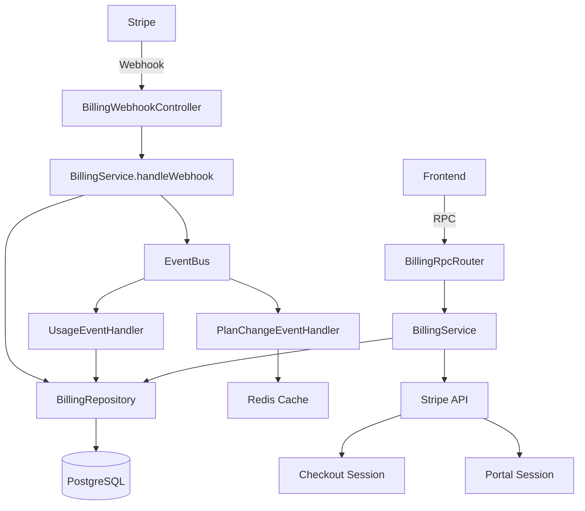
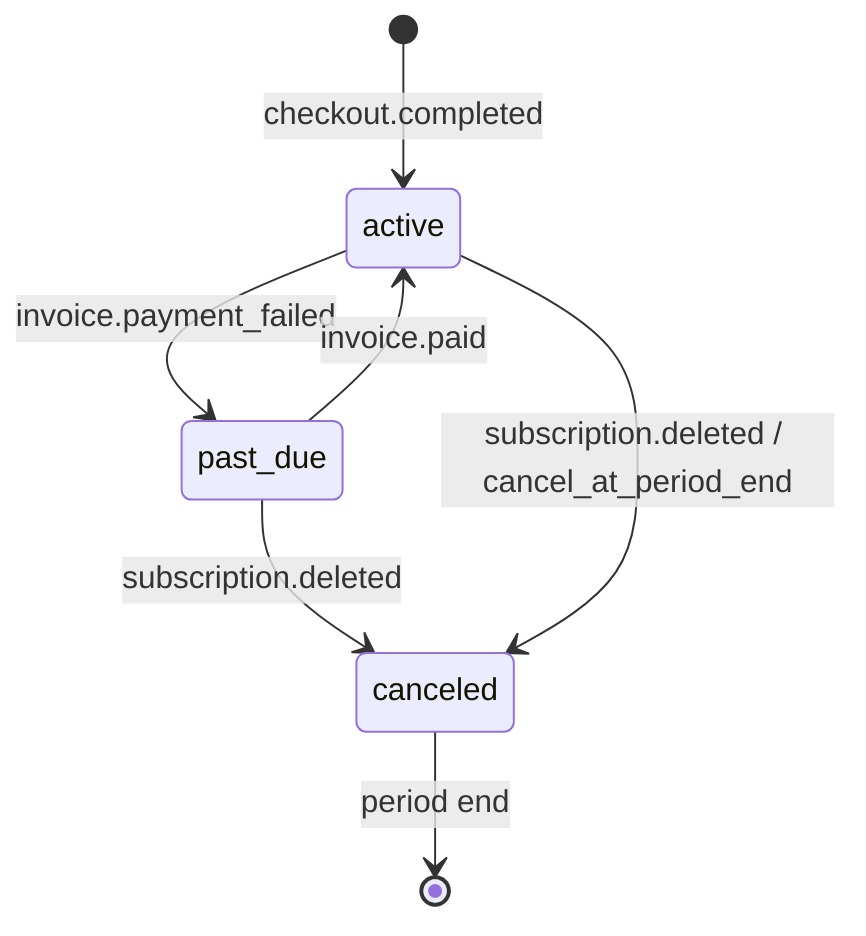

# Billing Runbook

> **Versão:** 1.0.0 | **Última actualização:** 2026-07-03 | **Departamento:** Documentação / Backend

## Visão Geral

O módulo de facturação do SAPTM gere subscrições, planos, métricas de uso e facturas através da integração com **Stripe**. O Stripe é a source of truth para estados de subscrição; a base de dados local é um read model projectado a partir de webhooks.

## Arquitectura



## Fluxo End-to-End

### 1. Subscrição (Checkout)

```
User → "Fazer upgrade" → BillingService.createCheckoutSession()
  → Stripe Checkout Session (redirect)
  → User paga no Stripe
  → Stripe envia webhook checkout.session.completed
  → BillingService.handleWebhook() processa
  → upsertSubscription() actualiza BD local
  → EventBus emite billing.subscription.created
  → PlanChangeEventHandler invalida cache de planos
  → UI refetch via RPC billing.subscription → mostra novo plano
```

### 2. Ciclo de Vida da Subscrição



### 3. Métricas de Uso

```
Cargo.registered → EventBus → UsageEventHandler
  → UsageService.trackUsage(orgId, "cargo_shipments", 1)

Tracking.event.recorded → EventBus → UsageEventHandler
  → UsageService.trackUsage(orgId, "tracking_events", 1)
```

## Webhooks Stripe

### Eventos Processados

| Evento Stripe | Acção |
|---------------|-------|
| `checkout.session.completed` | Criar/actualizar subscrição, associar `stripeCustomerId` e `stripeSubscriptionId` |
| `customer.subscription.updated` | Actualizar plano, status, períodos. Emitir evento de actualização |
| `customer.subscription.deleted` | Mudar para plano `free`, status `canceled`. Emitir evento de deleção |
| `invoice.paid` | Criar registo de factura paga |
| `invoice.payment_failed` | Mudar status para `past_due`, criar factura `open` |

### Verificação de Assinatura

A função `BillingService.handleWebhook()` usa `stripe.webhooks.constructEvent()` para verificar a assinatura Stripe usando `STRIPE_WEBHOOK_SECRET`. Se a assinatura for inválida, retorna erro `500` com código `assinatura.webhook_invalida`.

### Idempotência

Os webhooks Stripe incluem cabeçalho `Idempotency-Key`. O Stripe garante entrega pelo menos uma vez; o handler actual faz **upsert** (não insert) nas operações de subscrição, o que garante idempotência para eventos duplicados.

**⚠️ Nota:** Facturas não têm protecção explícita contra duplicados. O campo `stripeInvoiceId` não tem unique constraint. Risco baixo porque o Stripe envia `invoice.paid` uma vez por factura.

## Planos

### Plano Free
- Preço: 0€/mês
- Limites: 50 cargas, 1.000 tracking events, 5 membros
- Features: Tracking básico

### Plano Pro
- Preço: 29€/mês (configurável via `STRIPE_PRICE_PRO`)
- Limites: 500 cargas, 50.000 tracking events, 25 membros
- Features: SSO, Audit Log, API Access

### Plano Enterprise
- Preço: Sob consulta
- Limites: Ilimitados
- Features: SSO/SAML, Custom Roles, Suporte dedicado

### Mapeamento Stripe Price → Plano

A função `resolvePlanFromPrice(priceId)` mapeia `priceId` do Stripe para o slug do plano usando variáveis de ambiente:

| Env Var | Plan Slug |
|---------|-----------|
| `STRIPE_PRICE_FREE` | `free` |
| `STRIPE_PRICE_PRO` | `pro` |
| `STRIPE_PRICE_ENTERPRISE` | `enterprise` |

**Segurança:** Price IDs desconhecidos fazem default para `free` (nunca escalam para `pro`/`enterprise`).

## Gestão de Subscrição (Portal Stripe)

O `BillingService.createPortalSession()` redirecciona o utilizador para o Stripe Customer Portal, onde pode:

- Ver/alterar método de pagamento
- Ver facturas
- Cancelar subscrição
- Reativar subscrição cancelada
- Actualizar dados de facturação

URL de retorno: `{NEXT_PUBLIC_APP_URL}/app/configuracoes/assinatura`

## Cache de Planos (PlanCacheService)

Implementado pelo Departamento de Performance (Stage 8).

| Parâmetro | Valor |
|-----------|-------|
| TTL | 60 segundos |
| Chave | `saptm:plan:{slug}` |
| Estratégia | Stale-while-revalidate (sem refresh background) |
| Fallback | In-memory Map se Redis indisponível |
| Invalidação | Automática via eventos `billing.subscription.*` |

## Variáveis de Ambiente

| Variável | Obrigatória | Descrição |
|----------|-------------|-----------|
| `STRIPE_SECRET_KEY` | ✅ | Chave secreta da API Stripe |
| `STRIPE_WEBHOOK_SECRET` | ✅ | Segredo para verificar webhooks Stripe |
| `STRIPE_PRICE_FREE` | Recomendada | Price ID do plano Free no Stripe |
| `STRIPE_PRICE_PRO` | Recomendada | Price ID do plano Pro no Stripe |
| `STRIPE_PRICE_ENTERPRISE` | Recomendada | Price ID do plano Enterprise no Stripe |

## Troubleshooting

### Webhook não está a ser processado

1. Verificar se `STRIPE_WEBHOOK_SECRET` está configurado
2. Verificar logs do API: `grep "billing" apps/api/logs/`
3. Verificar no Dashboard Stripe se o webhook está a ser entregue
4. Confirmar que o endpoint `POST /billing/webhook` está acessível (não atrás de auth)

### Subscrição não actualizada após pagamento

1. Verificar se o webhook `checkout.session.completed` foi recebido
2. Verificar se `organizationId` está no metadata do session/checkout
3. Verificar se o `priceId` corresponde a uma variável `STRIPE_PRICE_*`

### Utilizador não consegue aceder ao Portal Stripe

1. Verificar se `stripeCustomerId` existe na subscrição
2. Verificar se `NEXT_PUBLIC_APP_URL` está correcto
3. Tentar criar nova sessão de portal: `pnpm billing:debug-portal`

### Limites de uso não actualizados

1. Verificar se `UsageEventHandler` está registado no módulo
2. Verificar se os eventos `cargo.registered` e `tracking.event.recorded` estão a ser publicados
3. Verificar logs: `grep "UsageEventHandler" apps/api/logs/`

## Comandos Úteis

```bash
# Verificar subscrição de uma organização
pnpm billing:check --org-id <orgId>

# Forçar sincronização com Stripe
pnpm billing:sync --org-id <orgId>

# Reset de métricas de uso (fora do período normal)
pnpm billing:reset-usage --org-id <orgId>

# Debug de price IDs
pnpm billing:debug-prices
```

## Alertas

| Alerta | Condição | Acção |
|--------|----------|-------|
| `BillingWebhookFailure` | Webhook devolve erro 5xx | Verificar logs, testar webhook no Stripe Dashboard |
| `BillingSubscriptionExpired` | Subscrição cancelada há >30 dias | Contactar organização, arquivar se necessário |
| `BillingUsageExceeded` | Uso > 90% do limite | Notificar organização, sugerir upgrade |
| `BillingPaymentFailed` | `invoice.payment_failed` recebido | Notificar organização, actualizar método de pagamento |

---

**Departamento de Documentação** — `@enterprise-documentation`
