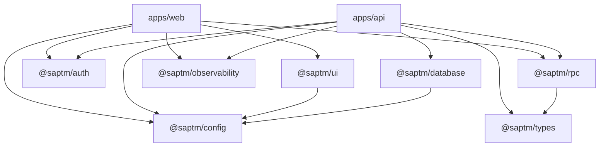

# Phase 3 — Monorepo and Workspace Strategy

## Workspace Goals

- Keep product apps, shared contracts, design system, database, auth, and testing utilities in one governed workspace.
- Make dependency boundaries explicit.
- Prevent feature teams from bypassing auth, contracts, observability, or design-system rules.
- Support incremental implementation: one module, one feature, one task per execution.

## Root Structure

```text
apps/
  web/
  api/
packages/
  ui/
  auth/
  database/
  rpc/
  types/
  config/
  observability/
  testing/
  tsconfig/
docs/
  adr/
  architecture/
  business-rules/
  database/
  design-system/
  devops/
  enterprise/
  governance/
  observability/
  roadmaps/
  rpc/
  security/
  testing/
  workspace/
.ai/
  agents/
  rules/
  skills/
  prompts/
  memory/
  reports/
.github/
  workflows/
```

## Application Responsibilities

| Workspace | Responsibility | Forbidden |
| --- | --- | --- |
| `apps/web` | Next.js web shell, auth route, UI composition, data fetching client | Business rules, direct database access |
| `apps/api` | NestJS service composition, oRPC server, policy enforcement, domain orchestration | UI concerns, raw unaudited mutations |

## Package Responsibilities

| Package | Owns | Must Not Own |
| --- | --- | --- |
| `@saptm/ui` | Tokens, shadcn/ui components, layout primitives, form/table/dialog composition | Business-specific pages |
| `@saptm/auth` | Better Auth config, session types, client/server helpers | Platform permission decisions |
| `@saptm/database` | Prisma schema, migrations, database client factory | UI logic or direct route handlers |
| `@saptm/rpc` | oRPC contracts, shared errors, endpoint metadata | Database calls |
| `@saptm/types` | Shared non-persistence types and value objects | Duplicated API contracts |
| `@saptm/config` | Environment parsing, runtime config, feature flags | Secrets committed to repository |
| `@saptm/observability` | Trace context, structured telemetry records, redaction helpers | Vendor-specific exporter setup |
| `@saptm/testing` | Fixtures, factories, mocks, contract test helpers | Production-only code paths |
| `@saptm/tsconfig` | TypeScript presets | Runtime code |

## Dependency Direction



Rules:

- `apps/web` never imports `@saptm/database`.
- `@saptm/ui` never imports domain modules.
- `@saptm/rpc` defines contracts, not implementations.
- `@saptm/auth` exposes authenticated identity, not business authorization decisions.
- `apps/api` is the only app allowed to orchestrate domain mutations.

## Workspace Commands

| Command | Purpose |
| --- | --- |
| `pnpm dev` | Run development tasks through Turborepo |
| `pnpm build` | Run package/app build tasks |
| `pnpm typecheck` | Run TypeScript checks |
| `pnpm lint` | Run Biome checks |
| `pnpm format` | Format with Biome |
| `pnpm test` | Run unit/integration tests |
| `pnpm test:e2e` | Run Playwright tests |
| `pnpm changeset` | Prepare package version/change metadata |

## Implementation Sequencing

1. Root workspace and tooling.
2. Shared TypeScript, config, and quality packages.
3. Auth package and Better Auth schema integration.
4. Database package and Prisma baseline.
5. oRPC contracts and API transport.
6. UI package and design-system tokens.
7. Observability middleware.
8. First bounded context module.

## Guardrails

- No app code without a matching package boundary decision.
- No package dependency that reverses the declared direction.
- No domain model without security policy and audit classification.
- No UI component outside `@saptm/ui` unless it is app-only composition.
- No external integration without idempotency and observability.
